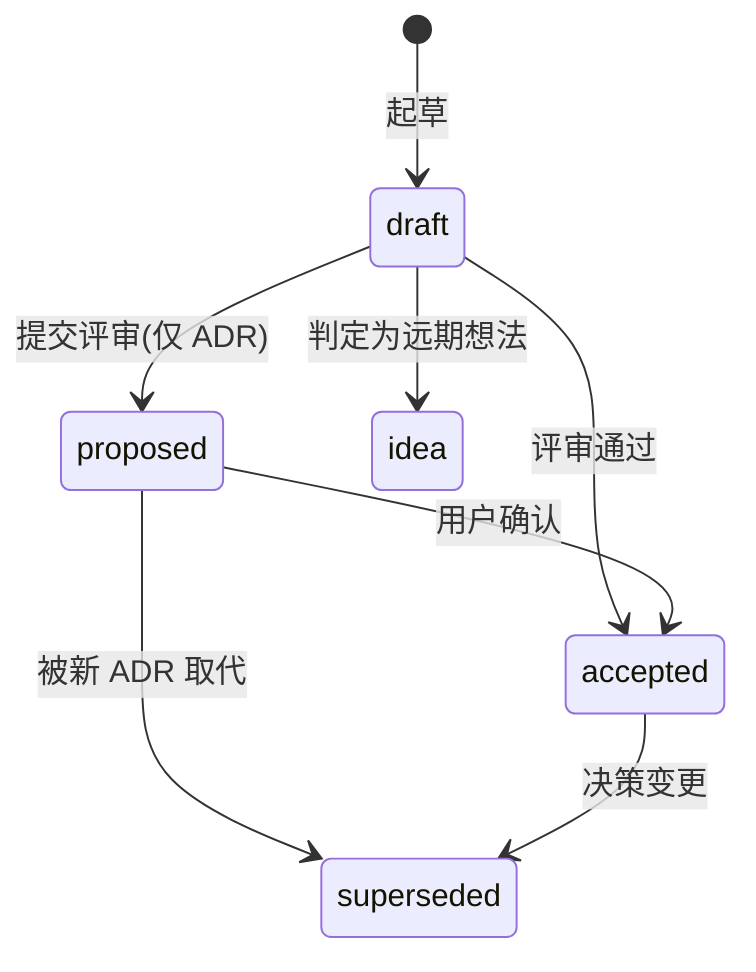

# .ai/conventions.md —— 文档与协作约定

## 1. 语言与风格

- 正文中文；文件名英文小写短横线，数字前缀表示阅读顺序。
- 一句话一个事实；避免「大概/可能/建议考虑」等模糊表述，未定就写「待定」。
- 禁止外部图片；结构图、流程图、状态机、时序图一律用 Mermaid 代码块内嵌。

## 2. 文档类型

| 类型 | 位置 | 规则 |
| --- | --- | --- |
| 规格（Spec） | `docs/*.md` | 描述「是什么、必须满足什么」，可验收 |
| ADR | `docs/adr/NNNN-*.md` | 描述「一个决策 + 备选 + 影响」，状态 `proposed/accepted/superseded` |
| 开放问题 | `docs/07-open-questions.md` + `.ai/open-questions.yaml` | 未决事项唯一登记处 |
| 插件规范模板 | `plugin-spec/` | 可整目录复制，自包含，不依赖 `docs/` 才能读懂 |
| Agent 上下文 | `.ai/` | 派生索引，非事实来源 |

## 3. 状态流转

- 只有用户确认后，文档才能从 `draft/proposed` 变为 `accepted`。代理**不得自行**标记 `accepted`。

## 4. 「待定」写法

统一格式：`待定（OQ-012）`。**每一处待定都必须可追溯**，满足以下任一条件即可：

1. 同行（同段落/同表格行）给出 `OQ-xxx` 或 `ADR-xxxx`；
2. 登记在本文档末尾的「待定项」小节；
3. 登记在文档内的「NFR → 决策项」映射表。

同时，每个 OQ 必须在两处登记：

1. [docs/07-open-questions.md](../docs/07-open-questions.md) 的描述与推荐项；
2. [.ai/open-questions.yaml](open-questions.yaml) 的结构化条目。

**禁止**为了「看起来完整」而补一个自造字段/端口/阈值。

## 5. 术语一致性

- 所有领域词以 [docs/01-glossary.md](../docs/01-glossary.md) 与 [glossary.yaml](glossary.yaml) 为准。
- 已声明为「禁用别名」的词不得在正文中出现（除术语表本身）。

## 6. 同步义务（同批次完成）

1. 新增/删除/改名文档 → `docs/README.md`、`.ai/index.md`、根 `README.md`（如涉及目录结构）。
2. 新增决策 → 新 ADR + `.ai` 索引 + 关联 OQ 状态。
3. 新增/关闭 OQ → `docs/07-open-questions.md` 与 `.ai/open-questions.yaml` 同步。
4. 契约变更 → `docs/03`、`docs/05`、`plugin-spec/` 三处同批次一致。

## 7. 目录与文件命名

- 目录：`docs/`、`docs/adr/`、`plugin-spec/`、`.ai/`。
- ADR：`NNNN-kebab-case-title.md`，四位数字递增，不复用。
- 插件规范：`NN-kebab-case.md`，`NN` 表示阅读顺序。
- 模板文件：`*.template.yaml`。

## 8. 提交约定

Conventional Commits：`docs:` 用于纯文档，`feat:`/`fix:` 用于代码（代码阶段）。
一次提交尽量只做一类变更；契约类变更必须在提交信息中引用 ADR 编号。
