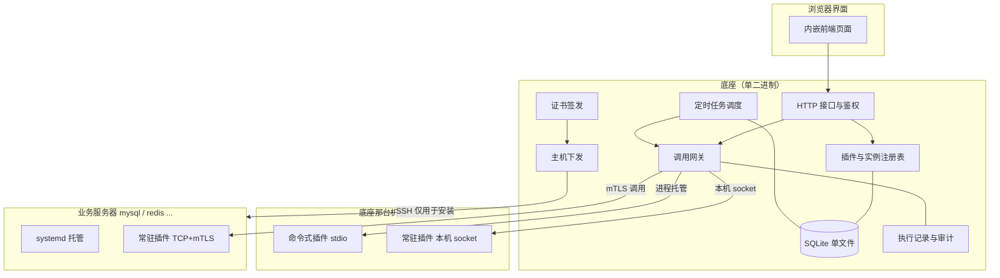
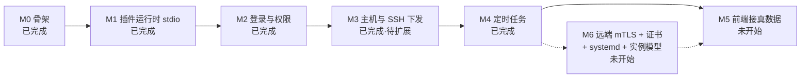

# 运维平台底座 · 项目全景汇报

> 面向：项目负责人
> 目的：用一页说清"这东西最终长什么样、关键处怎么定的、现在做到哪"
> 状态：规格已覆盖到 M4 实现；远端插件与实例模型正在定稿

---

## 1. 一句话

一个 Go 编成的单二进制运维平台底座：自身只提供账号权限、插件托管与调用、主机下发、定时任务、执行与审计这些基础能力，具体运维功能全部由插件提供，插件可以装在本机，也可以装到各台业务服务器上。

---

## 2. 最终形态

三句话概括：

1. **底座是"空壳 + 骨架"**：不含任何具体运维业务，只有托管插件、调度、下发、鉴权、记录这些基础设施。
2. **插件是唯一的业务来源**：命令式（跑一次就退出）和常驻式（后台服务）两种形态，同一套契约。
3. **主机是被管理对象**：底座通过 SSH 把插件包装到目标机、配上证书、注册成服务；此后调用走 mTLS 直连，不再经 SSH。

---

## 3. 你的需求 → 实际设计

| 你的要求 | 落到哪里 |
| --- | --- |
| Go 开发，前后端打包成一个二进制 | Go + `embed` 内嵌前端，构建脚本强制 `CGO_ENABLED=0`，SQLite 用纯 Go 驱动（免 cgo），产物就是一个可执行文件 |
| 底座只提供基础能力 | 12+1 项能力编目（CAP-01~13），明确写了"不做什么"：不做 CMDB、不做通用远程执行、不做容器编排 |
| 插件两种形态：CLI（stdio）、常驻（远程调用） | 命令式走 NDJSON 单行协议；常驻走 gRPC + protobuf，本机用 socket，远端用 TCP + 双向证书 |
| 底座与插件必须严丝合缝 | 插件契约独立成 `plugin-spec/`，含清单 25 个字段、报文样例、12 类错误码、退出码表、版本规则、FAQ |
| 插件开发规范要能整目录复制 | `plugin-spec/` 全部用相对路径、不含指向仓库内部的链接，复制出去即可作为新插件的开发文档 |
| 之后按规范开发各种插件 | 每台主机装什么插件、用哪个版本、什么状态，全部在底座上登记与查询 |

---

## 4. 关键处的判断（以及为什么）

### 4.1 插件"被注册"，而不是"自报"

插件装在业务机上，底座怎么知道它有什么能力？

**做法**：安装那一刻就已经登记完了。底座手里有包、有清单、有证书绑定关系，能力清单从清单里提取入库。插件不许"我声明我能删库"就真的多出一个删库能力。

**为什么**：业务机一旦被入侵，自报机制等于把能力定义权交给了被入侵者。想清楚这一点，注册方向就没得选。

### 4.2 插件类型 与 实例 必须分开

`mysql-backup` 是**类型**，装在 10 台机器上是**10 个实例**。类型回答"这软件能干什么"，实例回答"这台机器上具体在跑什么、连的是主库还是从库、现在健不健康"。

不分开会怎样：界面上一个"备份"按钮，你根本不知道会备份哪台机器；定时任务绑到类型上，第二天多了一台机器，任务自己就"多跑了一份"。

### 4.3 状态分三层，不信插件自称

| 层 | 内容 | 来源 |
| --- | --- | --- |
| 静态事实 | 版本、能力、权限、是否高危 | 安装时从清单提取 |
| 运行状态 | 已安装 / 已启动 / 可调用 / 不健康 | 底座主动探测 + 调用失败降级 |
| 自报信息 | 负载、队列深度 | 插件上报，仅作参考 |

**为什么拆开**：插件说"我健康"没有意义——它挂了就说不出来了；它被入侵了，说的更不可信。健康必须由调用方验证。

### 4.4 远端为什么是 TCP + 证书，而不是隧道或代理

你选了 B，我认同的理由：SSH 凭据是用来"装东西"的，不该兼任"长期数据通道"。拿装机器用的钥匙去承担每秒钟的业务调用，权限边界和责任边界都糊了。证书是另一个身份体系：装完就发，调用时双方互验，跟 SSH 完全解耦。

代价也要说清：目标机要开端口、要管证书生命周期、崩溃重启交给 systemd 而不是底座。端口可达与防火墙你负责，我这边把证书签发、下发、探测做扎实。

### 4.5 远端托管交给 systemd，是对原决定的修订

原规格写的是"插件必须由底座进程托管，禁止 systemd 双托管"。这条在**本机**是合理的；到了远端，底座进程根本不在那台机器上，逻辑上不可能成立。

修订后的规则：本机由底座托管，远端由 systemd 托管；同一插件不许两种方式同时托管。**这不是妥协，是原来的规则只对一半场景成立**。

### 4.6 配置作用域落到实例

同一份 mysql 备份插件，A 机连主库、B 机连从库，配置天然不同。所以配置项不是"全局设置"，而是"某个实例的设置"：清单声明有哪些可配置项（类型、必填、是否敏感），下发时按主机填值，底座校验后入库。

### 4.7 契约必须能自证，否则规范等于没有

插件作者不该来问"我该怎么启动""凭据怎么给我"。所以做了三件事：

1. **写死**：八个固定启动参数、socket 位置与权限、凭据用一次性文件读后即删、高危机器的确认字段。
2. **FAQ**：`plugin-spec/10-faq.md` 十五节，逐条标"契约强制 / 实现建议 / 待定"，把能预见的疑问一次答完。
3. **回流规则**：规范没覆盖的，插件作者必须停下提问，答案写回规范正文，禁止各插件自己定。

### 4.8 数据库选 SQLite，是拿部署简单换扩展性

单二进制交付 + 单节点部署，SQLite（WAL、单写者、批写队列）足够，且不引入外部依赖。代价是没法水平扩展——这条已写进"不做"清单，将来要扩展属于架构变更。

凭据用 AES-256-GCM 加密存库，主密钥来自环境变量或配置文件、不落库。**边界明确**：能防"数据库文件被单独拷走"，防不了"主机被完全控制"。

### 4.9 我在过程中做错并纠正的地方

- 一开始判断"跨主机调用是远期功能，本机足够"，错了。你的 mysql / redis 场景说明跨主机是核心场景，已改为正式规格。
- 建议过 SSH 隧道，只解决了"怎么连"，没解决"谁拉起进程"，属于方案不完整，已废弃。
- 一度想让你接受"只支持命令式插件"，也不成立——常驻插件是这类监控分析插件的自然形态。

---

## 5. 现在做到哪

已完成且可运行：插件扫描与清单校验、启用禁用、stdio 调用、执行记录、登录会话与三级角色、审计、主机 CRUD 与加密凭据、SSH 下发（落地安装、不启动）、定时任务调度。

还没做：远端 mTLS 与证书体系、远端 systemd 托管、实例模型与注册表扩展、前端接真实接口。

---

## 6. 要你拍板的几件事

| 事项 | 现状 | 影响 |
| --- | --- | --- |
| M5 与 M6 的先后 | 建议先 M6 再 M5 | 决定前端是否要重做一遍 |
| 权限按类型还是按实例给 | 未定 | 决定授权模型复杂度 |
| 插件升级时配置如何迁移 | 未定 | 决定运维成本 |
| cron 是否支持秒级 | 当前分钟级 | 影响高频巡检场景 |
| 失败重试是否退避 | 当前立即重试一次 | 影响重启窗口内的成功率 |
| 新建定时任务默认暂停 | 当前是 | 多一步操作，但避免误触发 |
| 证书有效期与轮换周期 | 待定 | 决定运维负担与安全强度 |

---

## 7. 风险提示

1. **远端插件的"成功"是三种状态**，界面上不能合并显示，否则一次失败会被误认为成功。
2. **证书体系是新引入的复杂度**：签发容易，轮换、吊销、私钥保护才是难点，偷懒会在半年后集中爆发。
3. **插件契约是硬承诺**：版本一旦发布，语义变更要走 MINOR/MAJOR，插件作者会依赖它。
4. **SSH 下发只解决安装**：远端插件的升级、回滚、卸载必须走同一套下发通道，否则会退化成人工登录操作。
