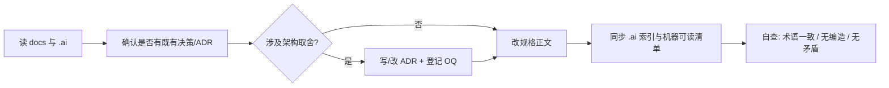

# AGENTS.md —— AI 编码代理工作规则

本文件面向所有在本仓库工作的 AI 编码代理（含子代理）。**本文件优先级低于用户直接指令，高于个人习惯**。
机器可读的索引与约定见 [.ai/index.md](.ai/index.md) 与 [.ai/conventions.md](.ai/conventions.md)。

## 1. 项目一句话

Go 编写的**运维平台底座**：单二进制交付，自身只提供基础设施能力，全部运维业务功能由插件（命令式 / 常驻式）提供。

## 2. 当前阶段

**M0 基础设施骨架与 M1–M6 业务闭环已落地，可运行、可演示**。
- 已完成：Go 单二进制骨架、YAML 配置、数据目录自检、SQLite 与 schema 迁移（v1~v7）、内嵌 UI、健康/版本接口、结构化日志、优雅关闭、构建脚本。
- M1 插件运行时（发现注册、NDJSON stdio 调用、执行记录）；M2 本地账号、会话、三级角色与审计；M3 主机清单、加密凭据、TOFU 指纹与下发安装；M4 定时任务（cron/间隔、认领调度、错过留痕）；M5 控制台接入真实接口与总览统计；M6 内置 CA 与 mTLS、远端常驻插件、类型/实例模型、三态与漂移、实例级授权。
- 实现基线见 [docs/11](docs/11-implementation-baseline-m0.md)～[docs/18](docs/18-m6-remote-plugins-and-instances.md)；未定数值登记在 [docs/07](docs/07-open-questions.md)（OQ-036、OQ-039～OQ-051）。
  仍受约束：人类身份源（OQ-037）、量化阈值（OQ-017）、证书轮换与 CA 备份（OQ-047）、systemd 细节（OQ-048）、探测阈值（OQ-049）等未定项不得编造为既定设计；已实现值均为可配置基线。
- 当前交付物同时包含：人读规格 `docs/`、agent 上下文 `.ai/`、ADR `docs/adr/`、插件规范模板 `plugin-spec/`、M0~M6 代码。

## 3. 铁律

1. **规格是唯一事实来源**。文档与代码冲突时，先问用户，禁止私自推翻文档中的既有决策。
2. **不确定就不写**。数据库字段、接口路径、配置项、协议字段、端口、指标阈值等，未确认的写「待定（OQ-xxx）」，
   并登记到 [docs/07-open-questions.md](docs/07-open-questions.md)。**严禁编造**。
3. **文档即代码**。改动任何影响范围/契约/流程的内容，必须同批次修改对应 `docs/**` 与 `.ai/**`。
4. **不做未记录的架构决策**。新增依赖、改协议、改存储、改鉴权模型，先写 ADR（`docs/adr/`），状态 `proposed`，等用户确认。
5. **不引入未经确认的技术选型**。语言固定为 Go；其余（前端框架、RPC 框架、数据库、消息队列等）均为待决策项。
6. **远期想法标 `idea`**，单独成节，不得写进正式规格正文。
7. **Mermaid 内嵌**，禁止引用外部图片。
8. **中文撰写**，文件名用英文短横线小写，数字前缀表示阅读顺序。

## 4. 文档地图（改动前先读）

| 场景 | 必读 |
| --- | --- |
| 判断「这个功能归底座还是插件」 | [docs/00-overview.md](docs/00-overview.md)、[docs/02-foundation-capabilities.md](docs/02-foundation-capabilities.md) |
| 定义术语 | [docs/01-glossary.md](docs/01-glossary.md) |
| 改插件契约 / 协议 / 清单 | [docs/03-plugin-model.md](docs/03-plugin-model.md)、[plugin-spec/](plugin-spec/README.md) |
| 改插件状态流转 | [docs/04-plugin-lifecycle.md](docs/04-plugin-lifecycle.md) |
| 改版本兼容规则 | [docs/05-extension-points-and-compatibility.md](docs/05-extension-points-and-compatibility.md) |
| 改打包 / 部署 / 日志 / 配置 / 安全 | [docs/06-non-functional-requirements.md](docs/06-non-functional-requirements.md) |
| 查未决问题 | [docs/07-open-questions.md](docs/07-open-questions.md) |
| 查 M0 已实现范围 / 配置键 / 构建命令 | [docs/11-implementation-baseline-m0.md](docs/11-implementation-baseline-m0.md) |

## 5. 修改工作流

自查清单：

- 术语与 [.ai/glossary.yaml](.ai/glossary.yaml) 一致，不出现同义异名。
- 新增的每个「待定」都有 OQ 编号，且已登记。
- 新增/改名文件已写入 [.ai/index.md](.ai/index.md) 与 [docs/README.md](docs/README.md)。
- 没有把 `idea` 写成正式规格。
- 没有出现外部图片链接、绝对路径、密钥或生产 IP。

## 6. 代码阶段约定

- 构建：`go build ./...`；单二进制产物：`.\scripts\build.ps1`（Windows）或 `./scripts/build.sh`（Linux/macOS），脚本内部强制 `CGO_ENABLED=0`。
- 测试：`go test ./...`；静态检查：`go vet ./...`；格式：`gofmt -l .`（应无输出）。
- 要求 Go 1.26+（`modernc.org/sqlite v1.62.0` 的 `go.mod` 约束）。
- 目录结构、包边界、SDK 形态：见 [ADR-0012](docs/adr/0012-module-boundaries-and-sdk.md)（proposed）；M0 实际落地布局见 [DOC-11](docs/11-implementation-baseline-m0.md) §3。
- 提交信息遵循 Conventional Commits：`feat|fix|docs|refactor|test|chore`。
- 禁止硬编码密钥、密码、生产 IP；禁止吞异常。
- 修改 `prototype/index.html` 后必须重新执行构建脚本（或手动同步 `web/dist/index.html`），否则二进制内嵌的仍是旧页面。

## 7. 遇到这些情况必须停下来问用户

- 要改变架构、数据模型、对外契约（含插件契约）。
- 要推翻已记录在 ADR 的技术决策。
- 规格之间出现矛盾，或验收标准缺失。
- 需要引入新依赖 / 新中间件 / 新外部服务。

## 8. 完成定义（Definition of Done）

一次文档变更完成 = 规格正文更新 + ADR/OQ 更新（如涉及）+ `.ai` 索引更新 + 自查清单通过。
