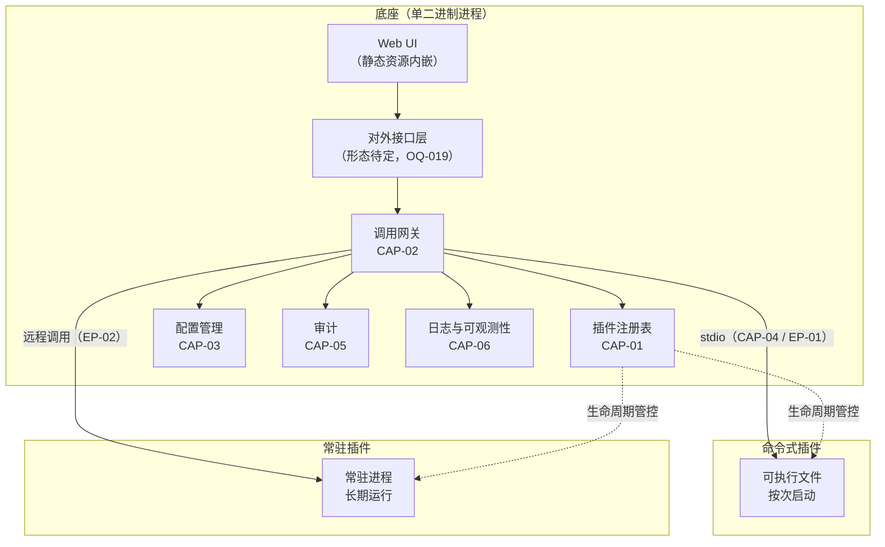
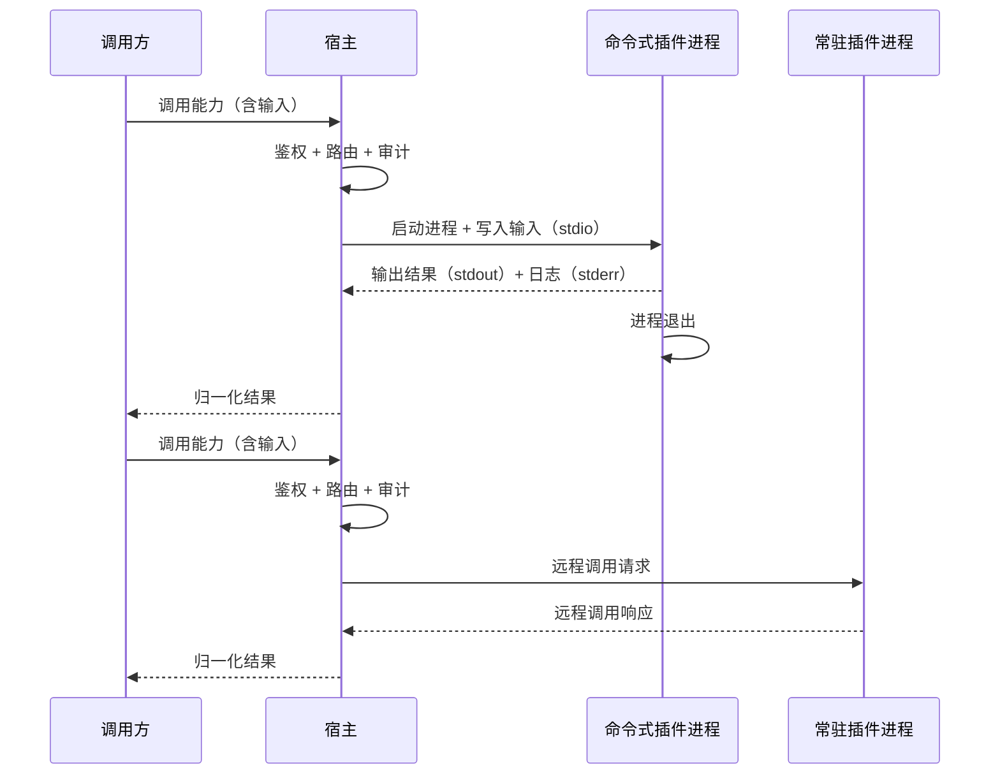

# DOC-00 项目总览与范围

> 状态：`draft` ｜ 读者：所有人 ｜ 上游：无 ｜ 下游：[01 术语](01-glossary.md)、[02 底座能力](02-foundation-capabilities.md)

## 1. 一句话定位

Operations Platform 是一个**运维平台底座**：用 Go 编写、以单二进制交付、只提供基础设施能力，所有具体运维业务能力由**插件**按统一契约接入。

## 2. 为什么要做底座

运维团队的工具通常是「一堆彼此独立的脚本 + 若干自制系统」，共性问题反复出现：

- 每个工具都要自己实现登录、权限、审计、配置、日志，重复且不一致；
- 工具之间无法互相调用，也没有统一的调用入口和错误语义；
- 新增一个能力就要改主程序，主程序越来越难以维护和升级。

底座的思路是把这些共性能力**下沉并固定成契约**，让新增能力只通过插件扩展，主程序保持稳定、可独立升级。

## 3. 目标（Goals）

| 编号 | 目标 | 可验收方式 |
| --- | --- | --- |
| G-1 | 单一交付物：前端静态资源内嵌，前后端编译为一个二进制 | 产物目录中只有一个可执行文件即可启动完整平台（配置文件与数据目录除外） |
| G-2 | 底座自身不含具体运维业务功能 | 代码审查：底座模块中不出现主机资产管理、业务发布部署、监控采集等业务实现（例外：CAP-13 仅维护供插件下发使用的轻量主机清单） |
| G-3 | 插件接入契约稳定、可版本化 | 契约有独立版本号，且对外提供兼容性声明（见 DOC-05） |
| G-4 | 同时支持「按次执行」与「常驻服务」两类插件 | 两类插件遵守同一套清单、能力声明与调用语义，仅传输层不同 |
| G-5 | 插件可独立开发、独立发布，不依赖底座源码 | 仅依赖公开契约（SDK 或协议文档）即可完成插件开发（SDK 形态见 ADR-0012） |
| G-6 | 全程可追溯 | 插件生命周期操作与调用均产生审计事件（字段待定，OQ-016） |

## 4. 非目标（Non-Goals）

明确**不做**，避免范围蔓延：

| 编号 | 非目标 | 说明 |
| --- | --- | --- |
| NG-1 | 不内置任何具体运维业务功能 | CMDB、主机资产管理与监控采集、业务系统发布部署、工单、变更审批等，全部由插件提供。**唯一例外**：供插件下发的轻量主机清单与 SSH 下发安装属于底座能力 CAP-13（[DOC-09](09-host-management-and-plugin-distribution.md)） |
| NG-2 | 不做通用低代码/流程编排平台 | 底座不提供可视化流程设计器；如未来需要，另立 ADR |
| NG-3 | 不做插件市场/应用商店 | 插件分发机制见 ADR-0008；在线市场不在 v1 范围 |
| NG-4 | 不做多租户 SaaS | 面向单团队自建部署；多租户为 idea |
| NG-5 | 不承诺跨语言 SDK 先行 | 首选 Go 生态；其他语言按已定协议接入（NDJSON stdio / gRPC 契约，见 ADR-0004、ADR-0005），不提供官方非 Go SDK |
| NG-6 | 不在 v1 支持插件注入前端代码或自带页面 | 只允许**声明式界面**（清单声明、底座渲染，ADR-0025 proposed，边界待 OQ-011）；二档「自带前端包」挂起为 idea |
| NG-7 | 不在 v1 支持插件间直接调用 | 插件之间不建立点对点依赖，统一经宿主中转（约束见 DOC-03） |

## 5. 目标用户与典型场景

- **平台维护者**：部署、升级底座，管理插件生命周期与权限。
- **插件开发者**：按契约实现能力，不关心平台其余部分。
- **运维使用者**：通过统一界面/调用入口使用插件提供的能力。

典型场景（仅示意流程，不含具体业务实现）：

1. 维护者安装一个「命令式插件」，执行一次性巡检任务并取回结构化结果。
2. 维护者安装一个「常驻插件」，由底座统一路由调用其长期提供的服务能力。
3. 某个常驻插件异常退出，底座将其标记为不健康、短路后续调用并记录审计事件。

## 6. 整体架构

说明：接口层形态、远程调用传输方式、注册表持久化方式均为待决策项，分别见 OQ 与 ADR，不在本文档定稿。

## 7. 两类插件的调用差异（概览）

细节（帧格式、超时、错误码、退出码语义）见 [DOC-03](03-plugin-model.md) 与 [plugin-spec/](../plugin-spec/README.md)。

## 8. 范围判定规则（底座 or 插件）

遇到一个需求，按顺序判定：

1. **是否所有插件都会用到？** 是 → 候选底座能力；否 → 插件。
2. **是否是「平台机制」（发现、调用、鉴权、审计、配置）？** 是 → 底座；**是否是「业务动作」？** 是 → 插件。
3. **放进底座是否引入业务语义（实体、流程、行业规则）？** 是 → 插件。
4. 仍无法判定 → 写入 [07-open-questions.md](07-open-questions.md)，由用户裁决；不得默认塞进底座。

## 9. 成功标准（v1）

- 一个全新插件仓库**只复制 `plugin-spec/`** 即可开始开发，且无需阅读底座源码。
- 新增一个插件不需要修改底座代码，也不需要重新编译底座。
- 两类插件在清单、能力声明、错误语义上遵循同一套规范，差异仅限传输层。
- 所有未决事项均有编号并可追溯；文档中不出现无出处的字段/接口/阈值。

## 10. 远期想法（idea，不属 v1 范围）

以下仅为记录，**不是需求承诺**：

- IDEA-1 插件自带前端包（二档，沙箱 iframe + Host API；OQ-011 挂起，不进入 v1）。一档声明式界面为 v1 方向，见 [ADR-0025](adr/0025-plugin-provided-ui.md)（proposed）。
- IDEA-3 插件间通过宿主中继的事件总线通信。
- IDEA-4 插件在线市场与自动更新。
- IDEA-5 多租户与团队隔离。
- IDEA-6 声明式作业编排（DAG）。
- IDEA-7 多节点高可用（多实例共享状态、主备/集群选主）。v1 明确为单节点部署，多节点涉及的存储共享与一致性方案不进入本阶段规格；SQLite 单文件模型不支持多主机共享同一数据目录（[ADR-0007](adr/0007-persistence.md)）。

> IDEA-2（常驻插件跨主机运行与调用）已由用户决策**转正为 v1**：远端 systemd 托管 + TCP 双向 TLS 调用（[ADR-0018](adr/0018-daemon-process-custody-and-injection.md)、[ADR-0022](adr/0022-remote-plugin-pki-and-mtls-certificates.md)）。

## 11. 相关文档

- 术语：[01-glossary.md](01-glossary.md)
- 底座能力：[02-foundation-capabilities.md](02-foundation-capabilities.md)
- 插件契约：[03-plugin-model.md](03-plugin-model.md)
- 待决策清单：[07-open-questions.md](07-open-questions.md)
