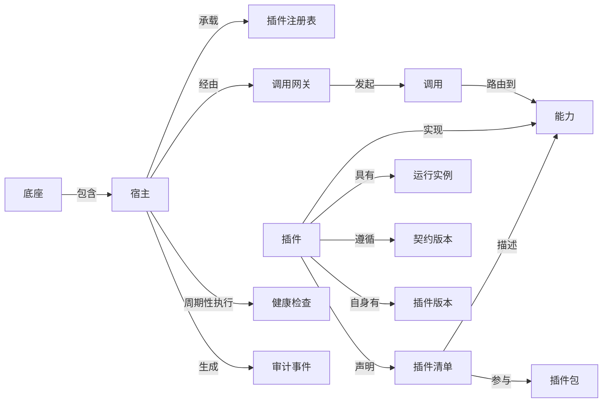

# DOC-01 领域概念与术语表

> 状态：`draft` ｜ 读者：所有人 ｜ 上游：[00 总览](00-overview.md) ｜ 下游：全部文档

## 1. 使用规则

- 本文是术语的**唯一释义来源**。其余文档首次使用术语时可直接使用，不再重复定义。
- 「禁用别名」列中的词**不得**在规格正文中作为同义词出现，避免歧义。
- 机器可读版本：[.ai/glossary.yaml](../.ai/glossary.yaml)，两者必须同步。

## 2. 术语表

| 术语 | 英文 | 定义 | 禁用别名 |
| --- | --- | --- | --- |
| 底座 | Foundation | 本项目本体。提供插件管理、统一调用、配置、审计、可观测性等基础设施能力，不含具体运维业务功能 | 内核、核心引擎、框架本身 |
| 宿主 | Host | 以单二进制运行的底座进程，负责加载、调用与监管插件 | 主程序、server、agent |
| 插件 | Plugin | 向底座注册并提供能力的独立交付单元，分为命令式插件与常驻插件 | 扩展、模块、组件、addon、子应用 |
| 命令式插件 | Command Plugin | 按次调用、进程随调用创建并退出的插件形态，通过 stdio 与宿主通信 | CLI 插件、脚本插件、一次性插件 |
| 常驻插件 | Daemon Plugin | 长期驻留、以远程调用方式提供能力的插件形态 | 服务插件、后台插件 |
| 插件清单 | Manifest | 描述插件身份、版本、形态、能力与所需权限的声明文件，是底座校验插件的入口 | 插件配置、描述文件 |
| 能力 | Capability | 插件对外声明并可被宿主调用的最小功能单元，具备稳定标识与输入输出约定 | 接口、动作、action、function |
| 扩展点 | Extension Point | 底座预留的、允许插件接入的契约位置，具有稳定性等级与版本 | 钩子、hook、插槽 |
| 调用 | Invocation | 宿主针对某个插件能力发起的一次请求-响应过程 | 请求、作业、任务执行 |
| 运行实例 | Runtime Instance | 插件在宿主上的实际运行状态载体；命令式插件每次调用一个实例，常驻插件通常长期一个实例 | 进程、worker |
| 插件注册表 | Registry | 底座内部记录插件身份、版本、状态与能力的权威数据结构 | 仓库、市场、marketplace |
| 调用网关 | Invocation Gateway | 底座内统一接收调用请求，完成鉴权、路由、超时与错误归一的组件 | 代理、proxy、路由器 |
| 契约版本 | Contract Version | 底座与插件之间接口规范的版本，独立于插件版本，兼容性按主版本判定 | API 版本、底座版本 |
| 插件版本 | Plugin Version | 插件自身功能演进的版本号，由插件维护者维护 | 软件版本、发布版本 |
| 插件包 | Plugin Package | 插件分发的最小单位，含清单、可执行文件或服务描述及附带资源 | 安装包、artifact |
| 健康检查 | Health Check | 宿主判定插件运行实例是否可用、能否继续接收调用的探测 | 心跳、探活、liveness |
| 审计事件 | Audit Event | 底座记录的可追溯操作事实，至少含主体、动作、对象、结果、时间 | 操作日志、审计日志 |
| 主机清单 | Host Inventory | 为插件下发维护的轻量目标主机记录集合，只含连接、认证与分组信息，不是资产台账或 CMDB | 资产台账、主机库、CMDB |
| 插件下发 | Plugin Distribution | 底座经 SSH 把插件包传输、校验并安装到目标主机的动作；不等于启用，也不等于可远程调用 | 推送、部署、发布 |
| 主机凭据 | Host Credential | 连接目标主机所用的 SSH 私钥或账号密码，加密落库，保存后不可回显、不可导出 | 登录密码、密钥文件 |
| 定时任务 | Scheduled Task | 按时间规则调用某个插件的某个能力的底座任务定义；执行经调用网关，不是任意命令执行 | 计划任务、定时作业、调度任务 |
| 触发规则 | Trigger Rule | 定时任务的时间规则，取值为 cron 表达式或固定间隔之一，并绑定一个时区 | 调度规则、计时规则、时间表 |
| 错过执行 | Missed Run | 因停机、暂停或长时间阻塞导致某个计划触发时点未被执行；必须记录，补跑策略待定 | 漏跑、补偿执行 |
| 待定 | TBD | 尚未达成一致的规格内容，必须携带 OQ 编号；禁止用假设值填充 | 暂定、TODO |

## 3. 概念之间的关系

## 4. 关键区分（容易混淆的概念）

### 4.1 契约版本 vs 插件版本

- **契约版本**由底座维护，描述「插件与底座之间的接口长什么样」。它只在接口不兼容变化时才升主版本。
- **插件版本**由插件作者维护，描述「这个插件自身功能演进」。
- 二者正交：插件可以只升级自身版本而契约版本不变；底座可以提升契约主版本而无需改插件代码之外的逻辑。

兼容规则见 [DOC-05](05-extension-points-and-compatibility.md)。

### 4.2 能力 vs 扩展点

- **能力**是插件**提供**的东西（被调用）。
- **扩展点**是底座**预留**的位置（插件**接入**的位置）。
- 一个扩展点上可以挂多个能力；一个插件也可以接入多个扩展点。

### 4.3 命令式插件 vs 常驻插件

| 维度 | 命令式插件 | 常驻插件 |
| --- | --- | --- |
| 进程生命周期 | 一次调用一个进程，调用结束即退出 | 长期驻留，跨调用复用 |
| 通信方式 | 标准输入 / 标准输出（NDJSON，单行 JSON；stderr 用于日志） | gRPC over 本机 Unix Domain Socket（通用 `Invoke`） |
| 状态 | 无跨调用内存状态（可写自有数据目录，待定） | 可持有内存状态 |
| 适用 | 短任务、可重放、结果一次性返回 | 需要常驻、需要预热、需要持续提供服务 |
| 故障影响 | 单次调用失败 | 影响该插件全部后续调用，需健康检查介入 |

## 5. 命名约定（用于后续规格与代码）

- 插件标识：小写短横线 `^[a-z][a-z0-9-]*$`，**全局唯一**，不得含大写、下划线、中文、空格（已定，ADR-0003）。
- 能力标识：强制 `<插件标识>.<能力名>`，两段同规则（已定，ADR-0003）。
- 禁止在标识中使用中文、空格、大小写混写。
