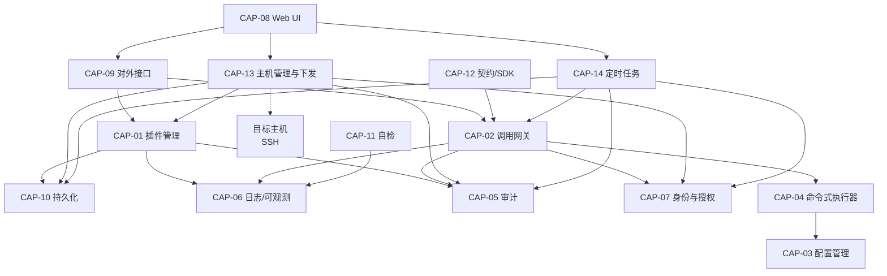

# DOC-02 底座能力范围

> 状态：`draft` ｜ 读者：评审、底座开发 ｜ 上游：[00 总览](00-overview.md) ｜ 下游：[03 插件模型](03-plugin-model.md)、[06 非功能](06-non-functional-requirements.md)

## 1. 能力清单

每条能力用 `CAP-NN` 编号，编号不复用。能力是**底座自身提供**的机制，不是业务功能。

| 编号 | 能力 | 一句话职责 | 关键约束 | 决策来源 |
| --- | --- | --- | --- | --- |
| CAP-01 | 插件管理 | 发现、登记、启用/禁用、升级、卸载插件 | 注册表是唯一权威状态来源 | ADR-0003 |
| CAP-02 | 调用网关 | 统一接收调用，完成定位、鉴权、路由、超时、错误归一 | 所有调用必须经网关，禁止旁路 | ADR-0005、ADR-0006 |
| CAP-03 | 配置管理 | 管理底座自身配置，向插件提供配置获取途径 | 配置项清单待定 | ADR-0009 |
| CAP-04 | 命令式插件执行器 | 启动插件进程、写入输入、读取输出、回收进程 | 单次调用单次进程，禁止复用 | ADR-0004 |
| CAP-05 | 审计 | 记录插件生命周期与调用的可追溯事实 | 审计不可被插件篡改，写入失败须显式告警 | — |
| CAP-06 | 日志与可观测性 | 统一日志格式与采集；提供插件运行状态可见性 | 不得记录敏感信息 | ADR-0011 |
| CAP-07 | 身份与授权 | 确认调用主体身份，按能力级权限判定是否放行 | 默认拒绝（deny by default） | ADR-0006 |
| CAP-08 | Web UI 宿主 | 内嵌前端静态资源，提供导航、登录、插件能力入口 | 插件不注入前端代码；插件界面仅限**声明式**（v1 方向，见 ADR-0025 proposed） | ADR-0001、ADR-0002、ADR-0025 |
| CAP-09 | 对外接口层 | 向 UI 与外部客户端暴露统一调用入口 | 具体协议与路径待定 | OQ-019 |
| CAP-10 | 持久化 | 为注册表、审计、配置等提供数据落盘 | 嵌入式 SQLite 单文件库，仅宿主写入 | ADR-0007（accepted） |
| CAP-11 | 自检与版本信息 | 暴露底座版本、契约版本、健康状态 | 只读 | — |
| CAP-12 | 契约与 SDK 分发 | 对外发布契约定义与开发支撑物 | 形态待定 | ADR-0012 |
| CAP-13 | 主机管理与插件下发 | 维护用于下发的轻量主机清单；通过 SSH 连接目标主机并下发安装插件包 | 只做「下发安装」，不提供通用远程执行；凭据加密复用 ADR-0013 | ADR-0014（proposed） |
| CAP-14 | 定时任务 | 按时间规则调用某个插件的某个能力；任务定义维护、执行记录与失败处置 | 只做「到点发起一次能力调用」；不做通用编排/DAG、分布式调度、任意命令执行 | ADR-0015（proposed） |

## 2. 能力依赖关系

依赖含义：**被指向的能力必须先存在**。例如调用网关依赖身份与授权，未完成 CAP-07 就不能宣称 CAP-02 可用。

## 3. 各能力职责边界

### CAP-01 插件管理

**负责**：扫描/接收插件包 → 校验 → 登记 → 启用 → 监控状态 → 禁用 → 升级 → 卸载；维护插件注册表。

**不负责**：插件内部实现质量、业务能力正确性、插件之间的协调。

**关键约束**：

- 注册表中的状态是唯一权威；文件系统上的存在不代表已启用。
- 任何状态变化必须产生审计事件。
- 校验失败必须拒绝登记，且给出可定位原因。

### CAP-02 调用网关

**负责**：接收调用请求、定位目标能力、鉴权、注入上下文（调用方、超时、跟踪标识）、路由到执行器、超时与取消、错误归一。

**不负责**：业务参数语义校验（由插件负责，底座只做结构校验）、结果业务解释。

**关键约束**：

- **禁止旁路**：UI 与外部客户端不得绕过网关直接访问插件。
- 错误必须归一为底座统一错误模型（插件原始错误作为详情保留）。
- 单次调用的超时必须由底座兜底，不能依赖插件自律。

### CAP-03 配置管理

**负责**：加载底座配置、校验配置合法性、向插件下发其所需配置。

**不负责**：插件私有配置的语义解释；具体配置项清单（**待定**，随实现补，禁止提前编造）。

### CAP-04 命令式插件执行器

**负责**：按清单定位可执行文件、拉起进程、写入输入、读取输出与日志、处理退出码、超时后回收进程。

**不负责**：在两次调用之间保存插件内存状态。

### CAP-05 审计

**负责**：记录主体、动作、对象、结果、时间、来源等事实；提供查询入口（范围待定）。

**不负责**：业务级变更记录（插件可自行记录，但不得写入底座审计）。

**关键约束**：审计记录对插件**只写不可改**；审计写入失败必须可被运维发现。

### CAP-06 日志与可观测性

**负责**：统一结构化日志、插件日志归集与归属（插件标识 + 运行实例）、基础运行指标。

**不负责**：完整 APM 能力；指标清单与端点待定（OQ-016）。

### CAP-07 身份与授权

**负责**：识别调用主体、维护权限模型、按能力判定放行/拒绝。

**不负责**：企业级身份源对接细节（是否支持外部 IdP 待定，见 OQ-037）。

### CAP-08 / CAP-09 Web UI 宿主与对外接口

**负责**：内嵌静态资源、提供登录与导航骨架、把用户操作转为对网关的调用。

**不负责**：插件业务页面与任意插件前端代码（v1）。插件界面只允许以**声明式**方式——清单声明入口、配置表单与结果展示形态，由底座统一渲染，不加载插件代码；承载模型见 [ADR-0025](adr/0025-plugin-provided-ui.md)（proposed），一档的能力与展示边界待 OQ-011。二档「插件自带前端包」挂起为 idea，不进入 v1。

### CAP-10 持久化

**负责**：为注册表、审计、配置、凭据保险库提供可靠落盘；对插件外部凭据提供静态加密能力（[ADR-0013](adr/0013-plugin-credential-encryption.md)）。

**不负责**：向插件提供通用数据库服务。ADR-0007 已明确插件**不得**直连底座数据库，只能使用独立数据目录（见 [DOC-08](08-storage-and-data-directory.md) §4）。

### CAP-11 / CAP-12 自检、契约与 SDK

**负责**：暴露版本与健康信息；发布契约定义与开发支撑物，使插件可脱离底座源码开发。

### CAP-13 主机管理与插件下发

**负责**：

- 维护用于插件下发的**轻量主机清单**（分组/标签、连接信息、认证方式、凭据引用、连通状态）。
- 连接认证：SSH 密钥与账号密码两种方式，凭据加密落库（复用 ADR-0013）。
- 连通性测试与凭据可用性校验。
- 插件包向目标主机的传输、校验、安装与状态回报；单台与按分组批量下发。
- 下发任务的并发控制、幂等、失败处置与审计。

**不负责**：

- 通用远程命令执行（不得作为跳板入口暴露给插件或外部调用方）。
- 主机资产发现、CMDB 全量建模、主机监控采集。
- 目标机上插件的**进程托管与调用传输**本身（属于 EP-02 与 ADR-0018 / ADR-0022：systemd 托管 + TCP+mTLS 调用；本能力只负责安装、下发 unit 与启停探测）。
- 系统初始化、容器编排、配置管理（属于插件或其他工具）。

**关键约束**：

- 「已安装」「已下发」不等于「可调用」；状态必须如实反映目标机实际结果。
- 同一主机上下发串行，跨主机并行受全局上限约束（默认值待定，OQ-029）。
- 凭据保存后不可回显、不可导出；日志与审计不得出现明文（[DOC-09](09-host-management-and-plugin-distribution.md) §4）。
- 目标主机操作系统范围未定前不得假定仅 Linux（OQ-024）。

### CAP-14 定时任务

**负责**：

- 任务定义的创建、修改、删除、启用/暂停（执行体 = 某个插件的某个能力）。
- 触发规则：cron 表达式与固定间隔；时区处理与下次执行时间计算。
- 到点经 CAP-02 调用网关执行；手动立即执行。
- 并发、超时、重试、失败处置与告警；错过执行的识别与记录。
- 执行记录与审计；任务定义变更、插件升级/卸载时的联动处置。

**不负责**：

- 通用作业编排、DAG、任务依赖与分支（属于插件或远期能力）。
- 跨节点分布式调度、选主与多实例协调（单节点，见 ADR-0007；多节点为 IDEA-7）。
- 任意 shell/脚本/命令执行；事件触发、消息触发、Webhook 触发。
- 面向目标主机的执行或下发（**未确认**，OQ-030）。
- 业务级任务模板与业务成功判定（由插件定义）。

**关键约束**：

- 执行必须走 CAP-02，复用鉴权、超时、错误归一与审计（[DOC-10](10-scheduled-tasks.md) §7）。
- 任务参数禁止明文凭据，只能引用凭据库条目（[DOC-10](10-scheduled-tasks.md) §6）。
- 同一任务默认不并发；重启后任务不丢、不重复触发、不静默漏跑（[DOC-10](10-scheduled-tasks.md) §9、§10）。
- 调度精度、最小间隔、补跑策略与告警通道均待定（OQ-031、OQ-032、OQ-033、OQ-035）。

## 4. 明确不属于底座的能力

以下能力**一律由插件提供**，底座不得实现，也不得为其预留隐式通道：

- 主机资产管理与 CMDB 类实体维护（**唯一例外**：供插件下发使用的轻量主机清单归 CAP-13，不做资产发现、关系建模与全量资产台账）
- 发布、部署、回滚、扩缩容（**唯一例外**：CAP-13 仅负责「把插件包下发安装到主机」，不接管业务系统的发布与编排）
- 监控数据采集、告警规则与告警处置
- 工单、变更审批、值班排班
- 脚本仓库与批量执行编排
- 任意具体业务数据模型

## 5. 尚未确定的底座能力（不得提前实现）

| 候选项 | 状态 | 说明 |
| --- | --- | --- |
| 任务调度（定时/周期执行） | **已纳入 v1** | CAP-14，见 [DOC-10](10-scheduled-tasks.md)；执行体限定为插件能力调用，是否可面向目标主机待定（OQ-030） |
| 事件总线 / 插件间通信 | idea | 见 DOC-00 IDEA-3 |
| 通知通道（邮件/IM） | 待定 | 可能属于插件 |
| 插件私有配置下发 | 待定 | 与 OQ-008 一并确认 |
| 插件自带前端包（沙箱 iframe + Host API） | idea（挂起） | 不进入 v1；暂缓理由见 ADR-0025 §2。v1 方向为声明式界面（ADR-0025 proposed，边界待 OQ-011） |
| 任务执行历史与结果留存 | 待定 | 存储方案已定（DOC-08），保留策略见 OQ-016 |

## 6. 待定项登记

- 配置项清单：待定（OQ-008）
- 存储引擎已定：嵌入式 SQLite（纯 Go、免 cgo），单节点部署，见 ADR-0007 与 [DOC-08](08-storage-and-data-directory.md)
- 插件凭据加密已定：AES-256-GCM，主密钥不入库，见 ADR-0013；防护边界（不防主机被完全控制）见 [DOC-08](08-storage-and-data-directory.md) §2
- 配置文件未指定数据目录时的默认回退：待定（OQ-022）
- 定时任务的触发语义与策略：cron 秒级（OQ-031）、错过补跑（OQ-032）、告警通道（OQ-033）、面向目标主机（OQ-030）、权限体系（OQ-034）、高频执行（OQ-035）
- 主密钥轮换与丢失处置：待定（OQ-023）
- 指标与日志端点：待定（OQ-016）
- 身份源与角色模型：待定（OQ-037）
