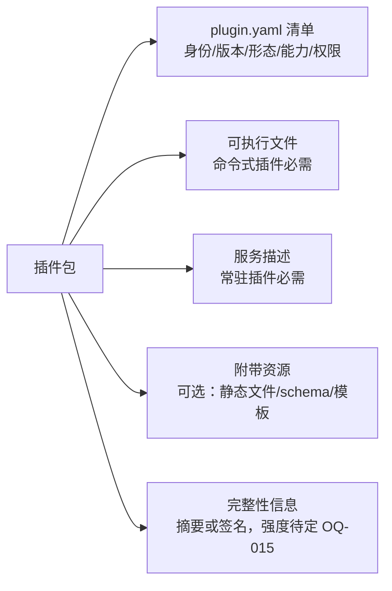

# DOC-03 插件模型与两种形态的契约

> 状态：`draft` ｜ 读者：底座开发、插件开发 ｜ 上游：[02 底座能力](02-foundation-capabilities.md) ｜ 下游：[04 生命周期](04-plugin-lifecycle.md)、[plugin-spec/](../plugin-spec/README.md)

本文定义**插件是什么、必须遵守哪些不变量、两种形态各自的契约**。清单字段集、stdio 报文、远程 Invoke 契约与版本规则已于 2026-11-16 定稿
（[ADR-0003](adr/0003-plugin-discovery-registration.md)、[ADR-0004](adr/0004-stdio-wire-protocol.md)、[ADR-0005](adr/0005-daemon-rpc-transport.md) 均已 `accepted`；
常驻插件的启动托管与注入、错误类别扩展、契约来源与工具链、能力执行与高危确认分别见
[ADR-0018](adr/0018-daemon-process-custody-and-injection.md)、[ADR-0019](adr/0019-error-categories-and-exit-code-scope.md)、
[ADR-0020](adr/0020-contract-source-and-protoc-toolchain.md)、[ADR-0021](adr/0021-capability-execution-and-destructive-confirmation.md)，同样为 `accepted`；
远端证书体系见 [ADR-0022](adr/0022-remote-plugin-pki-and-mtls-certificates.md)，插件注册、类型/实例与配置模型见
[ADR-0023](adr/0023-plugin-registry-instances-and-configuration.md) 与 [DOC-17](17-plugin-registry-and-configuration.md)（均为 `accepted`）；
版本规则随 [ADR-0012](adr/0012-module-boundaries-and-sdk.md) 定稿，该 ADR 仅 SDK 发布形态仍待 OQ-018）。当前契约版本 **1.2**。
字段级定义与示例的唯一权威副本在 [plugin-spec/01](../plugin-spec/01-manifest.md) ~ [plugin-spec/05](../plugin-spec/05-errors-and-exit-codes.md)。

## 1. 设计原则（不变量）

以下七条是契约的地基，任何实现与后续 ADR 都不得违背：

| 编号 | 不变量 | 含义 |
| --- | --- | --- |
| INV-1 | 声明即契约 | 插件只能使用清单中已声明的能力与权限；未声明的一律无权、不可调用 |
| INV-2 | 单一入口 | 所有调用必须经调用网关；插件不得被 UI 或外部直接访问 |
| INV-3 | 形态自描述 | 插件在清单中声明形态（命令式 / 常驻），底座不猜测、不自动降级 |
| INV-4 | 契约版本正交 | 契约版本管接口兼容，插件版本管功能演进，两者不得混用 |
| INV-5 | 无隐式状态 | 命令式插件不得依赖跨调用的内存状态；常驻插件的内存状态不得成为契约的一部分 |
| INV-6 | 错误可归一 | 两种形态都必须能把失败表达为底座统一错误模型，禁止只靠字符串 |
| INV-7 | 插件自治 | 插件之间不建立点对点依赖，也不共享进程地址空间 |

**契约完备性原则**：插件契约的完备性由本规格承担——插件作者**不应需要**与底座额外口头约定任何行为（进程由谁拉起、socket 与配置路径、凭据载体、退出码与错误类别、超时与体积、并发与重试、日志与目录等）。
若插件开发中发现必须口头约定，视为**规格缺口**：按 [plugin-spec/AGENTS.md](../plugin-spec/AGENTS.md) §5 停下提问，答案必须写回 `docs/` 与 `plugin-spec/` 正文（涉及取舍则补 ADR）并同步 `.ai/`，**不得**在单个插件中自行决定或因循惯例。
已知高频问题先查 [plugin-spec/10-faq.md](../plugin-spec/10-faq.md)。

## 2. 插件包组成

要求：

- 一个插件包对应**一个插件**，不允许打包多个插件。
- 清单缺失或不可解析 → 直接拒绝登记，不进入「已安装」状态。
- 允许携带子目录与资源文件，但路径必须限制在包内（防目录穿越）。
- 清单文件名固定为 `plugin.yaml`，位于插件包根目录，格式 YAML，UTF-8 编码。

### 2.1 部署与安装位置

- v1 的插件安装位置有两种：**宿主本机**（目录扫描或本地导入）与**目标主机**（由底座经 SSH 下发安装，见 CAP-13 与 [DOC-09](09-host-management-and-plugin-distribution.md)）。
- 两种位置都对应**插件实例**：类型（一个包代表的能力与清单事实）与实例（某台主机上的一次具体安装）必须分开看待，
  同一类型装在多台主机上产生多个实例（[DOC-17](17-plugin-registry-and-configuration.md)）。
- 远端实例的运行由目标机 systemd 托管，调用经 TCP + mTLS（§5.2）；「已下发安装」不得推断为「已启动」或「可调用」，
  三者为独立状态（[ADR-0018](adr/0018-daemon-process-custody-and-injection.md) §1.2）。
- 插件包自身**不得**绑定安装位置，也不得假定与底座同机；需要感知自身运行环境的插件，通过底座注入的上下文获取（上下文内容见 §5、§7，字段待定）。
- 远端安装目录、权限与文件布局待定，必须与 `plugin-spec/08-directory-layout.md` 对齐后再定稿。
- 插件能力除了被用户直接调用，也可被**定时任务**按时间规则调用（CAP-14，[DOC-10](10-scheduled-tasks.md)）；两种来源都经 CAP-02 调用网关，插件不得假定只有人工触发。
- 触发来源（手动/定时/补跑）是否注入调用上下文、字段如何命名**待定**；确认前插件不得依赖该信息做业务分支。

## 3. 清单（Manifest）

清单文件名 `plugin.yaml`，格式 YAML，**内置 JSON Schema 校验**（解析后按 schema 校验结构），再做语义校验。

| 信息组 | 字段 | 必须表达的内容 | 约束 |
| --- | --- | --- | --- |
| 身份 | `identity` | `id`、`display_name`、`description` | `id` 为**小写短横线** `[a-z][a-z0-9-]*`，全局唯一 |
| 版本 | `version` | `plugin`、`contract` | `contract` 为契约版本**范围**（见 §5 与 [DOC-05](05-extension-points-and-compatibility.md) §3） |
| 形态 | `form` | `command` 或 `daemon` | 二选一，禁止同时声明 |
| 入口 | `entry` | 命令式 `executable`；常驻 `launch` + `socket` | 路径必须在包内且存在，不得指向包外 |
| 能力 | `capabilities[]` | `id`、`description`、输入/输出结构引用、执行特征、敏感性 | 至少一个；标识全局唯一 |
| 权限 | `permissions[]` | `category`、`actions`、可选 `scope` | 只声明实际需要的；不得出现未定义类别 |
| 运行假设 | `runtime` | `suggested_timeout`、`max_result_bytes`、`resource_expectation`；可选 `listen.port`（仅 daemon，声明即支持远端部署） | 建议值，底座可覆盖；端口默认值可按主机覆盖 |
| 配置声明 | `config[]` | `key`、`type`、`required`、`secret`、`default`、`enum`、`description` | 只声明「有哪些配置项」，**不声明值**；值按实例由底座收集与校验（[DOC-17](17-plugin-registry-and-configuration.md) §7） |
| 元信息 | `metadata` | 作者、许可、主页、文档 | 可选，不参与运行决策 |

字段类型、是否必需、示例值与完整示例见 [plugin-spec/01](../plugin-spec/01-manifest.md) §2~§3；清单模板见
[manifest.template.yaml](../plugin-spec/manifest.template.yaml)。

**禁止**：在清单中写密钥、口令、令牌等敏感值（见 §6.3）；声明插件间依赖（v1 禁止，见 §7）。

**未知字段**：忽略，不报错（[DOC-05](05-extension-points-and-compatibility.md) §5）。

## 4. 能力声明

能力是调用的最小单位，声明必须包含：

1. **能力标识**：格式固定为 `<插件标识>.<能力名>`，两段均为小写短横线/小写字母数字；全局唯一。
2. **语义描述**：做什么、不做什么。
3. **输入约定**：JSON Schema 文件（`input_schema_ref` 引用包内 schema）、必填/可选、示例。
4. **输出约定**：成功结果结构、错误结构。
5. **执行特征**：是否幂等、是否可能长时间执行、建议超时、是否支持取消、并发承受声明。
6. **敏感性标记**：输入/输出是否可能包含敏感信息（影响日志与审计记录策略）。
7. **风险等级**：`risk_level`（`normal` / `destructive`）；`delete` / `restore` / `gc` 类能力必须为 `destructive`（[ADR-0021](adr/0021-capability-execution-and-destructive-confirmation.md)）。

约束：

- 一个能力对应一个明确动作，禁止「万能能力」（如单一 `execute` 能力承载全部语义）。
- 能力标识一旦对外发布不得改变语义；语义变更必须新增能力或提升契约主版本。
- **禁止**声明能力名末段为 `setup` 或 `version` 的能力：初始化必须是幂等、无交互的普通能力；版本由 `GetVersion`（常驻）或清单 `version.plugin`（命令式）承担。
- **高危操作确认是契约强制**：`delete` 必须携带 `confirm_partition` 且严格等于目标分区；`restore` / `gc` 必须显式 `confirm: true` 并给出目标字段。校验在插件侧、任何副作用之前完成；底座只做静态一致性与调用前审计（细则见 [plugin-spec/01](../plugin-spec/01-manifest.md) §3.5）。

## 5. 两种形态的契约

### 5.1 命令式插件（stdio）

**进程模型**：一次调用 = 启动一个进程 → 写入一行请求 → 读取一行响应 → 等待退出。

| 通道 | 约定 |
| --- | --- |
| 标准输入（stdin） | 承载**一行** NDJSON 请求；写入完成后关闭，关闭即「输入结束」信号 |
| 标准输出（stdout） | **只承载一行** NDJSON 结果；不得混入日志、进度、调试信息、多行内容 |
| 标准错误（stderr） | 承载日志与诊断信息，逐行为主 |
| 退出码 | 表达结果类别，且必须与响应中的错误类别一致（[plugin-spec/05](../plugin-spec/05-errors-and-exit-codes.md) §3） |

协议已定稿（[ADR-0004](adr/0004-stdio-wire-protocol.md)）：UTF-8、NDJSON、单请求单响应。

请求字段：`contract_version`、`capability`、`input`、`context{invocation_id, deadline_ms, subject?, credential?}`（`credential` 为契约 1.1 新增）。
响应字段：成功 `{status:"ok", output, plugin_version?}`；失败 `{status:"error", error{code, message, details?, retryable?}}`。
完整结构与示例见 [plugin-spec/02](../plugin-spec/02-stdio-protocol.md) §3~§4。

**退出码只适用于命令式插件**：0~8 共 9 个固定值，且必须与响应 `error.code` 同桶；常驻插件无退出码语义（[ADR-0019](adr/0019-error-categories-and-exit-code-scope.md)）。

必须遵守：

1. 不得要求交互式输入（禁止 TTY 依赖）。
2. 不得在 stdout 输出人类可读提示；结果必须是可解析的一行 JSON。
3. 单次调用只产生一份结果，不支持流式增量结果（v1）。
4. 超时被宿主终止时，不得留下子进程（插件自行管理其子进程）。
5. 不得假设自己以某个特定工作目录运行（路径须基于清单或显式参数）。
6. 结果预计超过体积上限时，必须返回 `result_too_large` 错误，禁止截断后返回成功；上限数值待定（OQ-017）。

### 5.2 常驻插件（远程调用）

**进程模型**：插件进程长期驻留。托管与传输随部署位置分成两种形态，**同一主机 + 同一插件只允许一种**：

| 形态 | 托管者 | 传输 | 认证 |
| --- | --- | --- | --- |
| 本机 | 底座以子进程方式拉起并托管 | gRPC over 本机 Unix Domain Socket | 启动期一次性凭据文件 + `context.credential` |
| 远端 | 目标机 **systemd**（`Type=simple` + `Restart=on-failure`）；底座经 SSH 下发 unit 并 `enable/start` | gRPC over TCP + **双向 TLS** | 服务端/客户端证书（内置 CA 签发） |

**共同禁令**：两种形态都**不得** daemonize（自建后台进程）、不得写 pid 文件、不得注册计划任务以外的自启动方式；
远端形态的系统服务由底座下发的 unit 承担，插件自身不得再套一层守护。

#### 5.2.1 本机形态

| 阶段 | 约定 |
| --- | --- |
| 启动 | 底座 spawn 子进程，经固定 `--ops-*` 参数注入插件标识、实例标识、socket 路径、配置路径、数据目录、契约版本、一次性凭据文件路径 |
| 监听 | 只能 listen `--ops-socket` 指定路径（`<data-dir>/run/plugins/<plugin-id>/<instance-id>.sock`，socket `0600`、目录 `0700`）；禁止监听 TCP |
| 凭据 | 启动期读一次性文件（`0600`）后立即删除并仅存内存；运行期由每次 `Invoke` 的 `context.credential` 续期；不得经环境变量/命令行传递值 |
| 就绪 | 必须实现 `Ready` 探测；socket 出现 ≠ 就绪，未就绪时调用返回 `not_ready`，宿主不转发 |
| 版本复核 | 就绪后宿主调 `GetVersion`，实际契约版本必须落在清单声明范围内且 MAJOR 与注入值一致，否则拒绝启用 |
| 健康检查 | 必须实现无副作用的 `Health` 探测；失败判定阈值待定（OQ-012） |
| 关闭 | 宿主先停止新调用 → drain 在途调用 → `Shutdown(grace_ms)` → 超时 `SIGTERM` → 再超时 `SIGKILL` → 删除 socket 与凭据文件 |
| 崩溃 | 记录退出码/信号与 stderr 尾部；仍 `enabled` 时按指数退避重启，每次使用新 `instance-id`；超上限转 `unhealthy`，不静默无限重启 |
| 输出通道 | stdout / stderr 均被宿主捕获接入结构化日志，**不**承载业务结果 |

#### 5.2.2 远端形态

| 阶段 | 约定 |
| --- | --- |
| 启动 | 目标机 systemd 按底座下发的 unit 拉起；unit 由底座生成，`ExecStart` 指向包内入口并传入固定 `--ops-*` 参数（**不含** `--ops-socket` 与 `--ops-credential-file`） |
| 监听 | listen `--ops-config` 配置文件中 `listen.address` 与 `listen.port` 指定的地址；地址/端口由底座按主机生成，插件不得硬编码；不得监听配置文件以外的地址 |
| 证书 | 服务端证书、私钥、CA 证书路径来自配置文件 `tls.*`；私钥 `0600`、状态目录 `0700`；必须校验客户端证书的期望底座标识 |
| 凭据 | 远端**不**注入一次性凭据文件；`context.credential` 可携带但**不是**身份依据（[ADR-0006](adr/0006-plugin-authz.md) §2） |
| 就绪 | 必须实现 `Ready`；底座在 TCP 可达 + TLS 握手成功后再探测 `Ready`，三者都通过才记为「可调用」 |
| 版本复核 | 同本机：`GetVersion` 的实际契约版本必须落在清单范围内 |
| 健康检查 | 必须实现无副作用的 `Health`；底座探测失败或调用失败降级都会影响运行状态 |
| 关闭 | 底座经 SSH 执行 `systemctl stop`；插件在 `SIGTERM` 后按 `Shutdown` 语义停止接收新调用并结束在途调用，超时由 systemd 强杀 |
| 崩溃 | 由 systemd `Restart=on-failure` 重启；底座观测 unit 状态与探测结果，不自行 spawn |
| 输出通道 | stdout / stderr 由 systemd 写入 journald，**不**承载业务结果，不写入业务数据目录 |

**远端禁止事项**：不得监听未在配置文件中声明的地址；不得自行生成或替换证书/私钥；不得跳过客户端证书校验；
不得依赖 `--ops-socket` 与凭据文件（远端不注入）；不得把端口写死在包内。

必须遵守（两形态共同）：

1. **本机**不得监听任何 TCP（含回环）；**远端**不得使用明文 TCP 或单向 TLS；跨主机调用的前提是 mTLS 与内置 CA（[ADR-0022](adr/0022-remote-plugin-pki-and-mtls-certificates.md)）。
2. 不得依赖调用方与被调用方共享内存、共享文件句柄。
3. 底座对每个插件**一律串行调度**（跨能力亦串行）；`concurrency` 只声明插件自身承受能力，不改变调度。
4. 崩溃后不得要求底座「猜测」恢复；恢复由生命周期机制负责（见 [DOC-04](04-plugin-lifecycle.md)）。
5. 能力载荷以 UTF-8 JSON 字节承载，结构由清单中的 JSON Schema 声明，底座只做结构校验与透传。
6. 必须容忍未识别的 `--ops-*` 参数与未知上下文字段，不得因此启动失败。

启动参数表、凭据文件格式、按主机配置示例、证书权限、就绪/关闭时序图与 proto 定义见 [plugin-spec/03](../plugin-spec/03-remote-protocol.md)。

### 5.3 两种形态的共同要求

| 主题 | 统一要求 |
| --- | --- |
| 输入校验 | 先做结构校验，再做业务校验；结构不合法直接拒绝 |
| 错误表达 | 使用统一错误模型（类别 + 消息 + 详情 + 可重试性），不允许仅返回字符串 |
| 超时 | 遵守底座下发的截止时间；超时必须中止执行并返回 `timeout` 类错误 |
| 取消 | 尽力响应取消信号；不支持的必须在能力声明中标明 |
| 结果大小 | 超限必须返回 `result_too_large` 错误，禁止截断；**数值上限待定（OQ-017）** |
| 并发 | 底座对每个插件**一律串行**调度（跨能力亦串行）；`concurrency` 仅是承受能力声明 |
| 版本上报 | 命令式由清单 `version.plugin`；常驻由 `GetVersion`；实际契约版本必须落在声明范围内 |
| 退出码 | 仅命令式适用（0~8，且与错误类别同桶）；常驻无退出码语义，异常退出折算为环境类错误 |
| 事实来源 | 静态事实（版本、能力、权限）来自**安装时掌握的包与清单**；运行状态来自**底座探测**；插件自报只作参考，不得用于自证健康或能力（[DOC-17](17-plugin-registry-and-configuration.md) §3） |

## 6. 权限与安全边界

### 6.1 默认拒绝

- 插件默认**没有任何**底座能力访问权。
- 需要访问配置、文件、网络、其他插件能力等，必须在清单中声明，由宿主授予。

### 6.2 最小权限

- 权限粒度已定：**能力级授权 + 「资源类别 + 动作」声明**（[ADR-0006](adr/0006-plugin-authz.md)）。
  资源类别为 `config` / `data_dir` / `network` / `filesystem` / `credential` / `invoke_plugin`（后者 v1 恒拒绝）。
- 插件声明的权限必须与其能力声明自洽；声明了却未使用、或使用未声明，均视为违规。
- 是否强制校验 `scope`（路径/域名范围）待定（OQ-037）。

### 6.3 敏感信息

- 清单中禁止出现密钥、口令、令牌。
- 日志中禁止输出凭据；输入/输出标记为敏感时，审计与日志只记录摘要或元信息。
- 插件访问外部中间件所需凭据的静态加密方案见 [ADR-0013](adr/0013-plugin-credential-encryption.md) 与 [DOC-08](08-storage-and-data-directory.md) §2（含防护边界）。
- 插件不得读取其他插件的数据目录（存储边界见 [DOC-08](08-storage-and-data-directory.md) §4）。

## 7. 插件间关系

- **禁止**插件直接调用另一个插件（INV-7）。需要组合能力时，由调用方或宿主编排。
- 插件之间的数据传递只能通过调用方的输入输出或底座提供的显式机制（后者是否提供为 idea）。
- **已定（v1）**：禁止声明「依赖某插件的能力」；清单 schema 不接受依赖声明，`invoke_plugin` 类别恒被拒绝。

## 8. 契约不变量自查（供评审使用）

- [ ] 清单信息组齐全，无敏感值。
- [ ] 能力标识唯一、语义单一、输入输出有结构定义。
- [ ] 形态声明唯一，且实际实现与声明一致。
- [ ] 错误可与统一错误模型一一映射；使用 1.1 新类别时契约下限 ≥ 1.1。
- [ ] 超时、取消、并发行为已明确（并发一律按串行实现）。
- [ ] 权限声明与实际访问自洽。
- [ ] 版本声明包含契约版本，且落在底座支持范围内。
- [ ] 无 `setup` / `version` 能力；无 TTY 依赖。
- [ ] `delete` / `restore` / `gc` 已标记 `destructive` 并在副作用前校验确认字段。
- [ ] 常驻插件按部署形态取参数：本机只监听注入的 socket、只经一次性凭据文件取凭据；远端只监听配置文件中的地址并校验客户端证书。
- [ ] 远端形态声明了 `runtime.listen.port`；未声明则不得要求远端部署。
- [ ] 实现中不存在「与底座口头约定」的行为；存在即视为规范缺口，必须回流到 `docs/` / `plugin-spec/` 正文。

## 9. 待定项

| 主题 | 编号 |
| --- | --- |
| 清单完整性（摘要/签名）强度 | OQ-015 |
| 结果体积上限、超时默认值、并发上限等量化目标 | OQ-017 |
| 健康检查频率与阈值、熔断策略 | OQ-012 |
| 常驻插件启动/就绪/drain/grace/重启退避/凭据有效期默认值、Windows 支持 | OQ-044 |
| protoc / protoc-gen 具体锁定版本 | OQ-045 |
| 人类用户身份源、角色划分、`scope` 是否强制校验 | OQ-037 |
| 字段命名风格、废弃支持周期、分页约定、错误堆栈是否返回 | OQ-038 |
| 证书算法/有效期/轮换周期/CA 私钥保护与备份 | OQ-047 |
| systemd unit 细节、远端启动停止与探测超时、端口默认值与范围 | OQ-048 |
| 探测间隔、状态过期 TTL、降级阈值、记录保留 | OQ-049 |
| 实例/类型授权粒度与批量授权范围 | OQ-050 |
| 升级配置迁移、撤销后配置保留期 | OQ-051 |
| 触发来源是否注入调用上下文 | DOC-10 §15（待定） |
