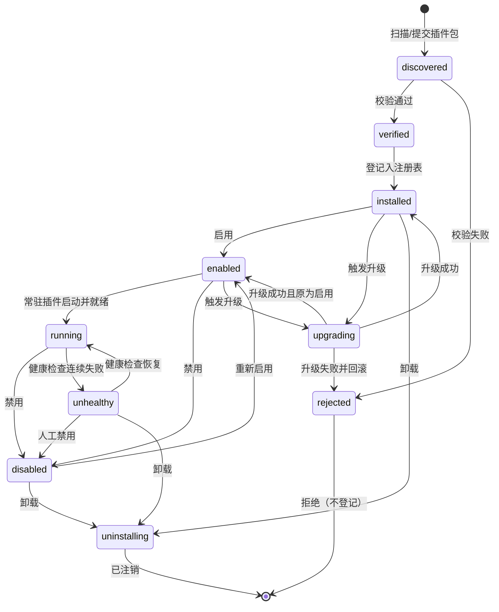
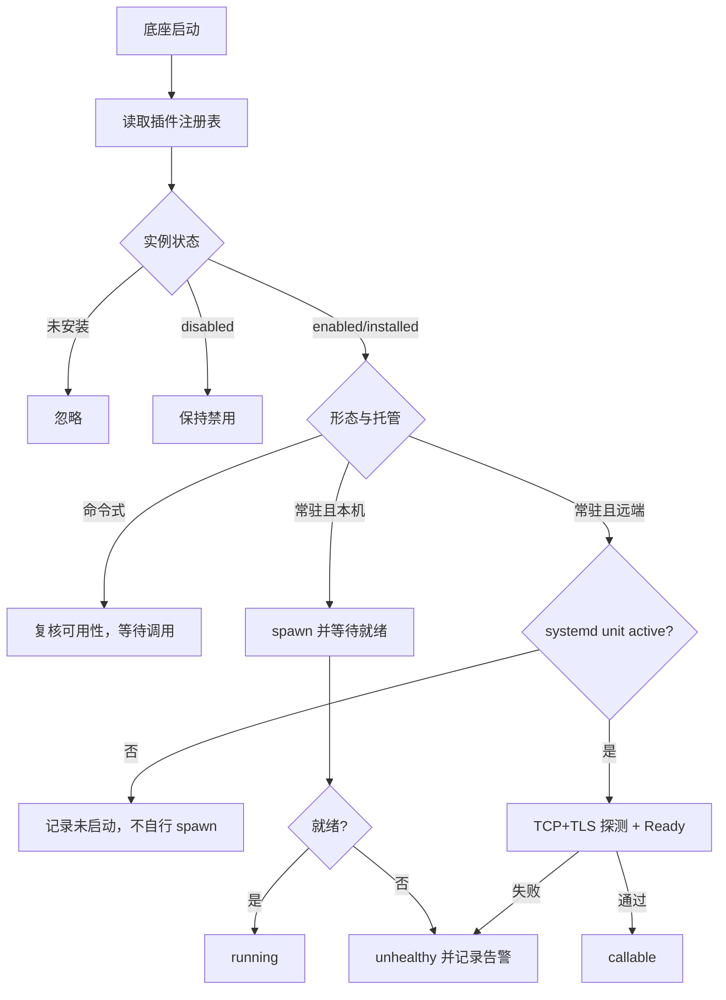

# DOC-04 插件生命周期

> 状态：`draft` ｜ 读者：底座开发 ｜ 上游：[03 插件模型](03-plugin-model.md) ｜ 下游：[06 非功能](06-non-functional-requirements.md)

## 1. 生命周期阶段

| 阶段 | 含义 | 是否持久化状态 |
| --- | --- | --- |
| 发现（discovered） | 底座在约定位置或通过约定方式获知插件包的存在 | 否 |
| 校验（verified） | 清单可解析、信息组齐全、版本兼容、完整性校验通过 | 否 |
| 安装（installed） | 插件包被接纳并登记到插件注册表，创建**插件实例** | 是 |
| 启用（enabled） | 底层允许该插件接收调用 | 是 |
| 运行（running） | 常驻插件的进程已就绪并处于健康状态 | 否（重启后需重建） |
| 不健康（unhealthy） | 运行实例无法通过健康检查，调用被短路 | 否 |
| 禁用（disabled） | 保留安装信息但拒绝一切调用 | 是 |
| 升级（upgrading） | 用新版本替换已安装版本的过程态 | 否 |
| 卸载（uninstalling） | 注销插件并清理其运行资源 | 是（变为未安装） |

「是否持久化状态」决定底座重启后的恢复行为，见 §5。

**远端特有的三态拆分**：远端实例不把「装好了」当作一个状态，而是分「**已安装** / **已启动** / **可调用**」三个独立事实。
已安装 = 包与清单在校验通过并登记；已启动 = systemd unit 处于 active；可调用 = TCP 可达 + TLS 握手通过 + `Ready` 成功 + `GetVersion` 复核通过。
三者可任意组合，不得互相推断（[ADR-0018](adr/0018-daemon-process-custody-and-injection.md) §1.2、[DOC-17](17-plugin-registry-and-configuration.md) §5）。

## 2. 状态机

说明：

- **命令式插件没有 `running` 常驻态**：它在启用后即可被调用，每次调用临时产生运行实例。其健康检查语义是「可执行性探测」，见 §4.3。
- 状态存储以**插件注册表**为准；运行态（running/unhealthy）是派生状态，不作为持久事实。

## 3. 各阶段的要求

### 3.1 发现

- 基线方式：启动时扫描配置指定的插件目录，一个插件一个子目录（[ADR-0003](adr/0003-plugin-discovery-registration.md)）。
- 热加载（目录监听）为**可选开关，默认关闭**；开启后仍须走完整的「校验 → 登记」流程。
- 发现阶段**不得**执行插件代码（不做任何形式的探测性运行），只读取静态信息。
- 同一标识的多个版本同时存在时：注册表只保留一个已登记版本（候选为最高且契约兼容者），其余必须**显式报告冲突**。

### 3.2 校验

必须校验：清单存在且可解析（`plugin.yaml`，YAML）→ JSON Schema 结构校验 → 语义校验（形态合法、契约版本范围在支持范围内、入口存在且可读、路径不越界）→ 完整性（摘要/签名，强度待定，OQ-015）。

- 任一失败 → 进入 `rejected`，记录原因与插件标识（若有），**不登记**。
- 校验失败原因必须可定位到具体**字段路径**与具体项（例如「`capabilities[0].input_schema_ref` 指向的文件不存在」），禁止只返回「校验失败」。

### 3.3 安装

- 安装来源有两类：**本地**（扫描目录/导入插件包）与**远程下发**（CAP-13 经 SSH 安装到目标主机）。
- 登记内容：标识、版本、形态、能力列表、权限声明、安装来源、**安装位置**（本机或主机标识）、时间。
- 安装**不等于**启用：**安装后默认禁用**（installed，不可被调用），必须由显式操作启用（[ADR-0003](adr/0003-plugin-discovery-registration.md)）。
- 安装是幂等操作：重复安装同一版本应成功且不产生重复登记；远程重复下发同一版本同样幂等（[DOC-09](09-host-management-and-plugin-distribution.md) §7）。
- 远程下发的生命周期状态以目标机实际结果为准：传输/校验/安装失败必须反映为失败态，不得登记为已安装。
- **远端托管已定**（[ADR-0018](adr/0018-daemon-process-custody-and-injection.md) §1.2、OQ-027 decided）：目标机插件由 systemd 托管，
  底座下发 unit 并执行 `systemctl enable/start`，随后进入状态探测。
  「已安装」登记成功只说明包与清单已落地，**不得**据此推进到 `running`；`enabled`（业务启用）与 `started`（进程已启动）是两件不同的事。
- 下发与启用是两个动作：下发完成后是否启用必须由独立操作触发（默认禁用）。

### 3.4 启用 / 禁用

- 启用前必须复核：契约版本仍兼容、权限仍可授予。
- 禁用必须**立即生效**：新调用被拒绝；常驻插件**立即停止进程**（本机按 [ADR-0018](adr/0018-daemon-process-custody-and-injection.md) §6.1 的关闭顺序执行 drain → `Shutdown` → 信号 → 强杀；远端经 SSH 执行 `systemctl stop`，超时由 systemd 强杀）。
- 禁用/启用均产生审计事件。远端禁用只停服务，不删除包、证书与配置；重新启用时复用同一实例。

### 3.5 调用

- 调用与定时任务的目标都是**插件实例**，不是类型；只给类型时拒绝（[DOC-17](17-plugin-registry-and-configuration.md) §8）。
- 只有 `enabled` 且（常驻时）`running` 的实例可被调用。
- `unhealthy` 或未就绪状态下调用直接返回不可用类错误（`not_ready`），不重试到插件进程。
- 远端实例额外要求：主机可达 + TCP 可连 + TLS 握手通过 + `Ready` 成功；任一失败都不转发业务请求。
- 同一插件**一律串行调度**（跨能力亦串行，[ADR-0021](adr/0021-capability-execution-and-destructive-confirmation.md)）。
- 命令式插件的调用失败（进程崩溃/超时/退出码非成功）**不改变**插件整体状态；连续失败是否触发熔断待定（建议：记录并可查询，是否自动禁用待定）。
- 常驻插件进程异常退出：有在途调用时折算为 `internal_error`，无在途调用时仅转 `unhealthy`；折算规则见 [ADR-0019](adr/0019-error-categories-and-exit-code-scope.md) §5。

### 3.6 卸载

- 卸载前必须禁用。
- 必须清理：运行实例、临时文件、插件数据目录（是否保留数据待定，建议默认保留并显式要求清理）。
- 远端实例的卸载/撤销下发必须额外完成：`systemctl disable --now <unit>` → 删除 unit 并 `daemon-reload` → 删除证书、私钥、CA 证书与按主机配置文件 → 按保留策略处理数据目录与包（[DOC-09](09-host-management-and-plugin-distribution.md) §6.5）。
- 远端清理失败必须显式报告并保留可重试状态，不得在证书或 unit 残留的情况下登记为「已撤销」。
- 卸载后注册表不得再出现该插件记录；审计记录保留。

### 3.7 升级

- 升级是「校验新版本 → 停用旧实例 → 切换 → 按原启用状态恢复 → 失败回滚」的原子过程（回滚粒度待定）。
- 升级期间该插件的调用应快速失败（明确错误），而不是长时间阻塞。
- 是否允许跨主版本契约升级：由兼容性规则决定，见 [DOC-05](05-extension-points-and-compatibility.md)。

## 4. 健康检查

### 4.1 目的

区分「插件不存在/未启用」与「插件存在但不可用」，并让调用方得到确定性的快速失败。

### 4.2 常驻插件

- 检查方式：调用插件声明的健康探测入口（`Health`），与就绪探测（`Ready`）分离：`Ready` 决定能否接调用，`Health` 决定是否需要重启。
- **本机**就绪时序：spawn → 等待 socket 出现（`startup_timeout`）→ dial → `Ready` 轮询 → `GetVersion` 复核 → `running`；socket 出现不等于就绪。
- **远端**就绪时序：`systemctl start` → 等待 unit `active` → TCP 可连 → TLS 握手与双向身份校验 → `Ready` 轮询 → `GetVersion` 复核 → `callable`；任一阶段失败都停在对应状态，不得跳过。
- 判定：连续失败达到阈值 → `unhealthy`；连续成功达到阈值 → 恢复 `running`。
- 崩溃重启：**本机**记录退出码/信号与 stderr 尾部，按指数退避重启并使用新 `instance-id`，超过上限转 `unhealthy` 并告警，**不静默无限重启**；**远端**由 systemd `Restart=on-failure` 重启，底座只观测 unit 状态与探测结果，不自行拉起。
- 频率、超时、阈值、退避与上限：**待定（OQ-012、OQ-044、OQ-048）**。

### 4.3 命令式插件

- 命令式插件无常驻实例，健康检查退化为「可执行性检查」（入口存在、可执行、版本可读）。
- **不得**通过实际执行业务能力来判断健康（有副作用）。

## 5. 底座重启后的恢复

- 重启不改变安装/启用事实；运行态一律重建。
- 常驻插件启动失败不得自动卸载，必须保持可诊断状态。
- 本机启动前必须清理 `run/plugins/**` 中无对应运行实例的残留（socket、一次性凭据文件、实例临时目录），不复用旧 `instance-id`。
- 远端底座重启**不重新下发 unit、不重新签发证书**，只做状态探测；「已安装」事实来自注册表，「已启动」来自 systemd，「可调用」来自探测。
- 运行期不保留旧进程句柄；崩溃后由监督器（本机底座 / 远端 systemd）重建，不尝试「复活」原进程。

## 6. 并发与一致性

- 同一插件的状态变更（安装/启用/禁用/升级/卸载）必须**串行化**。
- 同一插件的业务调用**一律串行**（跨能力亦串行）。
- 状态变更期间对同一插件的调用：快速失败或排队，禁止「读到中间态」。
- 注册表写入必须原子，避免重启后出现半完成状态。
- 是否支持多底座实例同时管理同一注册表：**否（v1）**，见 OQ-020（单节点部署，已 decided）。

## 7. 审计要求

以下操作必须产生审计事件：安装、校验失败、启用、禁用、升级（含失败）、卸载、健康状态翻转、权限授予变更、
远端证书签发/吊销/重签、下发撤销、三态（已安装 / 已启动 / 可调用）翻转、配置变更与漂移发现。

审计事件字段：**待定（OQ-016）**（需在实现前确认，至少覆盖「主体、动作、插件标识、版本、结果、时间、原因」；
远端证书相关事件只记录序列号与指纹，不记录私钥内容，见 [ADR-0022](adr/0022-remote-plugin-pki-and-mtls-certificates.md) §6）。

## 8. 待定项

| 主题 | 编号 |
| --- | --- |
| 健康检查频率/阈值 | OQ-012 |
| 启动超时、就绪轮询、drain/grace、重启退避与上限 | OQ-044 |
| 完整性校验强度 | OQ-015 |
| 卸载是否保留插件数据 | DOC-08 §11 |
| 连续失败是否自动熔断/禁用 | OQ-012 |
| 远端安装目录与权限 | DOC-09 / plugin-spec/08 |
| systemd unit 细节、远端启停与探测超时 | OQ-048 |
| 证书有效期、轮换、吊销与 CA 备份 | OQ-047 |
| 探测间隔、状态过期 TTL、降级阈值、记录保留 | OQ-049 |
| 升级时配置迁移、撤销后配置保留期 | OQ-051 |
