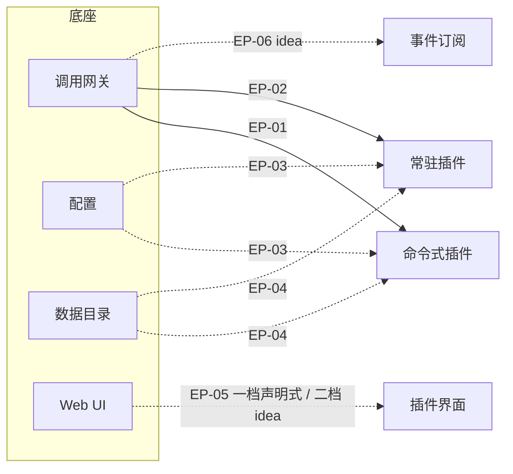
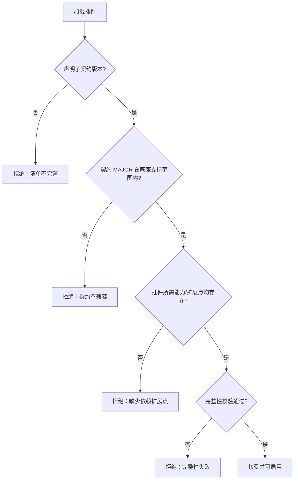

# DOC-05 扩展点与版本兼容策略

> 状态：`draft` ｜ 读者：底座开发、插件开发 ｜ 上游：[03 插件模型](03-plugin-model.md) ｜ 下游：[06 非功能](06-non-functional-requirements.md)

## 1. 扩展点定义

扩展点是底座预留的契约位置。每个扩展点具有：编号（`EP-NN`）、稳定性等级、契约版本、接入形态。

**稳定性等级**：

| 等级 | 含义 | 允许的破坏性变更 |
| --- | --- | --- |
| `stable` | 已定型，承诺向后兼容 | 只能在主版本升级时发生，且需 ADR |
| `experimental` | 可用但可能调整 | 允许在次版本内不兼容调整，需公告 |
| `idea` | 尚未实现，仅记录 | 无承诺 |

## 2. v1 扩展点清单

| 编号 | 扩展点 | 接入形态 | 稳定性 | 状态 | 说明 |
| --- | --- | --- | --- | --- | --- |
| EP-01 | 命令执行扩展点 | 命令式插件（stdio，NDJSON） | `stable` | 契约已定稿（ADR-0004） | 按次调用、一次性返回 |
| EP-02 | 服务能力扩展点 | 常驻插件（gRPC；本机 UDS / 远端 TCP+mTLS，通用 Invoke） | `stable` | 契约已定稿（ADR-0005、ADR-0018、ADR-0022） | 长期驻留、按插件串行调用 |
| EP-03 | 插件配置读取扩展点 | 两种形态均可 | `experimental` | 常驻已定（`--ops-config`，本机/远端一致）；命令式待 OQ-008 | 插件读取自身配置的途径 |
| EP-04 | 插件数据目录扩展点 | 两种形态均可 | `experimental` | 常驻已定（`--ops-data-dir`）；命令式待 OQ-008 | 插件私有数据落盘位置，见 [DOC-08](08-storage-and-data-directory.md) §4 |
| EP-05 | 前端界面扩展点 | 一档：插件声明式声明（底座渲染，无第三方代码）；二档：插件自带前端包（挂起） | `idea` | 一档为 v1 方向（ADR-0025 proposed，未实现）；二档挂起，不进入 v1 | 见 OQ-011 |
| EP-06 | 事件订阅扩展点 | 插件消费底座事件 | `idea` | 未规划 | 见 DOC-00 IDEA-3 |
| EP-07 | 身份源扩展点 | 外部身份提供方 | `idea` | 未规划 | 见 OQ-037 |



实线 = v1 目标范围；虚线 = 待定或 idea，**不得**作为 v1 验收依据。

### 2.1 与主机下发、远端部署的关系

- 扩展点是**插件向底座贡献能力**的接口，与「插件安装在哪个主机」正交；安装位置不改变扩展点语义。
- v1 允许插件包经 SSH 下发到目标主机（CAP-13，[DOC-09](09-host-management-and-plugin-distribution.md)），**远端运行与调用已定**：
  远端常驻插件由目标机 systemd 托管，底座经 TCP + mTLS 调用（OQ-010、OQ-027 已 `decided`，[ADR-0005](adr/0005-daemon-rpc-transport.md)、[ADR-0018](adr/0018-daemon-process-custody-and-injection.md)）。
- **EP-02 因此有两种传输**：本机 UDS 与远端 TCP+mTLS，共用同一 proto 与错误语义；部署位置只影响地址发现与认证方式。
- EP-01（命令式）仍是本机执行；下发到远端只表示「包已安装」，不构成远端调用能力。
- 任何与部署位置相关的契约变更都必须走版本兼容流程（§4）。
- 定时任务（CAP-14）只是 EP-01/EP-02 的一个**调用方**，不新增扩展点；若未来需要「任务执行前后钩子」之类的扩展点，必须按实验性扩展点流程新增（EP-08 起），不得偷偷复用既有 EP。

## 3. 版本模型

### 3.1 三个版本

| 版本 | 归属 | 变化含义 |
| --- | --- | --- |
| 底座版本 | 底座 | 产品整体发布版本（含 UI、内部实现） |
| 契约版本 | 底座 | 插件与底座之间的接口规范版本，两个形态各有契约，共用一套编号规则 |
| 插件版本 | 插件 | 插件自身功能演进版本 |

三者**互不推导**：不能用底座版本推断契约版本，也不能用插件版本推断其兼容性。

### 3.2 编号规则（已定稿）

契约版本采用 `MAJOR.MINOR`（[ADR-0012](adr/0012-module-boundaries-and-sdk.md)，OQ-006 已 decided）：

- **MAJOR**：破坏性变更（删除能力、改变字段语义、改变必填性、改变通信语义、改变错误码含义）。
- **MINOR**：向后兼容的增量（新增可选字段、新增能力、新增扩展点、新增错误类别）。
- 不使用 PATCH 表达契约变化；契约的编辑性修正不改版本。
- 底座**同时支持同一 MAJOR 下的多个 MINOR**：当前支持 `1.0`、`1.1` 与 `1.2`，并公布支持的 MAJOR 集合。
- 插件必须声明**支持的版本范围**，写法为空格分隔的约束集合（操作符 `>=`、`<`、`=`）：

  ```yaml
  version:
    contract: ">=1.0 <2.0"
  ```

- 禁止声明「任意版本兼容」。

### 3.2.1 契约 1.1 的增量（2026-11-16）

| 变更 | 类型 | 说明 |
| --- | --- | --- |
| 新增错误类别 `not_found` / `validation_failed` / `precondition_failed` | MINOR | 见 [ADR-0019](adr/0019-error-categories-and-exit-code-scope.md) |
| `InvocationContext` 新增可选字段 `credential` | MINOR | 短期凭据续期，旧插件忽略即可 |
| 清单新增可选字段 `capabilities[].risk_level` | MINOR | 缺省 `normal` |
| 常驻插件启动注入参数 `--ops-*` 与一次性凭据文件 | MINOR（此前未成文） | 见 [ADR-0018](adr/0018-daemon-process-custody-and-injection.md) |
| `concurrency` 语义明确为「承受能力声明」，调度一律串行 | 澄清 | 不改变既有插件的声明合法性 |

**使用门槛**：插件若要使用 1.1 新增的错误类别，`contract` 下限必须 ≥ `1.1`；只使用 1.0 语义的插件保持 `">=1.0 <2.0"` 即可。

### 3.2.2 契约 1.2 的增量（2026-11-16）

| 变更 | 类型 | 说明 |
| --- | --- | --- |
| EP-02 新增远端传输形态：TCP + 双向 TLS | MINOR | 共用同一 proto；本机 UDS 插件不受影响（[ADR-0005](adr/0005-daemon-rpc-transport.md)、[ADR-0022](adr/0022-remote-plugin-pki-and-mtls-certificates.md)） |
| 清单新增可选字段 `runtime.listen.port` | MINOR | 出现即表示支持远端部署；缺省仍为本机专用（[plugin-spec/01](../plugin-spec/01-manifest.md) §3.6） |
| 清单新增可选字段 `config[]`（`key`/`type`/`required`/`secret`/`default`/`enum`/`description`） | MINOR | 声明可配置项；值按实例由底座收集（[ADR-0023](adr/0023-plugin-registry-instances-and-configuration.md)） |
| 远端启动不注入 `--ops-socket` / `--ops-credential-file` | MINOR（新增形态的约束） | 远端身份改由 mTLS 承担；本机形态参数不变 |
| 远端按主机配置文件新增 `deployment` / `listen` / `tls` / `data_dir` 段 | MINOR | 字段级定义见 [plugin-spec/03](../plugin-spec/03-remote-protocol.md) §3.2 |
| 注册方向、类型/实例、自报边界 | 澄清（不影响运行时字段） | 见 [DOC-17](17-plugin-registry-and-configuration.md) |

**使用门槛**：未声明 `runtime.listen.port` 的 daemon 插件只能本机部署；使用 `config[]` 或远端形态的插件应声明 `contract` 下限 ≥ `1.2`（底座可对低版本声明给出兼容性告警）。

### 3.3 兼容判定



要求：

- 底座必须能同时支持**多个契约 MINOR**（同一 MAJOR 内），并对外公布支持的 MAJOR 集合。
- 插件必须声明其支持的契约**范围**（而非单一版本），避免底座升级后误判。
- 兼容性判定必须在**安装/启用时**完成并记录结果，不得等到首次调用才暴露。

## 4. 变更与废弃策略

| 变更类型 | 允许的版本位 | 要求 |
| --- | --- | --- |
| 新增可选输入字段 | MINOR | 旧插件必须仍能工作（忽略未知字段） |
| 新增能力 | MINOR | 不影响既有能力 |
| 新增扩展点 | MINOR | 标注稳定性等级 |
| 新增错误类别 | MINOR | 旧插件不返回；调用方按未知类别兜底（底座归一为 `internal_error`） |
| 新增可选上下文字段 | MINOR | 旧插件忽略未知字段 |
| 同一扩展点新增部署形态（如 EP-02 的远端 TCP+mTLS） | MINOR | 必须共用既有 proto 与错误语义；旧形态不受影响 |
| 删除字段/能力 | MAJOR | 需 ADR，需迁移说明 |
| 改变字段语义或必填性 | MAJOR | 视为新契约 |
| 改变错误码含义 | MAJOR | 错误语义属于契约 |
| 修复文档措辞 | 不变更版本 | 仅修订文档 |

废弃流程：

1. 标记 `deprecated`，在文档与清单中给出替代项。
2. 至少在**一个 MINOR 周期**内继续支持（具体时长待定，OQ-038）。
3. 在下一个 MAJOR 移除。

## 5. 未知内容处理

- **底座收到未知可选字段**：忽略，不得报错。
- **插件收到未知可选字段**：忽略，不得报错。
- **底座遇到未知能力标识**：视为该插件未声明该能力。
- **插件遇到未知调用上下文字段**：忽略。

这条规则保证「新增可选内容」不会破坏兼容性，是 MINOR 兼容的技术基础。

## 6. 兼容性测试要求（后续实现阶段）

- 契约新增字段后，用「旧版插件」回归验证仍可用。
- 底座支持的每个 MAJOR 都要有样例插件做冒烟验证。
- 兼容性声明必须可在自检接口中查询（CAP-11）。

## 7. 待定项

| 主题 | 编号 |
| --- | --- |
| 契约废弃支持周期长度 | OQ-038 |
| 常驻插件注入参数的默认值与超时 | OQ-044 |
| protoc / protoc-gen 版本锁定与生成校验 | OQ-045 |
| 证书有效期、轮换周期与吊销策略 | OQ-047 |
| systemd 托管细节与端口默认值 | OQ-048 |
| EP-03/EP-04 是否纳入 v1 | DOC-08 / OQ-008 |
| EP-05 一档（声明式，ADR-0025 proposed）/ 二档挂起；EP-06/EP-07 是否立项 | OQ-011、OQ-019 |
