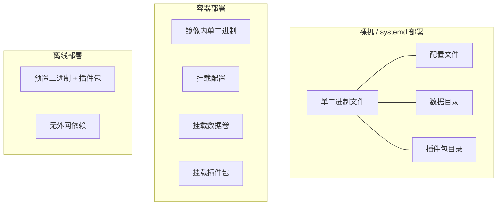

# DOC-06 非功能性要求

> 状态：`draft` ｜ 读者：评审、底座开发 ｜ 上游：[02 能力](02-foundation-capabilities.md)、[04 生命周期](04-plugin-lifecycle.md) ｜ 下游：[07 开放问题](07-open-questions.md)

本文只写**要求**，不写具体实现选型。带「待定」的条目必须先在 ADR / OQ 中拍板，不得由实现者自行决定。

## 1. 交付形态

| 编号 | 要求 | 验收方式 |
| --- | --- | --- |
| NFR-PKG-01 | 前端静态资源编译进二进制，运行时不依赖外部前端文件 | 删除前端源码目录后仍能启动并访问 UI |
| NFR-PKG-02 | 除配置文件与数据目录外，无外部运行时依赖（不要求 Node、Python、JVM 等） | 在纯净环境中仅放置二进制即可启动 |
| NFR-PKG-03 | 运行时可报告底座版本与契约版本 | 自检接口可查（CAP-11） |
| NFR-PKG-04 | 构建方式可重复：同一提交产出一致产物（可复现性） | 待定（OQ-014） |
| NFR-PKG-05 | 目标平台与架构清单 | 待定（OQ-014） |
| NFR-PKG-06 | 契约文件（proto 定义、清单 JSON Schema、错误类别与退出码常量、契约版本常量）**只**存在于 `sdk/`；底座内部与插件均从 `sdk/` 引用，不得另存副本（[ADR-0012](adr/0012-module-boundaries-and-sdk.md)） | 代码评审 + 编译期 import 检查 |

内嵌方式候选见 [ADR-0001](adr/0001-single-binary-embedding.md)；前端技术栈见 [ADR-0002](adr/0002-frontend-stack.md)。两者均**未定稿**。

## 2. 部署形态

| 编号 | 要求 |
| --- | --- |
| NFR-DEP-01 | 支持裸机直接运行，配置文件与数据目录路径可指定 |
| NFR-DEP-02 | 支持以系统服务方式托管（启动/停止/重启/开机自启语义明确） |
| NFR-DEP-03 | 默认监听地址与端口：**待定**；不得硬编码生产地址 |
| NFR-DEP-04 | 目录布局（配置/数据/日志/插件包的位置）**待定**（数据目录相关结论见 [DOC-08](08-storage-and-data-directory.md) §4；默认根位置见 OQ-022） |
| NFR-DEP-05 | 插件包目录必须可由配置指定，支持离线放置 |
| NFR-DEP-06 | 同一数据目录不允许被多个底座实例同时使用（单实例约束；部署形态为单节点，多节点高可用为远期 idea） |
| NFR-DEP-07 | 数据目录必须位于本地文件系统；禁止 NFS/SMB/FUSE 同步盘与跨主机共享（[DOC-08](08-storage-and-data-directory.md) §5） |
| NFR-DEP-08 | 数据目录**由配置文件指定**，路径可配置；必须为绝对路径；配置文件未指定时的默认回退**待定**（OQ-022）；启动时必须校验路径合法性与本地文件系统属性 |
| NFR-DEP-09 | 支持经 SSH 将插件包下发安装到目标主机（CAP-13 / ADR-0014）；**远端运行与调用**的目标平台 v1 收窄为 Linux + systemd（[ADR-0018](adr/0018-daemon-process-custody-and-injection.md) §1.2），非 systemd 与非 Linux 目标仅支持「下发安装」，不支持远端启动与调用；Windows 下本机 daemon 是否支持待 OQ-044 |
| NFR-DEP-10 | 下发并发上限、连接/传输超时、重试次数、回滚默认策略**待定**（OQ-029）；同一主机下发必须串行 |

## 3. 启动、关闭与运行

| 编号 | 要求 |
| --- | --- |
| NFR-RUN-01 | 配置非法时**启动失败并给出明确原因**，不得带病启动 |
| NFR-RUN-02 | 收到终止信号后：停止接收新调用 → 等待在途调用完成（有超时） → 停止常驻插件 → 退出 |
| NFR-RUN-03 | 优雅关闭超时时间**待定**（需可配置） |
| NFR-RUN-04 | 启动时不执行业务调用，只做必要的校验与就绪探测 |
| NFR-RUN-05 | 单个插件异常不得导致底座整体退出（故障隔离） |
| NFR-RUN-06 | 远程下发必须是异步可查询任务，不得长时间阻塞请求；服务重启后未完成任务必须可恢复为可重试状态 |
| NFR-RUN-07 | 下发任务必须可取消；取消后不得继续执行后续阶段 |
| NFR-RUN-08 | 定时任务的调度精度容差与最小触发粒度**待定**（OQ-031、OQ-035）；不得承诺秒级精度 |
| NFR-RUN-09 | 调度器重启后任务不得丢失、不得重复触发、不得静默漏跑；错过执行必须留记录（策略待定，OQ-032） |
| NFR-RUN-10 | 常驻插件有两套托管模型：**本机**由底座以子进程方式拉起并托管；**远端**由目标机 systemd 托管，底座负责下发 unit、启动与状态探测。启动超时、就绪轮询、drain 与 grace、重启退避必须可配置（默认值待 OQ-044、OQ-048） |
| NFR-RUN-11 | 常驻插件崩溃后必须按退避策略重启，使用新的运行实例标识；超过上限转 `unhealthy` 并告警，**不得**静默无限重启；远端由 systemd `Restart=on-failure` 承担重启，底座只观测并记录 |
| NFR-RUN-12 | 底座启动与每次重启前必须清理 `run/plugins/**` 中无对应运行实例的残留（socket、一次性凭据文件、临时目录） |
| NFR-RUN-13 | 常驻插件的 stdout/stderr 必须由托管方捕获并接入结构化日志，**不得**作为协议通道，也不得因日志写入阻塞调用；本机由底座捕获，远端写入 journald |
| NFR-RUN-14 | 常驻插件的调用一律按插件串行执行；跨能力亦不并发（[ADR-0021](adr/0021-capability-execution-and-destructive-confirmation.md)） |
| NFR-RUN-15 | 插件不得依赖 TTY 或交互输入；底座不提供任何交互通道 |
| NFR-RUN-16 | 同一任务默认不并发；执行必须异步化，单个任务卡死不得阻塞其他任务 |
| NFR-RUN-17 | 同一主机 + 同一插件只允许一种托管方式（本机 spawn 或远端 systemd），注册表必须记录托管归属；禁止同一实例被两种方式同时托管，也禁止运行时切换托管方式 |
| NFR-RUN-18 | 远端插件状态必须分「已安装 / 已启动 / 可调用」三个独立状态记录与展示，**不得**用其中任一状态推断其余两个 |
| NFR-RUN-19 | 远端日志由目标机 journald 承载；底座不得要求插件把日志写入业务数据目录，也不得依赖日志内容判定健康 |

## 4. 日志

| 编号 | 要求 |
| --- | --- |
| NFR-LOG-01 | 结构化日志（可被机器解析），字段命名统一 |
| NFR-LOG-02 | 默认输出到标准输出/标准错误，便于容器与 systemd 采集；是否同时支持文件输出**待定** |
| NFR-LOG-03 | 日志级别可配置，至少包含 error / warn / info / debug |
| NFR-LOG-04 | 插件日志必须携带插件标识与运行实例标识，便于归因 |
| NFR-LOG-05 | 禁止记录凭据、令牌、私钥；敏感字段按能力声明脱敏 |
| NFR-LOG-06 | 日志字段清单与格式：**待定**（OQ-016） |

## 5. 配置

| 编号 | 要求 |
| --- | --- |
| NFR-CFG-01 | 配置来源与优先级：**待定**（建议 命令行 > 环境变量 > 配置文件，见 OQ-008） |
| NFR-CFG-02 | 配置文件格式：**YAML**（[ADR-0016](adr/0016-yaml-and-json-schema-dependencies.md) proposed，M1 起生效；与插件清单复用同一解析依赖） |
| NFR-CFG-03 | 所有配置项必须有默认值或明确标记为必填；不得存在「隐藏必需配置」 |
| NFR-CFG-04 | 配置项清单**暂不定义**，实现前必须先写入本文件与 ADR-0009；M0 已落地最小配置项基线（§5.1），M1 扩展项见 [DOC-12](12-m1-plugin-runtime.md) §2；键名与环境变量名待 OQ-036/OQ-039 确认 |
| NFR-CFG-05 | 是否支持热加载：**待定**；v1 建议不支持，变更需重启 |
| NFR-CFG-06 | 配置中禁止出现明文业务凭据；主密钥来源**已定**为环境变量（优先）→ 配置文件独立字段，密钥不落库、不写日志（[ADR-0013](adr/0013-plugin-credential-encryption.md)）；具体字段名与环境变量名待定（OQ-008） |

### 5.1 M0 配置项基线（待 OQ-036 确认）

M0 只定义启动所需的最小配置项，完整说明见 [DOC-11](11-implementation-baseline-m0.md) §4。

| 键名 | 环境变量 | 命令行 | 必填 | 默认值 | 说明 |
| --- | --- | --- | --- | --- | --- |
| `data_dir` | `OPS_PLATFORM_DATA_DIR` | `-data-dir` | 是 | 无 | 必须为绝对路径；未配置时启动失败，默认回退待 OQ-022 |
| `listen_addr` | `OPS_PLATFORM_LISTEN_ADDR` | `-listen` | 是 | 无 | `host:port`；默认监听地址未定（OQ-036） |
| `log_level` | `OPS_PLATFORM_LOG_LEVEL` | `-log-level` | 否 | `info` | debug / info / warn / error |
| `shutdown_timeout` | `OPS_PLATFORM_SHUTDOWN_TIMEOUT` | `-shutdown-timeout` | 否 | `10s` | 优雅关闭等待时长（NFR-RUN-03） |

- 配置文件格式：M1 起采用 **YAML**（[ADR-0016](adr/0016-yaml-and-json-schema-dependencies.md)）；不提供 JSON 兼容模式，避免两套事实来源。
- 优先级：命令行 > 环境变量 > YAML 配置文件 > 内置默认值；未知字段直接报错。
- M1 新增的插件运行时配置键与默认值见 [DOC-12](12-m1-plugin-runtime.md) §2（实现基线，OQ-039）。
- 配置文件位置没有默认值，只能由 `-config <path>` 指定；配置文件目录约定仍待 ADR-0009 定稿。

## 6. 安全边界

### 6.1 信任模型

- 底座自身进程可信；**插件视为不可信代码**（即使是内部团队开发）。
- 插件只能通过底座授予的接口与资源工作，不得旁路访问内部组件。

### 6.2 强制要求

| 编号 | 要求 |
| --- | --- |
| NFR-SEC-01 | 默认拒绝：未声明的权限一律不可用 |
| NFR-SEC-02 | 所有调用经网关完成鉴权，禁止绕过 |
| NFR-SEC-03 | **已定**：常驻插件的调用通道有两种——**本机** gRPC over Unix Domain Socket，**不得**监听任何 TCP（含回环）；**远端** gRPC over TCP + **双向 TLS（mTLS）**，两侧必须校验到内置 CA 的链、EKU、CN/SAN、有效期与吊销名单（[ADR-0005](adr/0005-daemon-rpc-transport.md)、[ADR-0022](adr/0022-remote-plugin-pki-and-mtls-certificates.md)）。**明文 TCP 一律禁止**，不存在「开发模式跳过 TLS」开关 |
| NFR-SEC-04 | 插件包完整性校验必须存在（摘要或签名，强度待定，见 OQ-015） |
| NFR-SEC-05 | 插件文件访问限制在自身包目录与授权的数据目录内，禁止路径穿越 |
| NFR-SEC-06 | 管理与高危操作必须留审计，且审计不可被插件修改 |
| NFR-SEC-07 | 依赖库不得引入已知高危漏洞；升级流程需记录（工具与频率待定） |
| NFR-SEC-08 | **已定**：插件访问外部中间件的凭据使用 AES-256-GCM 对称加密存库，主密钥来自环境变量（优先）或配置文件独立字段，密钥不落库、不写日志（[ADR-0013](adr/0013-plugin-credential-encryption.md)）。防护边界：只防「数据库文件或备份被单独拷走」，**不防主机被完全控制**；缺少主密钥时必须显式失败，不得降级为明文 |
| NFR-SEC-09 | 用户口令只存不可逆派生值，任何接口不得返回；插件访问外部系统的凭据必须加密存储（[DOC-08](08-storage-and-data-directory.md) §2） |
| NFR-SEC-10 | 数据目录、库文件、备份与含敏感配置的文件权限必须限制为服务账号可读写（[DOC-08](08-storage-and-data-directory.md) §4.1） |
| NFR-SEC-11 | 主密钥轮换与丢失处置**待定**（OQ-023）；在方案确定前不得实现自动轮换。已知后果：主密钥丢失等于已存凭据**不可恢复** |
| NFR-SEC-12 | 主机凭据（SSH 私钥、账号密码）必须加密落库，复用 ADR-0013 基线；保存后不可回显、不可导出；日志与审计不得出现明文 |
| NFR-SEC-13 | SSH 连接必须校验主机身份，禁止「无校验」模式；算法白名单与指纹首次信任策略**待定**（OQ-025） |
| NFR-SEC-14 | 主机下发属于高权限操作（底座相当于跳板）：必须全程审计；按主机分组授权、二次确认的授权模型**待定**（OQ-028），未确认前不得默认放开多主机下发 |
| NFR-SEC-15 | 定时任务参数禁止明文凭据，只能引用凭据库条目；任务创建/修改/删除属于受控操作，默认拒绝（权限粒度待定，OQ-034） |
| NFR-SEC-16 | **已定**：宿主下发给插件的短期凭据仅存内存、可轮换、进程退出即失效；不得落盘、不得写入日志与审计；插件不得提供明文导出接口（[ADR-0006](adr/0006-plugin-authz.md)） |
| NFR-SEC-17 | **已定**：常驻插件的一次性凭据文件必须位于 `run/plugins/<plugin-id>/`，权限 `0600`、目录 `0700`；插件读取后立即删除；宿主在就绪后复核并清理（[ADR-0018](adr/0018-daemon-process-custody-and-injection.md)） |
| NFR-SEC-18 | **已定**：UDS socket 文件权限 `0600`，所在目录 `0700`；UDS 路径总长 ≤ 100 字节，超限启动失败且不得回退到全局可写目录 |
| NFR-SEC-19 | **已定**：远端调用必须使用 mTLS；底座校验服务端证书的插件标识 + 主机标识，插件校验客户端证书的期望底座标识；任一侧校验失败即拒绝连接，**不得**回退明文、不得降载为单向 TLS、不得提供跳过校验的配置项 |
| NFR-SEC-20 | **已定**：远端插件私钥 `0600`、证书 `0644`、CA 证书 `0644`、按主机生成的配置文件 `0600`、状态目录 `0700`；私钥不得写入日志/审计/崩溃转储，审计只记录证书序列号与指纹（[ADR-0022](adr/0022-remote-plugin-pki-and-mtls-certificates.md) §6） |
| NFR-SEC-21 | **已定**：内置 CA 私钥**永不下发**到目标机；落盘必须加密，且其保护与备份策略不得由实现者臆定（待 OQ-047）。CA 私钥不可用时不得静默改用自签或跳过 TLS |

### 6.3 未决安全项

- 人类用户身份源与登录方式（本地账号 / OIDC / LDAP）及角色划分：待定（OQ-037）。
- 资源权限 `scope`（路径/域名范围）是否强制校验：待定（OQ-037）。
- 是否引入沙箱/容器隔离插件进程：待定（OQ-009，v1 建议仅 OS 进程隔离）。
- 主机下发是否需要二次确认与按分组授权：待定（OQ-028）。
- 主机指纹首次信任策略与算法白名单：待定（OQ-025）。
- 目标主机操作系统范围与是否需要 WinRM：待定（OQ-024）；但「远端启动与调用」已收窄为 Linux + systemd（NFR-DEP-09）。
- 证书算法与有效期、轮换周期、CA 私钥保护与备份：待定（OQ-047）。
- systemd unit 细节、远端启动/停止/探测超时、端口默认值范围：待定（OQ-048）。

> **已按用户决策修订**：初版曾以「网络面为零」为由关闭跨主机 mTLS 讨论。用户否决 SSH 隧道与节点代理后，
> 选定「远端常驻插件直接监听 TCP + 双向 TLS」，证书由底座在**下发安装时签发并配置到目标机**
> （[ADR-0022](adr/0022-remote-plugin-pki-and-mtls-certificates.md)）。SSH 凭据只用于下发安装，不承担调用传输。

## 7. 可靠性与故障处理

| 编号 | 要求 |
| --- | --- |
| NFR-REL-01 | 插件崩溃、超时、输出不可解析都不得影响底座稳定性 |
| NFR-REL-02 | 所有跨进程调用必须有超时；无超时的调用视为缺陷 |
| NFR-REL-03 | 常驻插件不可用时，调用应快速失败并给出可区分的错误类别 |
| NFR-REL-04 | 升级失败必须可回滚到上一可用版本（回滚粒度待定） |
| NFR-REL-05 | 数据目录损坏时的行为：启动自检并拒绝启动，给出可诊断原因（恢复路径见 DOC-08 §7） |
| NFR-REL-06 | 备份必须使用数据库在线备份接口（或 checkpoint 一致性快照），**禁止运行中直接复制库文件**；必须支持恢复演练（[DOC-08](08-storage-and-data-directory.md) §7） |
| NFR-REL-07 | 执行与审计记录走批量写队列，禁止每次调用直接抢写锁；队列满时显式报错，不得静默丢弃（[DOC-08](08-storage-and-data-directory.md) §6） |
| NFR-REL-08 | schema 迁移只升不降；库版本高于二进制支持版本时必须拒绝启动（[DOC-08](08-storage-and-data-directory.md) §8） |
| NFR-REL-09 | 远程下发必须幂等：同一主机同一版本重复下发不产生重复安装或损坏状态；失败必须定位到阶段，不得留下「半装」 |
| NFR-REL-10 | 下发失败后的重试次数与回滚默认策略**待定**（OQ-029）；回滚动作必须可审计 |

## 8. 性能与容量

**不预设数值目标**。以下指标项需要在实现前由用户确认目标值（OQ-017）：

| 指标 | 说明 | 目标 |
| --- | --- | --- |
| 冷启动时间 | 从进程启动到可接受调用 | 待定（OQ-017） |
| 单次命令式调用开销 | 进程创建 + 调用往返 | 待定（OQ-017） |
| 并发调用能力 | 同时进行的调用数 | 待定（OQ-017） |
| 常驻内存占用 | 空闲时驻留内存 | 待定（OQ-017） |
| 单次结果体积上限 | 防止内存放大 | 待定（OQ-017）；超限行为已定：返回 `result_too_large`，禁止截断 |
| 插件数量上限 | 已安装插件数量 | 待定（OQ-017） |
| 定时任务调度精度 | 计划触发时点与实际触发时点之间的容差 | 待定（OQ-031、OQ-035）；不得承诺秒级 |
| 定时任务最小触发间隔 | 允许配置的最短固定间隔 / cron 最小粒度 | 待定（OQ-035） |
| 单任务执行超时 | 单次任务执行的超时上限 | 待定（OQ-035） |
| 停机期间错过执行的容忍度 | 重启后可识别的错过执行窗口 | 待定（OQ-032） |

## 9. 可观测性基线

| 编号 | 要求 | 状态 |
| --- | --- | --- |
| NFR-OBS-01 | 结构化日志 | 必需 |
| NFR-OBS-02 | 插件状态与健康可视化（UI 或接口） | 必需 |
| NFR-OBS-03 | 调用统计（次数、失败率、耗时） | 建议，清单待定（OQ-016） |
| NFR-OBS-04 | 分布式追踪 | 可选，v1 不承诺（OQ-016） |
| NFR-OBS-05 | 指标暴露端点与格式 | 待定（OQ-016） |

## 10. 质量门槛（实现阶段生效）

- 契约变更必须有兼容性回归（见 DOC-05 §6）。
- 生命周期状态机必须覆盖所有非法转换（拒绝并记录）。
- 审计与权限相关的路径必须有测试。
- 所有「待定」项在对应 OQ 关闭前，不得以硬编码常量落地。

## 11. NFR 与决策项映射

| NFR 主题 | 依赖决策 |
| --- | --- |
| 单二进制与构建 | ADR-0001 / OQ-014 |
| 前端与 UI 宿主 | ADR-0002 / ADR-0025 / OQ-013、OQ-011 |
| 部署目录与端口 | ADR-0009 / OQ-008、OQ-022 |
| 配置 | ADR-0009 / OQ-008 |
| 插件隔离 | ADR-0010 / OQ-009 |
| 常驻插件进程托管与注入 | ADR-0018（accepted：本机 spawn + 远端 systemd） / ADR-0023 / OQ-044、OQ-048 |
| 错误类别与退出码 | ADR-0019 / OQ-038 |
| 契约来源与代码生成 | ADR-0020 / OQ-045、OQ-018 |
| 能力执行与高危确认 | ADR-0021（accepted） / OQ-005 |
| 传输安全 | ADR-0005（accepted：本机 UDS + 远端 TCP/mTLS） / ADR-0022 / OQ-047、OQ-048 |
| 证书体系与 CA | ADR-0022（accepted） / OQ-047 |
| 鉴权与身份 | ADR-0006（accepted：短期凭据 + mTLS 通道身份 + 能力级授权） / OQ-037 |
| 插件注册、类型/实例与配置 | ADR-0023（accepted） / [DOC-17](17-plugin-registry-and-configuration.md) / OQ-049、OQ-050、OQ-051 |
| 存储、备份与数据目录 | ADR-0007 / [DOC-08](08-storage-and-data-directory.md) / OQ-022 |
| 凭据加密与密钥管理 | ADR-0013 / OQ-023 |
| 主机管理与 SSH 下发 | ADR-0014 / [DOC-09](09-host-management-and-plugin-distribution.md) / OQ-024、OQ-025、OQ-028、OQ-029 |
| 契约版本与模块边界 | ADR-0012 / OQ-018、OQ-038 |
| 定时任务与调度 | ADR-0015 / [DOC-10](10-scheduled-tasks.md) / OQ-030、OQ-031、OQ-032、OQ-033、OQ-034、OQ-035 |
| 日志与指标 | ADR-0011 / OQ-016 |
| 性能目标 | OQ-017 |
