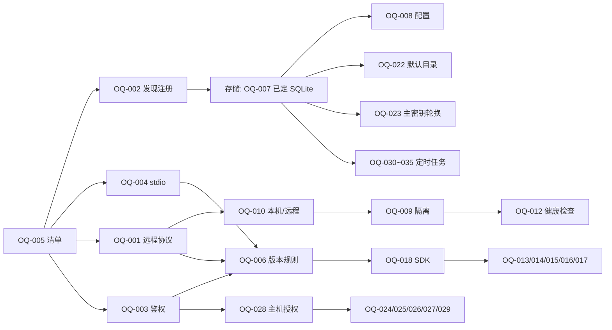

# DOC-07 开放问题与待决策清单

> 状态：`draft` ｜ 读者：决策者、评审、全体开发 ｜ 上游：全部规格 ｜ 关联：[ADR 索引](adr/README.md)

## 1. 使用规则

- 本清单是「未决事项」的**唯一登记处**。正文出现「待定」必须在这里有对应编号。
- 优先级：`P0` 阻塞契约与开发启动；`P1` 影响架构但可并行推进；`P2` 可延后到实现前。
- 关闭条件：用户明确裁决 → 更新对应 ADR 为 `accepted` → 更新受影响的规格正文 → 本清单状态改为 `decided`。
- 机器可读版本：[.ai/open-questions.yaml](../.ai/open-questions.yaml)。

## 2. 决策总览

| 编号 | 问题 | 优先级 | 关联 ADR | 状态 |
| --- | --- | --- | --- | --- |
| OQ-001 | 常驻插件远程调用协议与传输 | P0 | ADR-0005 | decided |
| OQ-002 | 插件发现与注册机制 | P0 | ADR-0003 | decided |
| OQ-003 | 插件鉴权与授权模型 | P0 | ADR-0006 | decided |
| OQ-004 | 命令式插件 stdio 编解码与帧格式 | P0 | ADR-0004 | decided |
| OQ-005 | 插件清单字段集与 schema | P0 | ADR-0003 | decided |
| OQ-006 | 契约版本号规则与兼容矩阵 | P0 | ADR-0012 | decided |
| OQ-007 | 是否内置持久化存储及方案 | P1 | ADR-0007 | decided |
| OQ-008 | 配置来源、格式与优先级 | P1 | ADR-0009 | open |
| OQ-009 | 插件进程隔离与资源限制 | P1 | ADR-0010 | open |
| OQ-010 | 常驻插件是否支持跨主机运行与调用（传输层） | P1 | ADR-0005、ADR-0018、ADR-0022 | decided |
| OQ-011 | 插件界面：一档声明式边界（v1 方向）与二档挂起 | P1 | ADR-0002、ADR-0025 | open |
| OQ-012 | 健康检查语义、频率与失败判定 | P1 | ADR-0010 | open |
| OQ-013 | 前端技术栈 | P2 | ADR-0002 | open |
| OQ-014 | 单二进制内嵌前端资源的构建方式 | P2 | ADR-0001 | open |
| OQ-015 | 插件分发与签名方式 | P2 | ADR-0008 | open |
| OQ-016 | 可观测性基线内容 | P2 | ADR-0011 | open |
| OQ-017 | 非功能指标目标值 | P2 | — | open |
| OQ-018 | 插件 SDK 的形态与发布方式 | P2 | ADR-0012 | open |
| OQ-019 | 对外接口层的形态与开放程度 | P1 | ADR-0009 | open |
| OQ-020 | 单节点部署还是多节点高可用 | P1 | ADR-0007 | decided |
| OQ-021 | 插件凭据加密方式 | P1 | ADR-0013 | decided |
| OQ-022 | 配置文件未指定数据目录时的默认回退 | P1 | ADR-0009 | open |
| OQ-023 | 主密钥轮换与丢失处置 | P1 | ADR-0013 | open |
| OQ-024 | 目标主机操作系统范围（是否仅 Linux，是否需要 WinRM） | P1 | ADR-0014、ADR-0018 | open（远端运行已收窄为 Linux + systemd） |
| OQ-025 | 主机指纹首次信任与变更确认策略 | P1 | ADR-0014 | open |
| OQ-026 | 下发前签名校验是否强制 | P1 | ADR-0014、ADR-0008 | open |
| OQ-027 | 下发是否依赖目标机守护进程 | P1 | ADR-0014、ADR-0018 | decided |
| OQ-028 | 主机分组与下发授权模型（含二次确认） | P1 | ADR-0014、ADR-0006 | open |
| OQ-029 | 下发并发上限、超时、重试与回滚默认值 | P2 | ADR-0014 | open（跨主机调用相关项已随 OQ-010 关闭） |
| OQ-030 | 定时任务是否可面向目标主机（而非仅本机） | P1 | ADR-0015、ADR-0014 | open |
| OQ-031 | cron 语义是否支持到秒 | P1 | ADR-0015 | open |
| OQ-032 | 错过执行是否补跑 | P1 | ADR-0015 | open |
| OQ-033 | 定时任务失败告警通道 | P2 | ADR-0015 | open |
| OQ-034 | 定时任务是否与主机分组/授权模型共用权限体系 | P1 | ADR-0015、ADR-0006 | open |
| OQ-035 | v1 是否允许高频执行及最小间隔 | P2 | ADR-0015 | open |
| OQ-036 | M0 实现基线：配置键名/环境变量/HTTP 路径/库文件名与默认值 | P1 | ADR-0009 | open |
| OQ-037 | 人类用户身份源、角色划分与 `scope` 强制校验 | P1 | ADR-0006 | open |
| OQ-038 | 契约细节遗留：字段命名风格、废弃支持周期、分页、错误堆栈 | P2 | ADR-0012、ADR-0004 | open |
| OQ-039 | M1 插件运行时的配置键、默认值与 HTTP 路径 | P1 | ADR-0009、ADR-0016 | open |
| OQ-040 | M2 本地账号口令派生参数、会话 TTL 与登录限速 | P1 | ADR-0006、ADR-0017 | open |
| OQ-041 | M3 主机下发默认值（并发、超时、远端根目录、指纹策略） | P1 | ADR-0014、ADR-0017 | open |
| OQ-042 | M4 定时任务默认值（超时、重试、最小间隔、重叠策略） | P1 | ADR-0015 | open |
| OQ-043 | M5 总览接口的统计口径 | P2 | ADR-0002 | open |
| OQ-044 | M6 常驻插件运行时默认值（启动超时、就绪轮询、drain/grace、重启退避、凭据有效期、日志截断、Windows 支持） | P1 | ADR-0018 | open |
| OQ-045 | protoc / protoc-gen 版本锁定与生成物校验方式 | P2 | ADR-0020、ADR-0024 | decided |
| OQ-046 | 执行记录是否保留输入/输出摘要、摘要上限与脱敏策略 | P2 | DOC-12、DOC-16 | open |
| OQ-047 | 证书算法与密钥长度、有效期、轮换周期与提前量、CA 私钥保护与备份 | P1 | ADR-0022 | open |
| OQ-048 | systemd unit 细节、远端启动/停止/探测超时、端口默认值与范围、journal 读取方式 | P1 | ADR-0018、ADR-0022 | open |
| OQ-049 | 远端探测间隔、状态过期 TTL、失败降级阈值、探测/执行记录保留 | P2 | ADR-0023、DOC-17 | open |
| OQ-050 | 实例级与类型级授权粒度、类型模板与实例例外的优先级、批量授权范围 | P1 | ADR-0006、ADR-0023 | open |
| OQ-051 | 升级时配置迁移、撤销后配置/数据保留期、类型变更处理 | P2 | ADR-0023、DOC-17 | open |

### 2.1 OQ-047～OQ-051 的 M6 实现基线（可回改，非定稿）

以下数值已实现为**可配置基线**，目的是让 M6 可运行、可演示；它们**不是**用户确认的产品阈值。改动这些值只需改配置并同步 [DOC-18](18-m6-remote-plugins-and-instances.md)，不改变架构或对外契约。

| 编号 | 已实现基线 | 落点 |
| --- | --- | --- |
| OQ-047 | ECDSA P-256；CA 10 年、叶子 365 天；剩余不足 10% 时提示重签；CA 私钥 AES-256-GCM 加密落盘、永不下发；算法切换与 CA 备份未实现 | `pki_ca_validity`、`pki_leaf_validity`、`pki_base_id` |
| OQ-048 | `Type=simple`、`Restart=on-failure`、`RestartSec=5s`、`StartLimitBurst=5/300s`、`TimeoutStopSec=30`；连接 5s、`Ready` 3s、启动 60s；端口来自清单声明或下发覆盖，未设默认端口；journal 读取未实现 | `remote_dial_timeout`、`remote_ready_timeout`、`distribution_start_timeout` |
| OQ-049 | 探测间隔 1m、状态 TTL 5m、超时降 `unknown`；连续失败阈值未单独建模；探测记录保留未设上限 | `plugin_probe_interval`、`plugin_state_ttl` |
| OQ-050 | 判定落到实例；类型级不单独放行；模板与例外优先级、批量范围未实现 | `internal/plugin/authz`、实例接口 |
| OQ-051 | 撤销保留数据目录、删除配置与证书；升级保留配置；类型变更未自动迁移 | `distribution_data_root`、撤销流程 |

## 3. P0：阻塞契约定型（**已全部关闭**）

> 六项已于 2026-11-16 由用户批准并按推荐方案定稿，对应 ADR-0003/0004/0005/0006 转为 `accepted`，
> 契约已写入 [DOC-03](03-plugin-model.md) 与 [plugin-spec/](../plugin-spec/README.md)。以下保留原选项记录供追溯。

### OQ-001 常驻插件远程调用协议与传输

**为什么必须现在定**：它决定插件开发的全部工程体验（proto 契约、代码生成、超时/流式能力、跨语言可行性），也决定底座网关的路由实现。

| 选项 | 说明 | 优点 | 缺点 |
| --- | --- | --- | --- |
| A. gRPC over Unix Domain Socket | 标准 proto 契约，本机 UDS 传输 | 契约强类型、生态成熟、支持超时/元数据 | 需要 protoc 工具链；跨语言仍需生成代码 |
| B. gRPC over TCP/mTLS | 同 A，传输换成 TCP | 支持远程部署（OQ-010） | 证书与端口管理复杂，v1 过度 |
| C. HTTP + JSON（REST） | 简单直观 | 任何语言都能接、调试容易 | 契约弱、无流式、性能一般 |
| D. 自定义帧协议（TCP/UDS） | 完全可控 | 无依赖、极简 | 生态差、实现与维护成本高 |

**结论（2026-11-16 已定）**：A —— gRPC over 本机 Unix Domain Socket；只暴露通用 `Invoke`（按能力标识路由），**不**为每个能力预生成强类型方法；远程 TCP/mTLS（B）记 idea，与 OQ-010 绑定。
**理由**：底座与常驻插件同机部署是 v1 的合理边界；UDS 不暴露网络面；通用 Invoke 解决「动态插件无法预生成 RPC」。
**已批准依赖**：gRPC 与 protobuf 工具链（其余依赖未批准）。
**影响**：需引入 proto 工具链；插件开发需生成代码；禁止监听非回环 TCP。
**补充（同批定稿）**：进程由底座以子进程方式拉起并托管；启动注入用固定 `--ops-*` 参数；凭据经一次性文件（读后即删）与
`context.credential` 续期，不经环境变量/命令行；socket 位于 `<data-dir>/run/plugins/<plugin-id>/`，`0600`；
就绪、关闭、崩溃重启、残留清理、stdout/stderr 去向均已写死（[ADR-0018](adr/0018-daemon-process-custody-and-injection.md)）。
**关联**：[ADR-0005](adr/0005-daemon-rpc-transport.md)、[ADR-0018](adr/0018-daemon-process-custody-and-injection.md)（均 accepted）、[DOC-03](03-plugin-model.md) §5.2、[plugin-spec/03](../plugin-spec/03-remote-protocol.md)

### OQ-002 插件发现与注册机制

**为什么必须现在定**：决定安装体验、离线部署可行性、是否需要额外的注册中心组件。

| 选项 | 说明 | 优点 | 缺点 |
| --- | --- | --- | --- |
| A. 目录扫描 + 清单校验 | 启动时扫描插件目录 | 离线友好、无额外组件、符合单二进制 | 无热加载（除非加监听） |
| B. A + 文件监听热加载 | 目录变化自动发现 | 运维体验好 | 并发与状态一致性复杂 |
| C. 显式 API 安装（上传插件包） | 通过接口安装 | 可控、可审计 | 依赖 UI/接口，离线不便 |
| D. 独立注册中心服务 | 集中管理 | 多实例友好 | 与「单二进制」定位冲突 |

**结论（2026-11-16 已定）**：A 为基线（目录扫描 + 清单校验 + 注册表持久化到 SQLite）；B 热加载作为**可选开关、默认关闭**；C 可叠加；D 排除。
**补充**：**安装后默认禁用**，必须显式启用；发现阶段不执行插件代码；同标识多版本必须显式报冲突。
**关联**：[ADR-0003](adr/0003-plugin-discovery-registration.md)（accepted）、[DOC-04](04-plugin-lifecycle.md) §3.1

### OQ-003 插件鉴权与授权模型

**为什么必须现在定**：权限模型是插件契约的一部分（INV-1），后补会导致清单与调用语义返工。

| 选项 | 说明 | 优点 | 缺点 |
| --- | --- | --- | --- |
| A. 宿主签发短期凭据 + 能力级授权 | 调用时下发短时令牌，按能力校验 | 默认拒绝、可审计、无需长期密钥 | 需实现签发/校验逻辑 |
| B. 静态共享密钥 | 配置里约定密钥 | 实现最简单 | 轮换困难、易泄漏、无法细粒度 |
| C. mTLS 双向证书 | 证书即身份 | 强度高 | 运维负担重、证书生命周期管理 |
| D. 信任本机（无鉴权） | 仅靠文件系统权限 | 零成本 | 不满足审计与最小权限要求 |

**结论（2026-11-16 已定）**：A —— 宿主签发**短期凭据** + **能力级授权** + **默认拒绝**；权限声明采用「**资源类别 + 动作**」语义
（`config` / `data_dir` / `network` / `filesystem` / `credential` / `invoke_plugin`）；审计记录授权判定结果。
**仍未定（拆出）**：人类用户身份源、角色划分、`scope` 是否强制校验 → OQ-037。
**关联**：[ADR-0006](adr/0006-plugin-authz.md)（accepted）、[DOC-03](03-plugin-model.md) §6

### OQ-004 命令式插件 stdio 编解码与帧格式

| 选项 | 说明 | 优点 | 缺点 |
| --- | --- | --- | --- |
| A. 单行 JSON（NDJSON） | 一行一消息 | 简单、易调试、语言无关 | 大结果需注意单行长度 |
| B. 长度前缀 + JSON/二进制 | 先写长度再写负载 | 明确、可承载二进制 | 实现稍复杂、调试不便 |
| C. 纯文本参数 + 文本输出 | 传统 CLI 风格 | 兼容现有脚本 | 无结构、无法表达错误类型 |

**结论（2026-11-16 已定）**：A —— NDJSON（一行一条 JSON，UTF-8）；stdin 关闭即输入结束；stdout 严格只放结果、stderr 只放日志；
退出码与错误类别一致；大结果**必须返回 `result_too_large` 错误**，禁止截断后返回成功（**上限数值待定 OQ-017**）。
**关联**：[ADR-0004](adr/0004-stdio-wire-protocol.md)（accepted）、[plugin-spec/02](../plugin-spec/02-stdio-protocol.md)

### OQ-005 插件清单字段集与 schema

**结论（2026-11-16 已定）**：最小必需字段 + **内置 JSON Schema 校验**；清单格式 **YAML**（文件名固定 `plugin.yaml`，与配置文件同格式，解析后按 schema 校验）；
插件标识用**小写短横线**（`^[a-z][a-z0-9-]*$`）；能力标识强制 `<插件标识>.<能力名>`；**v1 禁止插件间依赖**。
**字段级定义与示例**：[plugin-spec/01](../plugin-spec/01-manifest.md)。
**关联**：[ADR-0003](adr/0003-plugin-discovery-registration.md)（accepted）

### OQ-006 契约版本号规则与兼容矩阵

**结论（2026-11-16 已定）**：契约版本用 `MAJOR.MINOR`；插件声明**支持的版本范围**（`>=1.0 <2.0` 形式）；底座**同时支持同一 MAJOR 下的多个 MINOR**（当前 `1.0`、`1.1` 与 `1.2`）；
兼容判定在安装/启用时完成并记录。
**1.1 增量**：新增 `not_found` / `validation_failed` / `precondition_failed` 三个错误类别、`InvocationContext.credential`、清单 `risk_level`；
使用新错误类别的插件声明下限须 ≥ `1.1`（[ADR-0019](adr/0019-error-categories-and-exit-code-scope.md)）。
**1.2 增量**：新增远端常驻插件形态（TCP + 双向 TLS）、清单 `runtime.listen.port` 与 `config[]`、远端配置文件的 `deployment`/`listen`/`tls`/`data_dir` 段；proto 无字段变更，本机条款不变（[ADR-0005](adr/0005-daemon-rpc-transport.md)、[ADR-0022](adr/0022-remote-plugin-pki-and-mtls-certificates.md)、[ADR-0023](adr/0023-plugin-registry-instances-and-configuration.md)）。
**仍未定（拆出）**：契约废弃支持周期长度、字段命名风格等细节 → OQ-038。
**已定（拆出）**：protoc 工具链版本锁定 → OQ-045（decided，见 ADR-0024：protoc 36.2.0 / protoc-gen-go v1.36.6 / protoc-gen-go-grpc v1.5.1）。
**关联**：[DOC-05](05-extension-points-and-compatibility.md) §3、[ADR-0012](adr/0012-module-boundaries-and-sdk.md)（版本规则已定稿）、[plugin-spec/07](../plugin-spec/07-versioning-compatibility.md)

## 4. P1：影响架构，可并行推进

| 编号 | 问题 | 选项摘要 | 推荐 | 关联 |
| --- | --- | --- | --- | --- |
| OQ-007 | 是否内置持久化存储 | A 嵌入式单文件库（SQLite/bbolt）；B 外部数据库；C 纯文件（JSON/YAML） | **已决定**：嵌入式 SQLite，纯 Go 驱动、免 cgo（ADR-0007 accepted） | ADR-0007 |
| OQ-008 | 配置来源、格式与优先级 | 格式 YAML/JSON/TOML；优先级 命令行 > 环境变量 > 文件 | 优先级如上；格式随 ADR-0009 定 | ADR-0009 |
| OQ-009 | 插件进程隔离与资源限制 | A OS 进程隔离；B 容器/沙箱；C 进程内（不推荐） | A；C 直接排除（违背故障隔离） | ADR-0010 |
| OQ-010 | 常驻插件是否支持远程/多机运行 | A 仅本机运行；B 支持跨主机调用 | **已决定**：B —— 本机 UDS（spawn 托管）+ 远端 TCP + 双向 TLS（systemd 托管），同一主机同一插件只允许一种托管；SSH 仅用于下发安装 | ADR-0005、ADR-0018、ADR-0022 |
| OQ-011 | 插件界面承载 | A 不支持；B 声明式界面（清单声明，底座渲染，无第三方代码）；C 自带前端包（沙箱 iframe + Host API） | **v1 = B**（一档，方向已定；控件集合、结果表达、展示顺序待定）。C **挂起为 idea，不进入 v1**；二档相关疑问（沙箱选型、Host API 面、审核/签名、是否允许网络）**合并为单条挂起项** | ADR-0002、ADR-0025 |
| OQ-012 | 健康检查语义与失败判定 | 周期性探测；阈值与频率 | 连续 N 次失败转 unhealthy，调用短路；N 与频率待定 | ADR-0010 |
| OQ-019 | 对外接口层的形态与开放程度 | A 仅服务内嵌 UI；B 同时提供开放 API（含独立鉴权与版本前缀）；C 仅开放 API | A（v1），B 记 idea | ADR-0009 |
| OQ-020 | 单节点部署还是多节点高可用 | A 单节点；B 多节点高可用 | **已决定**：单节点；多节点 HA 归入 idea（DOC-00 IDEA-7） | ADR-0007 |
| OQ-021 | 插件凭据加密方式 | A 基础方案（AES-256-GCM，主密钥来自环境变量/配置独立字段）；B 外接密钥服务 | **已决定**：A（ADR-0013 accepted） | ADR-0013 |
| OQ-022 | 默认数据目录回退 | A 操作系统惯例（Linux `/var/lib/`、Windows `C:\ProgramData\`）；B 与二进制同目录 | 候选 A，**未确认**；配置文件指定的路径为绝对路径且不得为网络文件系统 | ADR-0009 |
| OQ-023 | 主密钥轮换与丢失处置 | 轮换流程 / 丢失后重置凭据 | **未确认**；密钥丢失等于凭据不可恢复 | ADR-0013 |
| OQ-024 | 目标主机操作系统范围 | A 仅 Linux；B Linux + Windows（需 WinRM 等额外通道） | **部分收窄**：远端**启动与调用**限定 Linux + systemd（ADR-0018 §1.2）；仅「下发安装」是否扩展到非 Linux / 非 systemd 仍待裁决 | ADR-0014、ADR-0018 |
| OQ-025 | 主机指纹首次信任策略 | A 首次信任并记录（TOFU）+ 变更告警；B 要求预先录入指纹；C 不校验（**排除**） | A；C 明确排除；**不受远端 mTLS 影响**（SSH 指纹与插件证书是两套独立信任） | ADR-0014 |
| OQ-026 | 下发前签名校验是否强制 | A 摘要必验、签名可选；B 签名强制 | A（v1 建议），与 ADR-0008 一并定 | ADR-0014、ADR-0008 |
| OQ-027 | 下发是否依赖目标机守护进程 | A 纯 SSH 落地安装（无需常驻进程）；B 需目标机 Agent 协同 | **已决定**：不用自建 Agent —— 远端常驻插件由目标机 **systemd** 托管，底座经 SSH 下发 unit 并 `enable/start`；调用不走 SSH、不走 Agent | ADR-0018、ADR-0022 |
| OQ-028 | 主机分组与下发授权模型 | A 按分组授权；B 二次确认；C 全程审计；D 凭据最小化；E 下发与启用分离 | 建议 A+B+C+D+E 组合，**需用户拍板** | ADR-0014、ADR-0006 |
| OQ-030 | 定时任务是否可面向目标主机 | A 仅本机调用插件能力；B 可对目标主机执行/下发（复用 CAP-13） | A（v1 默认），B **未确认**；不得默认支持 | ADR-0015、ADR-0014 |
| OQ-031 | cron 是否支持到秒 | A 标准 5 段（分钟级）；B 6 段（含秒） | A（v1 建议）；秒级需明确精度容差 | ADR-0015 |
| OQ-032 | 错过执行是否补跑 | A 不补跑仅记录；B 合并补跑一次；C 逐次补跑 | A（v1 建议），补跑上限待定 | ADR-0015 |
| OQ-034 | 定时任务权限是否与主机授权共用 | A 共用一套角色与分组；B 独立任务权限 | 需用户拍板，与 OQ-028 一并确认 | ADR-0015、ADR-0006 |
| OQ-037 | 人类用户身份源与登录方式 | A 仅本地账号；B OIDC；C LDAP；D 组合 | 需用户拍板；决定登录页与角色划分 | ADR-0006 |
| OQ-044 | M6 常驻插件运行时默认值 | 启动超时、就绪轮询、drain/grace、重启退避与上限、凭据有效期、日志行截断、Windows 是否支持 | 契约形状已定（ADR-0018），仅数值待定；建议先给保守默认值并全部可配置 | ADR-0018 |
| OQ-047 | 证书算法与生命周期 | 密钥算法与长度、证书有效期、轮换周期与提前量、CA 私钥加密与备份策略 | 形状已定（ADR-0022），**数值未定，不得写死**；建议先给保守默认值并全部可配置 | ADR-0022 |
| OQ-048 | 远端托管与端口数值 | systemd unit 细节、启动/停止/握手/`Ready` 超时、端口默认值与合法范围、journal 读取方式 | 形状已定（ADR-0018 §1.2/§4.3）；端口默认值来自清单声明，底座不得臆造 | ADR-0018、ADR-0022 |
| OQ-050 | 授权粒度 | A 仅实例级；B 实例级 + 类型级模板；C 仅类型级 | **初步结论**：B —— 判定落到实例，类型级只作模板，不支持仅按类型放行；模板与例外优先级待定 | ADR-0006、ADR-0023 |

### 4.1 存储相关条目的本轮结论

- **OQ-020 已关闭**：部署形态为单节点。多节点高可用不进入 v1 规格，作为远期 idea 记录（[DOC-00](00-overview.md) IDEA-7）。
- **OQ-021 已关闭**：采用基础加密方案——插件访问外部中间件的凭据使用 AES-256-GCM 对称加密存库；主密钥来自环境变量（优先）或配置文件独立字段；密钥本身不落库、不写入日志。防护边界：可防数据库文件被单独拷走，**无法抵御主机被完全控制**。
- **OQ-022 仍未闭合**：数据目录由配置文件指定（已定），路径必须为绝对路径、不得指向网络文件系统；**配置文件未指定时的默认回退**仍待用户确认（候选：操作系统惯例路径 Linux `/var/lib/`、Windows `C:\ProgramData\`）。
- **OQ-023 仍未闭合**：主密钥的轮换流程与丢失处置方式待确认；**密钥丢失意味着已存凭据不可恢复**。

### 4.2 主机与下发的定位（本轮结论）

- **「v1 仅本机」已修正**：v1 支持把插件包经 SSH 下发安装到目标主机（CAP-13、[DOC-09](09-host-management-and-plugin-distribution.md)、ADR-0014）。此前该结论只适用于**插件运行与调用**层。
- **运行层已决策**：目标机上的插件由 **systemd** 托管、经 **TCP + mTLS** 调用（OQ-027、OQ-010 已 `decided`，ADR-0018 / ADR-0022）。但「已下发/已安装」仍不得自动等于「已启动」或「可调用」，三态必须独立记录。
- **授权模型是待拍板项**：底座持有生产机 SSH 凭据即构成高权限跳板，按分组授权、二次确认、全程审计的组合需用户确认（OQ-028）。
- **主机范围未定**：是否仅 Linux、是否需要 WinRM 未确认（OQ-024）；指纹策略（OQ-025）与签名强制（OQ-026）同样未闭环。

### 4.3 定时任务的定位（本轮结论）

- **已纳入 v1**：定时任务的执行体固定为「调用某个插件的某个能力」，走 CAP-02；默认在本机执行（CAP-14、[DOC-10](10-scheduled-tasks.md)）。
- **不做**：通用作业编排/DAG、跨节点分布式调度、任意 shell 执行。
- **未确认**：能否面向目标主机执行/下发（OQ-030）、cron 秒级（OQ-031）、错过执行补跑（OQ-032）、告警通道（OQ-033）、权限体系复用（OQ-034）、高频执行与最小间隔（OQ-035）。
- **硬约束（不待定）**：重启后任务不丢、不重复触发、不静默漏跑；同一任务默认不并发；任务参数禁止明文凭据。

### 4.4 M0 实现基线（OQ-036）

M0 骨架已落地，下列取值是为「能构建、能启动、能打开界面」而选的可运行值，
**尚未由用户确认**；完整说明见 [DOC-11](11-implementation-baseline-m0.md)。

| 项 | M0 取值 | 备选/说明 |
| --- | --- | --- |
| 配置格式 | JSON | ADR-0009 推荐 YAML；选 YAML 需新增依赖并单独走 ADR |
| 环境变量前缀 | `OPS_PLATFORM_` | 可改为其他前缀，需同步 DOC-06 §5.1 与代码 |
| 数据目录 | 必填、绝对路径；未配置即启动失败 | 默认回退仍待 OQ-022 |
| 监听地址 | 必填、无默认值 | 是否提供本地默认地址需拍板 |
| 日志级别 | 默认 `info` | 取值集合遵循 NFR-LOG-03 |
| 优雅关闭超时 | 默认 `10s` | NFR-RUN-03 只要求可配置 |
| HTTP 路径 | `/healthz`、`/api/version` | v1 仅服务内嵌 UI（OQ-019） |
| 库文件名 / 版本表 | `platform.db` / `schema_version` | DOC-08 §4、§8 |
| 数据目录创建 | 不存在时自动创建 | 与 OQ-022 一并确认 |
| Go module 路径 | `operations-platform` | 发布 SDK 时需改为可引用路径 |

**需要用户做的最小决定**：接受上述基线，或指出需要调整的项；未确认期间这些值视为「可运行基线」而非最终规格。

### 4.5 契约细节遗留（由 P0 拆出）

P0 六项关闭后，仍有两类「细节级」问题会影响实现细节但不改变契约形状，拆分为两条：

| 编号 | 遗留内容 | 来源 | 当前处理 |
| --- | --- | --- | --- |
| OQ-037 | 人类用户身份源、角色划分、`scope` 是否强制校验 | 原 OQ-003 的底座侧部分 | v1 至少要求「已认证主体」；角色与 IdP 待定 |
| OQ-038 | 字段命名风格、契约废弃支持周期、列表型能力是否统一分页、错误堆栈是否返回 | 原 OQ-004 / OQ-006 的细节部分 | 按本文档默认值实现（不返回堆栈、不强制分页、插件内命名风格自洽），定稿后再收紧 |

### 4.6 M1 实现基线（OQ-039，实现基线，可回改）

M1（插件运行时最小闭环）已落地。下列取值是为了让契约可运行而选的默认值，
**不属于已定规格**；用户确认或调整后，同步修改 [DOC-12](12-m1-plugin-runtime.md) 与代码。

| 项 | M1 取值 | 说明 |
| --- | --- | --- |
| 配置格式 | YAML（[ADR-0016](adr/0016-yaml-and-json-schema-dependencies.md)） | 已批准方向，ADR 保持 `proposed` |
| 插件调用超时 | `30s` | `plugin_invoke_timeout` |
| 结果体积上限 | `8 MiB` | `plugin_max_result_bytes` |
| 全局调用并发 | `20` | `plugin_max_concurrency` |
| 批量写队列 | 50 条 / `200ms` | `execution_queue_batch` / `execution_queue_interval` |
| 热加载 | 默认关闭，扫描周期 `30s` | `plugin_hot_reload` / `plugin_scan_interval` |
| 插件目录 | `<data_dir>/plugins` | `plugin_dir` |
| HTTP 路径 | `/api/plugins`、`/api/plugins/{id}`、`/api/plugins/scan`、`/api/plugins/{id}/enable|disable`、`/api/plugins/{id}/capabilities/{capability}/invoke`、`/api/executions` | 见 DOC-12 §6 |
| 执行记录分页 | 未分页，默认 100、上限 500 | 待 OQ-038 |
| 启动时插件目录不可读 | 告警但不阻断启动 | 规格未定义 |

### 4.7 M2 实现基线（OQ-040，实现基线，可回改）

M2（本地账号、会话与能力级授权）已落地。参数与表结构不属于已定规格，
确认或调整后同步修改 [DOC-13](13-m2-identity-and-authz.md) 与代码。

| 项 | M2 取值 | 说明 |
| --- | --- | --- |
| 口令派生 | PBKDF2-HMAC-SHA256，210000 次 / 16 字节盐 / 32 字节输出 | 只存派生值 |
| 会话 | 固定 TTL `12h`，不滑动续期 | 过期需重新登录 |
| 登录限速 | 同一账号 5 次失败锁定 5 分钟 | 审计记录失败原因 |
| 角色 | `admin` / `operator` / `viewer` | 能力级矩阵见 DOC-13 §4 |
| CSRF | Cookie `HttpOnly` + `SameSite=Strict`；非安全方法需同源或 `X-Ops-Request: 1` | 未登录 `/api/*` 一律 401 |
| 表结构 | `users` / `sessions` / `login_attempts` / `audit_events` | 见 DOC-13 |

### 4.8 M3 实现基线（OQ-041，实现基线，可回改）

M3（主机与插件下发）已落地。SSH 库、默认值与表结构均为可运行取值，
确认或调整后同步修改 [DOC-14](14-host-management-m3.md) 与代码。

| 项 | M3 取值 | 说明 |
| --- | --- | --- |
| SSH 库 | `golang.org/x/crypto/ssh`（[ADR-0017](adr/0017-golang-x-crypto.md)，proposed） | 纯 Go，无 cgo |
| 凭据加密 | AES-256-GCM，主密钥 `credential_key` 必填 | 缺失显式失败，不降级 |
| 远端根目录 | `/opt/ops-platform/plugins` | `distribution_remote_root` |
| 连接 / 上传超时 | `10s` / `5m` | `ssh_connect_timeout` / `ssh_upload_timeout` |
| 分发并发 | `4` | `distribution_max_concurrency` |
| 指纹 | TOFU 首次锁存，变更阻断，无忽略开关 | `hosts.host_key_fp` |
| 完整性 | tar.gz + 远端 `sha256sum`，安装阶段复核 `plugin.yaml` 摘要 | 比 DOC-09 §7.4 更严格 |
| HTTP 路径 | `/api/hosts` 路径族与 `/api/distributions/{id}` | 见 DOC-14 §5 |
| 主机授权 | 沿用角色矩阵，未做按主机授权 | 待 OQ-028 |

### 4.9 M4 实现基线（OQ-042，实现基线，可回改）

M4（定时任务）已落地。触发器、默认值与表结构均为可运行取值，
确认或调整后同步修改 [DOC-15](15-m4-scheduled-tasks.md) 与代码。

| 项 | M4 取值 | 说明 |
| --- | --- | --- |
| cron | 5 段、分钟粒度、无秒；支持 `*`/`n`/`a-b`/`*/n`/列表 | 周字段 `7`→`0`，日与周同时受限取 OR |
| 固定间隔 | `>= task_min_interval`（默认 `1m`） | 低于下限拒绝保存 |
| 默认超时 | `5m` | `task_default_timeout` |
| 默认重试 | `1` 次，立即重试无退避 | `task_default_retries`，范围 0~10 |
| 扫描周期 | `30s` | `task_scan_interval` |
| 重叠策略 | 固定 `skip`，写 `skipped` 记录 | 同一任务不并发 |
| 错过执行 | 不补跑，写 `missed` 记录并推进下次触发 | 启动时统一处理 |
| 新建状态 | 默认 `paused` | 需显式启用才调度 |
| 表结构 | `tasks` + `plugin_executions.task_id` | 见 DOC-15 §3 |
| HTTP 路径 | `/api/tasks` 路径族 | 见 DOC-15 §6 |
| 参数凭据 | 递归拒绝 `password`/`token`/`private_key` 等键名 | 比 TASK-P-03 更严格 |

### 4.10 M5 前端接入实现基线（OQ-043、OQ-046，实现基线，可回改）

M5 把原型 mock 换成真实接口，新增总览接口与执行摘要字段。

| 项 | M5 取值 | 说明 |
| --- | --- | --- |
| 总览接口 | `GET /api/overview` | 统计口径见 DOC-16 §3 |
| 执行指标窗口 | 最近 24 小时 | 失败 = 非 `ok`/`skipped`/`missed` |
| 执行摘要 | `input_summary` / `output_summary` 各 ≤ 2048 字节，超出截断并标注 | 完整输入输出不落库（OQ-046） |
| 前端形态 | 单文件原生 HTML/CSS/JS，Go embed 内嵌 | 不引入框架与构建链 |
| CSRF | 非 GET 请求带 `X-Ops-Request: 1` | 与会话中间件一致 |
| 会话过期 | 任意请求 401 → 回登录页并提示 | 不静默掉线 |
| 未实现 | 用户/角色管理页面（M2 仅有账号体系与 API） | 页面待后续里程碑 |

### 4.11 M6 常驻插件运行时（OQ-044，**尚未实现**）

常驻插件的**契约形状已定**（[ADR-0018](adr/0018-daemon-process-custody-and-injection.md)）：底座拉起托管、`--ops-*` 注入、
一次性凭据文件 + `context.credential`、`run/plugins/<plugin-id>/` 下的 socket、就绪/健康/关闭/重启时序、stdout/stderr 归集。
下列**数值**尚未确认，实现时先取保守默认值并全部可配置，不得散落魔法数：

| 项 | 状态 | 关联 |
| --- | --- | --- |
| 启动超时（等待 socket 出现） | 待定 | OQ-044 |
| 就绪轮询间隔与总超时 | 待定 | OQ-044 |
| drain 超时与 `Shutdown(grace_ms)` | 待定 | OQ-044 |
| 崩溃重启退避基数、上限、最大尝试次数 | 待定 | OQ-044 |
| 短期凭据有效期与续期提前量 | 待定 | OQ-044 |
| stdout/stderr 单行截断阈值 | 待定 | OQ-044、OQ-017 |
| Windows 上 daemon 形态是否支持 | 待定 | OQ-044 |

### 4.12 插件界面（OQ-011，本轮结论）

- **v1 只做一档「声明式界面」**：插件在清单中声明入口、配置表单与结果展示形态，由底座统一渲染；**不加载任何插件前端代码**。方向已定，ADR-0025 保持 `proposed`，因为能力边界与展示边界未定。
- **二档「插件自带前端包」挂起为 idea，不进入 v1**，也不承诺未来必然实现。暂缓理由：底座管理界面持有生产机 SSH 凭据、证书私钥与会话，第三方 JavaScript 一旦越过沙箱即直达最高权限；沙箱难以证明安全，供应链审核成本高。
- **一档待定**：可用控件集合、结果展示形态清单（表格/键值/文本/JSON）、字段与展示顺序、入口与导航声明范围、是否需要新的契约 MINOR 版本。
- **二档挂起项（单条）**：沙箱技术选型、Host API 最小面、第三方前端是否需审核/签名、是否允许网络请求——合并为一条，不拆成独立 OQ。
- 与既有结论不冲突：DOC-02 CAP-08 的「v1 不注入前端代码」仍成立；声明式界面不注入代码，只声明数据。

## 5. P2：实现前确认即可

| 编号 | 问题 | 说明 | 推荐 |
| --- | --- | --- | --- |
| OQ-013 | 前端技术栈 | 需用户拍板；影响构建链与内嵌方式 | TypeScript + 主流组件框架（具体框架待用户确认） |
| OQ-014 | 单二进制内嵌构建方式 | Go embed / 代码生成 / 第三方打包 | Go 原生 embed + 构建脚本 |
| OQ-015 | 插件分发与签名 | 摘要校验 / 签名验签 / 无校验 | 摘要为基线，签名可选 |
| OQ-016 | 可观测性基线 | 日志必需；含审计事件字段；指标/追踪可选 | 结构化日志与审计字段必需；指标可选；追踪不承诺 |
| OQ-017 | 非功能指标目标值 | 启动时间、并发、内存、结果上限等 | 需用户给出量化目标 |
| OQ-018 | 插件 SDK 形态 | 独立 module / 仓库内包 / 仅协议文档 | 独立 Go module |
| OQ-029 | 下发并发、超时、重试与回滚默认值 | 并发上限、连接/传输超时、重试次数、是否自动回滚；**跨主机调用的并发/超时/重试已随 OQ-010 迁至 OQ-048** | 需用户给出量化目标（默认值未定） |
| OQ-033 | 定时任务失败告警通道 | UI 通知 / 邮件 / Webhook / 外部告警系统 | 需用户拍板；须有重复抑制 |
| OQ-035 | v1 是否允许高频执行及最小间隔 | 最小间隔、全局并发上限、超时默认值、重试次数、关闭等待时长 | 需用户给出量化目标 |
| OQ-038 | 契约细节遗留 | 字段命名风格、废弃支持周期、分页约定、错误堆栈是否返回 | 按默认值实现，不阻塞；定稿后再收紧 |
| OQ-045 | protoc / protoc-gen 版本锁定 | **已 decided（ADR-0024）**：protoc 36.2.0（npm 包经 npx）/ protoc-gen-go v1.36.6 / protoc-gen-go-grpc v1.5.1；脚本 `scripts/gen-proto.*` 校验版本，三件套同步升级，生成物幂等 | 升级流程见 ADR-0024 §3 |
| OQ-046 | 执行记录摘要保留 | 输入/输出摘要上限与脱敏策略（摘要已在 M5 落地，见 DOC-16） | 保持 ≤2048B 截断；脱敏规则待定 |
| OQ-049 | 探测与状态数值 | 远端探测间隔、状态过期 TTL、失败降级阈值、探测/执行记录保留 | 需用户给出量化目标；形状已定（DOC-17 §5.3） |
| OQ-051 | 配置生命周期策略 | 升级时配置迁移、撤销后配置/数据保留期、类型变更（枚举/类型变化）处理 | 建议默认保留配置、类型变更显式报错；具体保留期待定 |

## 6. 建议的决策顺序

「清单 + 两种通信契约 + 鉴权 + 版本规则」这四项已于 2026-11-16 定稿，是插件规范模板从「语义描述」升级为「可执行契约」的前置条件。

## 7. 当前阻塞说明

在 OQ-001～OQ-006 关闭前（**已于 2026-11-16 全部关闭**，本节保留历史记录）：

- ~~`plugin-spec/` 中协议与字段相关章节只能以「语义要求 + 待定」形式存在~~ → 已升级为可执行契约，含最终字段表与示例报文。
- ~~不得开始插件契约相关实现~~ → 已解除：清单校验、stdio 执行器、远程 Invoke、鉴权判定均可按 ADR-0003/0004/0005/0006 实现。
- 底座实现此前只允许推进 M0 骨架（配置、数据目录、存储、内嵌 UI、健康检查/版本、日志与构建），范围见 [DOC-11](11-implementation-baseline-m0.md)。

当前仍阻塞或影响实现的项：

- OQ-037（人类身份源与角色）：阻塞「登录 + 细粒度权限」的完整实现，但不阻塞插件侧契约。
- OQ-017（量化目标）：阻塞超时、体积、并发上限的默认值；边界**行为**已定（超限即报错）。
- ~~OQ-010 / OQ-027（跨主机运行与调用）~~ → **已关闭**（2026-11-16）：本机 UDS + 远端 TCP/mTLS，systemd 托管。
  远端实现所需数值改由 OQ-047（证书生命周期）与 OQ-048（systemd/端口/超时）承载。
- OQ-024~OQ-026、OQ-028~OQ-029（主机下发）：阻塞下发的完整实现（OQ-027 已关闭）。
- OQ-047 / OQ-048（证书与远端托管数值）：阻塞远端部署的安全默认值与端口策略定稿，不阻塞形状实现。
- OQ-050（授权粒度）：形状已定为「落到实例 + 类型模板」，仅优先级与批量范围待定。
- OQ-030~OQ-035（定时任务策略）：阻塞调度精度与补跑策略的最终值。
- OQ-038（契约细节）：仅影响风格与策略，可先行实现。
