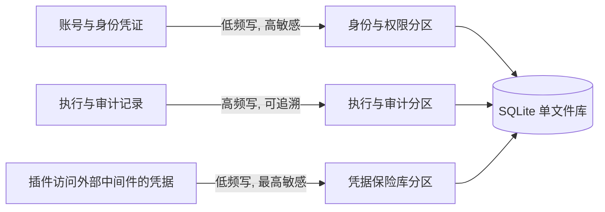
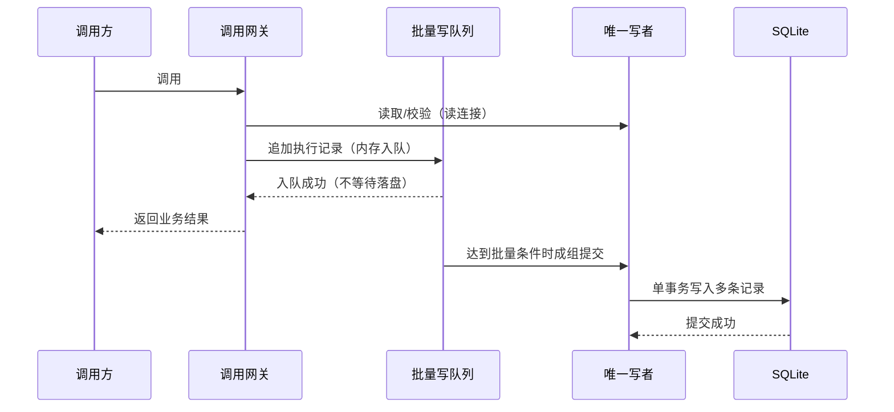
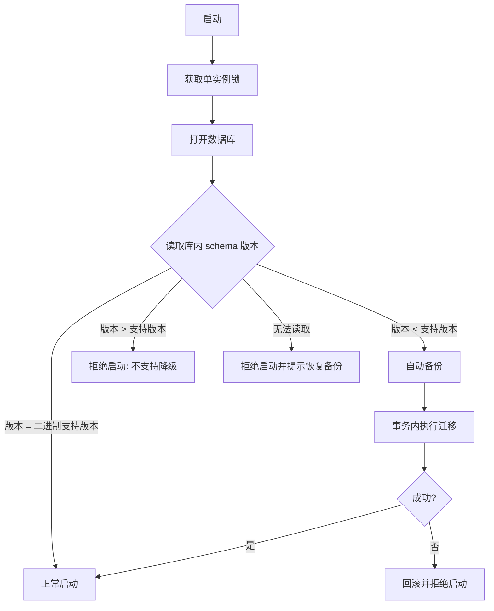

# DOC-08 存储与数据目录规格

> 状态：`draft`（存储引擎、部署形态、数据目录来源、凭据加密已定稿；默认目录回退与主密钥轮换待确认）
> 读者：底座开发、部署运维 ｜ 上游：[ADR-0007](adr/0007-persistence.md)、[ADR-0013](adr/0013-plugin-credential-encryption.md)、[06 非功能要求](06-non-functional-requirements.md)
> 下游：[07 开放问题](07-open-questions.md)、`plugin-spec/08-directory-layout.md`

本文定义底座持久化的**存储分区、数据目录、权限、写入策略、备份与迁移规则**。
**不定义表结构、字段、索引与驱动包名**——这些在实现阶段随迁移脚本落地，未确认前不得编造。

## 1. 结论摘要

| 项 | 结论 |
| --- | --- |
| 存储引擎 | 嵌入式 SQLite，纯 Go 驱动、免 cgo（ADR-0007） |
| 部署形态 | **单节点**（OQ-020 已关闭）；多节点高可用为远期 idea（DOC-00 IDEA-7），不进 v1 |
| 物理形态 | 单个库文件 + WAL 附属文件，位于数据目录 |
| 数据目录来源 | **由配置文件指定**，路径可配置；必须是绝对路径且位于本地文件系统 |
| 默认目录回退 | 配置文件未指定时的回退位置**待确认（OQ-022）**；不得硬编码默认路径 |
| 写入模型 | 单写者（仅宿主进程），批量写队列 + 短事务 |
| 插件数据 | 每插件独立目录，插件**不得**直连数据库 |
| 凭据加密 | 插件外部凭据用 **AES-256-GCM** 加密存库，主密钥不入库（ADR-0013）；只在防「库文件被单独拷走」的范围内有效 |
| 文件系统 | 仅本地文件系统，禁止网络文件系统（§5） |
| 备份 | 在线备份接口 / checkpoint 一致性快照，禁止运行中复制文件（§7） |
| schema 演进 | 只升不降，升级前自动备份（§8） |

## 2. 三类数据及其处理差异

用户已确认底座的持久化需求来自三类数据。它们的**敏感级别、写入频率、保留要求不同**，必须分别对待。



| 类别 | 典型内容 | 处理方式差异 | 强制要求 |
| --- | --- | --- | --- |
| A. 账号与身份凭证 | 平台登录账号、口令派生值、角色与授权关系、会话状态 | 读多写少；认证路径上必须低延迟 | 口令**只存不可逆派生值**（加盐）；任何接口不得返回口令或派生值；认证失败必须留审计；算法与参数待定（OQ-037） |
| B. 执行与审计记录 | 调用记录、生命周期事件、授权判定结果、错误事实 | 写多读多、只追加；量大；需要按时间/主体/插件过滤 | 走**批量写队列**（§6）；插件不可修改；写入失败必须可被发现，不得静默丢弃；保留期与归档待定（OQ-016） |
| C. 插件访问外部中间件的凭据 | 插件调用数据库/消息队列/API 所需账号、密钥、令牌 | 写少读少；调用时按需解密；绝不回显 | 必须**加密存储**：AES-256-GCM 密文存库，主密钥来自环境变量（优先）或配置文件独立字段，密钥不落库、不写日志（[ADR-0013](adr/0013-plugin-credential-encryption.md)）；只在调用时按最小权限解密使用；不得进入日志、审计、错误详情；不得提供明文导出接口；主密钥轮换与丢失处置待定（OQ-023） |

**C 类加密的防护边界（必须如实对外表述）**：

- **能防**：数据库文件或备份被单独拷走（离线拷贝、误提交、临时目录残留）时，没有主密钥就无法解出凭据。
- **防不住**：主机被完全控制。攻击者能读取进程内存与环境变量，即可取得主密钥并解密全部凭据。
- 因此这是**静态数据保护**，不是**运行期隔离**；文档与 UI 中不得表述为「主机被攻破时凭据仍安全」。
- 代价：主密钥丢失等于已存凭据**不可恢复**；缺少主密钥时涉及凭据的功能必须显式失败，不得降级为明文。

**共同底线**：

- 三类数据都**不向插件直接开放**。插件只能通过能力调用间接获取其被授权的最小信息。
- 凭据类数据（A、C）不得出现在日志、审计详情、备份文件名中。
- 任何一类数据的读写都不得绕过宿主进程。

## 3. 逻辑分区

物理上是一个库文件；逻辑上按职责分区，避免不同生命周期与敏感级别的数据混在一起。

| 分区 | 职责 | 生命周期特征 |
| --- | --- | --- |
| 元数据/注册表区 | 插件身份、版本、形态、状态、能力摘要 | 随插件安装/卸载变化，量小 |
| 身份与权限区 | 账号、角色、授权关系、会话 | 低频变更 |
| 执行与审计区 | 调用记录、审计事件、健康状态翻转 | 持续追加、量最大 |
| 凭据保险库区 | 插件访问外部系统所需的凭据（密文） | 低频变更；轮换与丢失处置待定（OQ-023） |

约束：

- 分区只是逻辑划分，**不要求**物理分库；是否分表、如何建索引在实现阶段决定。
- 跨分区事务应尽量避免；若必须，事务必须短小。
- 删除/归档某一分区的数据不得破坏其他分区的引用完整性。

## 4. 数据目录布局

**根目录由配置文件指定，路径可配置**（ADR-0009「已确认部分」）。以下为根目录之下的**规范布局**：

强制规则：

| 编号 | 规则 |
| --- | --- |
| ST-D-01 | 数据目录路径必须由配置文件给出；路径必须为**绝对路径**，相对路径一律拒绝启动 |
| ST-D-02 | 数据目录必须位于**本地文件系统**；指向网络文件系统时按配置非法处理（§5） |
| ST-D-03 | 配置文件未指定数据目录时的默认回退位置**待确认（OQ-022）**；确认前不得硬编码任何默认路径 |
| ST-D-04 | 启动时必须校验目录存在性与可写性；不存在时的创建策略随默认回退结论一并确定（OQ-022） |

```text
<data-dir>/
├── db/
│   ├── <database-file>      # 主库文件（M0 基线：platform.db，待 OQ-036 确认）
│   ├── <database-file>-wal  # WAL（运行时存在）
│   └── <database-file>-shm  # 共享内存索引（运行时存在）
├── backups/                 # 在线备份产物，按时间命名
├── plugins/                 # 已安装插件包（只读挂载/只读访问）
│   └── <plugin-id>/<version>/
├── plugin-data/             # 插件私有数据（每个插件一个子目录）
│   └── <plugin-id>/
├── run/                     # 运行期文件（重启可重建，不含持久数据）
│   └── plugins/<plugin-id>/ # 常驻插件 UDS socket 与一次性凭据文件
├── tmp/                     # 调用期临时文件，需可清理
└── .lock                    # 单实例锁（防止多个底座共用同一数据目录）
```

| 子目录 | 职责 | 访问规则 |
| --- | --- | --- |
| `db/` | 库文件与 WAL | 仅宿主进程可读写；插件不可读 |
| `backups/` | 备份文件与校验结果 | 仅宿主与运维账号可读；插件不可读 |
| `plugins/` | 插件包存放 | 底座安装/升级时写；运行时只读；插件只读自身包 |
| `plugin-data/` | 插件私有数据 | 每个插件仅访问自己的子目录；禁止跨插件访问 |
| `run/plugins/<plugin-id>/` | 常驻插件运行期文件：UDS socket 与一次性凭据文件 | 宿主创建；socket `0600`、目录 `0700`；凭据文件读后即删；**不属于持久数据**，启动时清理残留 |
| `tmp/` | 调用临时文件 | 调用结束清理；不得作为持久存储 |
| `.lock` | 单实例互斥 | 启动时获取，退出释放 |

补充规则：

- 配置文件所在目录与数据目录**分离**（配置格式与路径见 ADR-0009）；含敏感引用的配置文件不得放在插件可读目录。
- 日志默认输出到 stdout/stderr，**不默认**在数据目录内建日志目录（是否支持文件输出待定，OQ-016）。
- 目录名称属于规范；实际实现如需调整必须同步修改本文档。
- 远端实例的探测与拨号状态属于**非持久数据**，可重建；具体存放位置由实现决定，不得与插件包或插件私有数据混放，且不得写入证书材料（证书在目标机）。
- 注册与配置的**逻辑实体**（主机、插件类型、能力、实例、实例配置、探测记录、执行记录、证书绑定）见 [DOC-17](17-plugin-registry-and-configuration.md) §6；本文只约束物理布局与权限，不固定表名与字段。

### 4.1 目录与文件权限要求

| 编号 | 要求 |
| --- | --- |
| ST-P-01 | 数据目录、`db/`、`backups/` 必须仅对服务运行账号可访问；POSIX 系统上不得对 others 开放任何权限，Windows 上必须用 ACL 限定为服务账号与其所属组 |
| ST-P-02 | 库文件、WAL/SHM、备份文件、含敏感引用的配置文件必须仅对服务账号可读写；不得对其他用户可读 |
| ST-P-03 | `plugin-data/<plugin-id>/` 由宿主创建并归属服务账号；插件进程只获得自身子目录的访问权，不得通过共享账号绕过 |
| ST-P-04 | 权限不足或权限过宽（例如库文件对其他用户可读）时，启动必须告警；对敏感文件权限过宽应视为配置错误（是否拒绝启动待定） |
| ST-P-05 | 具体权限位数值与 umask 策略在实现阶段确定，但不得低于本节要求 |
| ST-P-06 | `run/plugins/<plugin-id>/` 目录权限 `0700`、UDS socket 权限 `0600`；socket 路径长度受限（具体上限见 [ADR-0018](adr/0018-daemon-process-custody-and-injection.md)），超限时按配置错误拒绝启动，**不得回退到 `/tmp`** |
| ST-P-07 | 一次性凭据文件仅宿主可读可写，插件读取后立即删除；凭据不得写入日志、审计或备份 |

## 5. 文件系统硬约束

**数据目录必须位于本地文件系统。**

禁止：

- NFS、CIFS/SMB、AFS 等网络文件系统；
- 云盘同步目录（Dropbox/OneDrive 类）与 FUSE 挂载的同步盘；
- 跨主机共享的块设备或共享卷；
- 将数据库放在 tmpfs/内存盘上作为生产存储。

原因：

1. SQLite 依赖**可靠的文件锁与共享内存语义**，网络文件系统常不保证一致性，可能导致库损坏。
2. WAL 模式需要 mmap 共享内存（`-shm`），跨主机或同步盘上行为不可预期。
3. 网络延迟会放大写事务耗时，引发锁等待与超时。
4. 同步盘的「文件级快照」可能捕获不一致状态，备份不可用。

补充：

- 容器部署时，数据卷必须由本地块存储支撑；绑定挂载到网络存储同样禁止。
- 只读挂载插件目录是允许的；`plugin-data/` 必须可写。
- 是否允许 `plugin-data/` 单独挂载到其他本地磁盘：允许，但必须保持本地文件系统语义与权限要求。

## 6. 单写者模型与写入策略

### 6.1 模型

- **只有一个写者**：宿主进程。插件、外部客户端、运维脚本都不得直接写库。
- 读可以由多个读连接承担（WAL 允许读写并行），但读也不向插件开放。
- 单实例约束：同一数据目录只允许一个底座进程（`.lock` 保证）。

### 6.2 写入路径



### 6.3 强制规则

| 编号 | 规则 |
| --- | --- |
| ST-W-01 | 执行与审计记录**禁止**在调用路径上直接抢写锁；必须经批量写队列 |
| ST-W-02 | 队列必须有界；满时先短暂阻塞，仍无法入队则返回明确错误并告警，**禁止静默丢弃** |
| ST-W-03 | 批量条件（条数/时间窗口）可配置，默认值待定（OQ-017） |
| ST-W-04 | 生命周期操作（安装/启用/升级/卸载）使用独立的高优先级写入通道，不得被业务记录挤占 |
| ST-W-05 | 事务必须短小；禁止在事务内做网络调用、插件调用或大文件 IO |
| ST-W-06 | 关闭时必须尝试 flush 队列；超时未完成必须告警，并记录未落盘条数（不静默） |
| ST-W-07 | 写锁等待超时必须可配置；超时后按错误处理，不得无限自旋（取值待定，OQ-017） |
| ST-W-08 | WAL checkpoint 采用「周期性 + 体积阈值」触发（数值待定，OQ-017），避免 WAL 无限增长 |

### 6.4 一致性取舍

- 业务结果可以在执行记录落盘前返回（降低调用延迟），但这意味着**极端断电时可能丢失最近若干条记录**。
- 若某类记录要求「不丢」，必须在写入前同步落盘，并在能力/操作声明中标注（哪些操作要求强持久化待定）。
- 凭据写入（A、C 类）不适用异步队列，必须同步提交成功后才对外生效。

## 7. 备份与恢复

### 7.1 允许的备份方式

| 方式 | 说明 | 要求 |
| --- | --- | --- |
| 在线备份接口（首选） | 使用数据库提供的在线备份能力生成一致性快照 | 备份期间业务可继续；备份产物必须可独立打开 |
| checkpoint + 一致性快照 | 先完成 checkpoint，再在可控窗口内生成快照 | 必须保证快照期间无写入；窗口与实现方式待定 |

**禁止**：运行中直接复制 `db/` 下的库文件与 WAL/SHM 文件，或在业务写入过程中对数据目录做文件级拷贝。

### 7.2 备份要求

| 编号 | 要求 |
| --- | --- |
| ST-B-01 | 备份产物落在 `backups/`，文件名包含时间与 schema 版本（命名规则实现时确认） |
| ST-B-02 | 备份完成后必须做完整性校验；校验失败必须告警并标记该备份不可用 |
| ST-B-03 | 备份频率、保留份数、RPO/RTO：待定（OQ-017） |
| ST-B-04 | 备份文件按敏感数据处理（权限见 §4），不得包含明文凭据于文件名或元信息 |

### 7.3 恢复演练

- 必须支持把备份恢复到**临时目录**并以只读方式打开验证，不影响生产实例。
- 演练至少验证：库可打开、完整性校验通过、schema 版本符合预期、注册表条目数与最近审计时间符合预期。
- 演练频率与演练结果留存方式：待定（OQ-017）。
- 恢复操作本身必须产生审计事件（恢复来源、时间、执行人）。

## 8. schema 迁移与版本规则



| 编号 | 规则 |
| --- | --- |
| ST-M-01 | 迁移只升不降：库 schema 版本高于二进制支持版本时，**拒绝启动**，不得尝试兼容读取 |
| ST-M-02 | 迁移前必须自动生成一次备份；备份失败则中止迁移 |
| ST-M-03 | 迁移在事务内执行；失败必须回滚，且不得留下部分迁移状态 |
| ST-M-04 | 迁移必须记录版本与执行结果；重复启动不得重复执行同一迁移 |
| ST-M-05 | 破坏性迁移（删列、改语义、清数据）必须先有 ADR 与迁移说明，不得在补丁版本静默执行 |
| ST-M-06 | 迁移期间不得启动插件、不得接收业务调用 |
| ST-M-07 | 降级只能通过「停服 → 恢复旧版本备份 → 启动旧二进制」完成，属于运维流程，不提供自动降级 |

## 9. 容量、保留与清理

| 主题 | 规则 | 状态 |
| --- | --- | --- |
| 库文件增长 | 以执行与审计区为主；需要容量观察手段 | 指标待定（OQ-016） |
| 审计保留期 | 超过保留期的数据归档或清理 | 待定（OQ-016） |
| 备份保留份数 | 超出份数按最旧优先清理 | 待定（OQ-017） |
| `tmp/` 清理 | 启动时清理残留；调用结束清理本次文件 | 已定 |
| `plugin-data/` 卸载处理 | 建议默认保留，需显式清理 | 待定（本文档 §11） |
| 文件空间不足 | 必须在写入前检测并明确报错，不得产生半写 | 已定 |

## 10. 验收标准

1. 数据目录位于网络文件系统时，启动检测应拒绝或明确告警（检测方式待定，但必须有可诊断提示）。
2. 并发调用场景下无 `database is locked` 类失败；执行记录成组落盘。
3. 运行中直接复制库文件被明确禁止（运维文档 + 启动/备份路径不提供该能力）；在线备份产物可独立打开。
4. 用旧二进制打开新 schema 库时拒绝启动，错误信息指出 schema 版本差异。
5. 插件无法读取 `db/`、`backups/`、其他插件的 `plugin-data/`。
6. 迁移失败后重启，库仍处于迁移前版本且可用（依赖自动备份与事务回滚）。
7. 断电模拟后重启，完整性校验通过，无半写记录。

## 11. 待定项与关联决策

| 待定内容 | 归属 |
| --- | --- |
| 配置文件未指定数据目录时的默认回退位置（候选：OS 惯例路径 Linux `/var/lib/`、Windows `C:\ProgramData\`） | OQ-022 |
| 主密钥轮换流程与丢失处置（丢失 = 已存凭据不可恢复） | OQ-023 |
| 主密钥的配置字段名与环境变量名 | ADR-0009 定稿时补（OQ-008） |
| 用户口令派生算法与参数 | OQ-037 |
| 审计保留期、归档方式、可观测指标 | OQ-016 |
| 批量阈值、队列容量、锁等待超时、checkpoint 阈值、备份频率与保留份数、RPO/RTO、演练频率 | OQ-017 |
| 卸载插件是否删除 `plugin-data/`（建议保留） | 本文档 §11，待用户确认 |
| 在线备份的具体调用方式与快照窗口实现 | 实现阶段确认，需满足 §7.1 |
| 网络文件系统的检测方式，以及检测到后是拒绝启动还是告警 | 实现阶段确认，需满足 §5、§10 |
| 「要求强持久化」的操作集合 | 实现阶段随能力清单确认（§6.4） |
| 敏感文件权限过宽时是否拒绝启动 | 实现阶段确认（§4.1 ST-P-04） |
| 纯 Go SQLite 驱动的具体包名与版本 | **M0 已选**：`modernc.org/sqlite v1.62.0`（纯 Go、免 cgo）；包名与版本仍待 OQ-036 确认 |
| 远端实例探测/执行记录的保留窗口与清理策略 | OQ-049 |
| 证书绑定信息的保留与吊销名单清理 | OQ-047 |
| 撤销后实例配置与插件数据的保留期 | OQ-051 |

已关闭项（不再作为待定）：存储引擎选型（ADR-0007）、部署形态单节点（OQ-020）、凭据加密基础方案（OQ-021 / ADR-0013）。多节点高可用为远期 idea（DOC-00 IDEA-7）。

## 12. 与其他文档的关系

- 引擎选型与理由：[ADR-0007](adr/0007-persistence.md)（accepted）
- 插件外部凭据的静态加密：[ADR-0013](adr/0013-plugin-credential-encryption.md)（accepted）
- 常驻插件运行期目录（socket 与一次性凭据文件）：[ADR-0018](adr/0018-daemon-process-custody-and-injection.md)（accepted）
- 远端证书材料位置与权限（在目标机，不在本数据目录）：[ADR-0022](adr/0022-remote-plugin-pki-and-mtls-certificates.md)（accepted）
- 注册与配置的逻辑实体：[DOC-17](17-plugin-registry-and-configuration.md) §6
- 数据目录路径来源与默认回退：[ADR-0009](adr/0009-configuration-model.md)（proposed，其中数据目录来源已确认）
- 非功能要求（本地 FS、备份、迁移）：[DOC-06](06-non-functional-requirements.md) §2、§7
- 插件数据目录（EP-04）与插件侧目录约定：[DOC-05](05-extension-points-and-compatibility.md)、`plugin-spec/08-directory-layout.md`
- 生命周期的卸载与审计要求：[DOC-04](04-plugin-lifecycle.md) §3.6、§7
- 未决事项登记：[DOC-07](07-open-questions.md)
