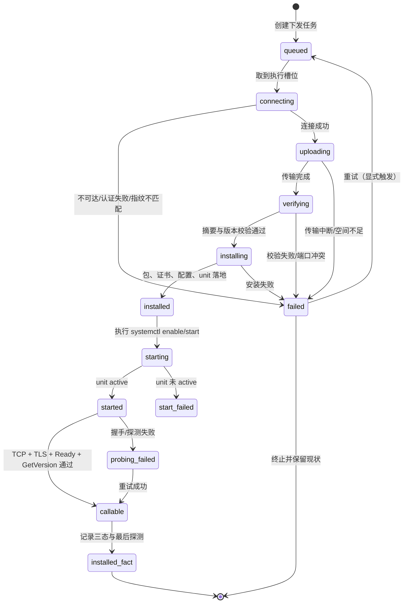

# DOC-09 主机管理与插件下发规格

> 状态：`draft` ｜ 读者：底座开发、部署运维、评审 ｜ 上游：[02 能力](02-foundation-capabilities.md) CAP-13、[ADR-0014](adr/0014-ssh-transport-and-host-credentials.md)、[ADR-0013](adr/0013-plugin-credential-encryption.md)、[ADR-0018](adr/0018-daemon-process-custody-and-injection.md)、[ADR-0022](adr/0022-remote-plugin-pki-and-mtls-certificates.md)、[08 存储](08-storage-and-data-directory.md)
> 下游：[03 插件模型](03-plugin-model.md)、[04 生命周期](04-plugin-lifecycle.md)、[07 开放问题](07-open-questions.md)、[17 注册与配置](17-plugin-registry-and-configuration.md)、`plugin-spec/08-directory-layout.md`

本文定义**主机清单维护、连接认证、连通性测试、插件包下发与安装**的规格。
**不定义表结构、字段名、SSH 端口、远端路径与具体命令**——这些在实现阶段确认，未定处标「待定」并引用开放问题编号。

## 1. 范围与边界

| 包含 | 不包含 |
| --- | --- |
| 主机清单的增删改查、分组/标签、启停用 | 主机资产发现、CMDB 全量建模 |
| SSH 密钥与账号密码两种认证配置 | 主机内部的进程级监控与采集 |
| 连通性测试与凭据可用性校验 | 目标机上的容器编排、系统初始化 |
| 插件包、证书、CA 证书、按主机配置与 systemd unit 的下发安装 | **业务能力调用传输**（由 EP-02 的 TCP+mTLS 承担，见 §6.4） |
| 安装后启动服务、三态状态回报、撤销下发、失败与回滚、审计 | 通用的远程命令执行入口（不提供给插件或用户当跳板） |

**边界原则**：本能力负责「插件在目标主机上被正确安装并启动」，**不承载业务调用**。
调用走 EP-02 的 TCP + mTLS（[ADR-0005](adr/0005-daemon-rpc-transport.md)、[ADR-0022](adr/0022-remote-plugin-pki-and-mtls-certificates.md)）；
SSH 凭据只用于下发安装、启停与探测，**不得**复用为调用传输。
UI 与接口必须分别展示「已安装 / 已启动 / 可调用」三个独立状态。

> **已按用户决策修订**：初版边界写为「不含插件在目标机上的运行与调用（依赖 OQ-027、OQ-010）」。
> 用户否决 SSH 隧道与节点代理后，选定「远端常驻插件直接监听 TCP + 双向 TLS、目标机 systemd 托管」，
> OQ-010 与 OQ-027 已关闭（[ADR-0018](adr/0018-daemon-process-custody-and-injection.md)）。

## 2. 主机记录的组成（信息分组）

字段名与存储结构**待定**（随实现与配置项清单落地）；以下信息组必须齐全：

| 信息组 | 内容 | 说明 |
| --- | --- | --- |
| 身份与标识 | 主机显示名、唯一标识、可选备注 | 唯一标识规则待定（建议与连接地址解耦） |
| 连接信息 | 地址、端口、登录用户名 | 端口与地址形式待定，禁止在文档中预写默认端口 |
| 认证方式 | 二选一：SSH 密钥 / 账号密码 | 见 §3 |
| 凭据引用 | 指向加密凭据的引用，而非明文 | 凭据本体不随主机记录明文返回（§4） |
| 分组与标签 | 主机分组/标签，用于授权范围与批量操作 | 分组模型待定（OQ-028） |
| 主机身份校验 | 目标机公钥指纹及其信任状态 | 首次信任策略待定（OQ-025） |
| 运行状态 | 最近一次连通性结果与时间 | 只反映探测事实，不代表插件运行状态 |
| 审计信息 | 创建人、变更人、变更时间 | 所有变更产生审计事件 |

要求：

- 一条主机记录只能绑定一种认证方式；切换认证方式视为一次受审计的变更。
- 凭据可用性不以「能保存」为准，必须以连通性测试结果为准。
- 删除主机前必须提示其上的插件下发记录如何处理（待定，见 §12）。

## 3. 两种认证方式的差异与凭据保存规则

| 维度 | SSH 密钥 | 账号密码 |
| --- | --- | --- |
| 适用场景 | 推荐默认；可免密码扩散 | 存量环境、无法预置密钥的场景 |
| 保存内容 | 私钥（**必须**加密落库）与可选口令短语 | 密码（**必须**加密落库） |
| 回显 | 保存后**不可回显**，只能替换 | 保存后**不可回显**，只能替换 |
| 导出 | **不提供**明文导出接口 | **不提供**明文导出接口 |
| 校验时机 | 保存时可选即时测试；下发前必须测试 | 同左 |
| 轮换 | 以「替换」语义覆盖旧凭据 | 同左 |
| 权限建议 | 优先使用受限账号与专用密钥 | 优先使用专用低权限账号，禁止默认 root |

强制规则：

| 编号 | 规则 |
| --- | --- |
| HOST-A-01 | 凭据一律加密存储，复用 [ADR-0013](adr/0013-plugin-credential-encryption.md) 的算法与密钥来源，不得另立密钥体系 |
| HOST-A-02 | 保存成功后，任何读接口、UI、日志、审计、错误详情都不得返回凭据明文或可逆表示 |
| HOST-A-03 | 不提供「导出凭据」能力；备份中的凭据保持密文（[DOC-08](08-storage-and-data-directory.md) §7） |
| HOST-A-04 | 凭据仅在建立连接前解密，作用域限定当次连接，不得缓存到可被其他请求复用的位置 |
| HOST-A-05 | 认证失败必须返回可区分原因（不可达 / 认证失败 / 主机指纹不匹配），但不得泄露凭据内容 |
| HOST-A-06 | 主密钥缺失时，依赖凭据的操作必须显式失败，不得降级为明文或无认证连接（见 OQ-023） |

## 4. 凭据机密性与防护边界

复用 [ADR-0013](adr/0013-plugin-credential-encryption.md) 的结论：

- **能防**：数据库文件或备份被单独拷走时，没有主密钥无法还原 SSH 私钥或密码。
- **防不住**：主机被完全控制。底座进程内存中存在解密后的凭据，攻击者可取得。
- **额外风险**：底座持有可登录生产机的凭据，本身就是高权限跳板。凭据应最小化（专用低权限账号/受限密钥），授权范围见 §10 与 OQ-028。
- 主密钥丢失等于已存主机凭据不可恢复，需要重新录入（OQ-023）。

## 5. 连通性测试与超时

| 编号 | 要求 |
| --- | --- |
| HOST-C-01 | 必须提供「测试连接」动作，返回成功或可分类的失败原因 |
| HOST-C-02 | 连接、认证、握手各阶段必须有超时；超时值可配置，默认值待定（OQ-029） |
| HOST-C-03 | 测试连接不得下发任何插件、不得执行与测试无关的远端操作 |
| HOST-C-04 | 测试结果必须记录时间与结果，并产生审计事件（失败也记录） |
| HOST-C-05 | 并发测试多台主机时必须限流，避免对目标机与底座造成突发压力（上限待定，OQ-029） |
| HOST-C-06 | 主机指纹与记录不一致时，测试必须失败并进入待确认状态（策略见 OQ-025） |

## 6. 下发安装的流程与状态流转

### 6.1 下发产物（每次下发必须完整）

| 产物 | 说明 | 生成方 |
| --- | --- | --- |
| 插件包 | 包本体 + `plugin.yaml` + 摘要 | 插件发布方 |
| 服务端证书与私钥 | 内置 CA 签发，CN/SAN 绑定插件标识 + 主机标识 + 用途（serverAuth） | 底座（内置 CA） |
| CA 证书 | 供插件校验底座客户端证书 | 底座 |
| 按主机生成的配置文件 | 监听地址与端口、插件标识、实例标识、数据目录、证书路径、配置项值 | 底座 |
| systemd unit | 指向包内入口、传入 `--ops-*` 参数、`Type=simple` + `Restart=on-failure` | 底座 |
| 目录与权限 | 安装目录、数据目录、证书目录、状态目录及各自权限 | 底座（安装步骤） |

- 证书**只在下发安装时签发**，序列号与指纹登记到实例（[ADR-0022](adr/0022-remote-plugin-pki-and-mtls-certificates.md) §3）。
- 端口默认值来自清单 `runtime.listen.port`，可按主机覆盖；**证书不绑定端口**，改端口不重签。
- 配置文件中的配置项值来自实例配置（[DOC-17](17-plugin-registry-and-configuration.md) §7）；敏感项在文件中为明文但文件权限 `0600`，不得写入日志。

### 6.2 流程与状态

流程要求：

| 编号 | 要求 |
| --- | --- |
| DIST-01 | 下发任务必须建模为**可查询的异步任务**，不得长时间阻塞请求 |
| DIST-02 | 每个阶段必须记录开始/结束时间与结果，失败必须定位到阶段 |
| DIST-03 | 传输完成后必须在目标侧校验完整性（摘要或签名，强度见 OQ-026），校验通过才允许安装 |
| DIST-04 | 「已安装」必须以目标机实际落地结果为准，不得由提交动作推定 |
| DIST-05 | **三态独立**：已安装（产物落地并登记）、已启动（unit active）、可调用（探测通过）必须分别记录与展示，不得互相推断 |
| DIST-06 | 下发目标可以是单台主机或主机分组，批量下发必须逐主机记录结果（不允许「整体成功/失败」掩盖个体失败） |
| DIST-07 | 目标机上的安装路径、目录结构与权限**待定**（OQ-041 / `plugin-spec/08`）；证书与配置文件权限按 [ADR-0022](adr/0022-remote-plugin-pki-and-mtls-certificates.md) §6 执行，不得放宽 |
| DIST-08 | 安装完成后必须执行 `systemctl daemon-reload` 与 `enable --now`；启动失败**不得**回滚成「已安装且可调用」 |
| DIST-09 | 业务启用与「已启动」是两个动作：下发安装并启动后，实例仍可能需要显式启用才能接受业务调用（[DOC-04](04-plugin-lifecycle.md) §3.3） |
| DIST-10 | 端口冲突、地址占用、证书写入失败、unit 安装失败都必须作为**可定位阶段**的失败返回，不得静默跳过 |

### 6.3 状态回报

- 状态回报以底座探测为准，**不采信插件自报**（[DOC-17](17-plugin-registry-and-configuration.md) §3）。
- 「已启动」来自 systemd unit 状态；「可调用」来自 TCP 可连 + TLS 双向校验通过 + `Ready` + `GetVersion`。
- 底座记录最后探测时间；超过 TTL 未更新时降为 `unknown`，不得继续展示为可调用（阈值待 OQ-049）。
- 漂移（包被删、版本不符、证书不符、unit 丢失）必须标记并拒绝调用，处理见 [DOC-17](17-plugin-registry-and-configuration.md) §5.3。

### 6.4 与调用传输的边界

- 下载与安装使用 SSH；**调用不使用 SSH**（用户已否决 SSH 隧道）。
- 底座按「主机地址 + 实例生效端口」拨号，使用客户端证书；插件以服务端证书应答（[ADR-0005](adr/0005-daemon-rpc-transport.md) §1.2）。
- 端口可达与防火墙由用户负责；底座只如实记录不可达，不修改防火墙、不做端口映射。

### 6.5 撤销下发

撤销必须按顺序执行，任一步失败都要显式报告并保留可重试状态：

1. `systemctl disable --now <unit>`（停止并取消开机自启）。
2. 删除 unit 文件并 `systemctl daemon-reload`。
3. 删除服务端证书、私钥、CA 证书与按主机配置文件。
4. 由底座吊销该实例证书序列号并登记吊销（[ADR-0022](adr/0022-remote-plugin-pki-and-mtls-certificates.md) §5）。
5. 按保留策略处理插件包与数据目录（策略待 OQ-051）。
6. 实例状态转 `revoked`，保留静态事实与审计，不再提供调用。

**禁止**：只删除包而不停服务；只停服务而不删私钥；在证书仍有效时把实例标记为已撤销。

### 6.6 失败与回滚

- 失败必须回到「下发前状态」或明确标记「需人工介入」，不得留下半装（DIST-F-02）。
- 升级型下发失败时，若 unit 已被替换，必须恢复到上一可用版本并 `daemon-reload`；是否默认自动回滚待 OQ-029。
- 证书写入失败或配置校验失败时，不得启动服务；已启动的旧版本应保持运行。
- 回滚后必须重新探测三态，不得沿用失败前的状态。

## 7. 并发下发与幂等

| 编号 | 要求 |
| --- | --- |
| DIST-C-01 | **同一主机**上的下发任务必须串行，后到任务排队，禁止并发写同一安装目录 |
| DIST-C-02 | **不同主机**可并行，但受全局并发上限约束（默认值待定，OQ-029） |
| DIST-C-03 | 同一主机 + 同一插件 + 同一版本重复下发必须幂等：不产生重复安装、不破坏已有状态 |
| DIST-C-04 | 同一主机 + 同一插件 + 不同版本的并发请求必须串行化，并由版本策略决定覆盖或拒绝（策略待定） |
| DIST-C-05 | 下发任务必须有唯一标识与幂等键，客户端重复提交不得产生重复任务 |
| DIST-C-06 | 服务重启后，未完成任务必须可恢复为「未知/中断」态并允许重试，不得静默丢弃 |

## 8. 失败与回滚

| 编号 | 要求 |
| --- | --- |
| DIST-F-01 | 任一步骤失败即停止后续步骤，不得继续安装 |
| DIST-F-02 | 失败不得留下「半装」状态：要么回到下发前状态，要么明确标记为「需人工介入」 |
| DIST-F-03 | 升级型下发失败时，目标机应保留上一可用版本（是否自动回滚默认开启待定，OQ-029） |
| DIST-F-04 | 回滚动作本身必须可审计，并记录回滚来源版本与目标版本 |
| DIST-F-05 | 不可达、认证失败、指纹不匹配、磁盘不足、校验失败、安装脚本失败必须使用可区分的错误类别 |
| DIST-F-06 | 重试必须有次数上限（默认值待定，OQ-029），超过上限进入终止态并告警 |

## 9. 下发审计要求

以下操作**必须**产生审计事件，且审计不可被插件修改：

- 主机记录的创建、修改、删除、启停用；
- 认证方式的变更与凭据替换（**记录发生了替换，不记录凭据内容**）；
- 连通性测试（成功与失败）；
- 下发任务的创建、开始、各阶段结果、完成、失败、重试、回滚；
- 证书的签发、写入目标机、吊销与重签（**只记录序列号与指纹，绝不记录私钥**）；
- 服务启动、停止、启动失败与三态翻转；
- 撤销下发（含每一步结果）；
- 主机指纹的首次信任与变更确认。

审计事件至少应能回答：谁、何时、对哪些主机、对哪个插件与版本、做了什么、结果如何。具体字段待定（OQ-016）。

## 10. SSH 连接安全基线

| 编号 | 要求 |
| --- | --- |
| SSH-01 | 不允许「无主机身份校验」的连接模式 |
| SSH-02 | 主机指纹首次信任策略待定（OQ-025）；候选：首次信任并记录（TOFU）+ 变更告警；或要求预先录入指纹 |
| SSH-03 | 指纹变更时默认阻断并告警，是否允许人工确认后继续待定 |
| SSH-04 | 必须拒绝已知不安全的算法与过时协议版本；具体算法清单待定，实现前必须形成白名单 |
| SSH-05 | 优先使用密钥认证；禁用或限制不安全的认证组合（具体禁用清单待定） |
| SSH-06 | 连接不得默认使用 root；凭据应绑定最小权限账号（与 OQ-028 一并确认） |
| SSH-07 | 所有连接必须设置超时与取消；禁止无限期挂起 |
| SSH-08 | 底座不得把 SSH 通道暴露为通用「远程执行」能力给插件或外部调用方 |

## 11. 与既有结论的关系（修正说明）

- 此前「远端插件的运行与调用未决策（OQ-010、OQ-027）」的表述**已失效**：两项均已 `decided`。
  现状是「安装、启动（systemd）与调用（TCP+mTLS）三者都在 v1 范围内，但相互独立」。
- 用户明确否决 SSH 隧道与节点代理：**SSH 只用于下发安装、启停与探测**，不得承担调用传输。
- **安装位置层保持放宽**：插件包可经 SSH 下发到目标主机（本文件）。
- 因此任何「插件一定与底座同机」的断言都必须删除或收窄为「默认可同机安装，也可下发到目标主机」。

## 12. 待定项与关联决策

| 待定内容 | 归属 |
| --- | --- |
| 目标主机操作系统范围（是否仅 Linux、是否支持 WinRM）——**远端启动与调用已收窄为 Linux + systemd** | OQ-024（部分收窄） |
| 主机指纹首次信任与变更确认策略 | OQ-025 |
| 下发前签名校验是否强制 | OQ-026 |
| 下发与远端托管协同方式——**已定**：systemd 托管，底座下发 unit 并启停（不再待定） | OQ-027（decided） |
| 主机分组与授权模型（含二次确认） | OQ-028 |
| 下发并发上限、连接/传输超时、重试次数、回滚默认策略 | OQ-029（跨主机调用相关项已随 OQ-010 关闭） |
| 证书算法/有效期/轮换周期/CA 私钥保护与备份 | OQ-047 |
| systemd unit 细节、启动停止与探测超时、端口默认值与范围 | OQ-048 |
| 探测间隔、状态过期 TTL、降级阈值、探测记录保留 | OQ-049 |
| 撤销后配置/数据保留期与升级配置迁移 | OQ-051 |
| 主机记录字段名与存储结构 | 实现阶段（随配置项与迁移脚本） |
| SSH 端口、远端安装路径、执行命令 | 实现阶段确认；路径与权限不得低于 ADR-0022 §6 |
| 删除主机时下发记录与目标机残留的处理 | 实现阶段确认（须先撤销下发，见 §6.5） |
| 审计事件字段 | OQ-016 |

## 13. 与其他文档的关系

- 能力定义：[DOC-02](02-foundation-capabilities.md) CAP-13
- 决策与授权边界：[ADR-0014](adr/0014-ssh-transport-and-host-credentials.md)
- 凭据加密基线：[ADR-0013](adr/0013-plugin-credential-encryption.md)、[DOC-08](08-storage-and-data-directory.md) §2
- 插件包完整性：[ADR-0008](adr/0008-distribution-signing.md)、OQ-026
- 插件安装语义：[DOC-04](04-plugin-lifecycle.md) §3.3
- 远端托管与证书：[ADR-0018](adr/0018-daemon-process-custody-and-injection.md)、[ADR-0022](adr/0022-remote-plugin-pki-and-mtls-certificates.md)
- 实例、配置与三态：[DOC-17](17-plugin-registry-and-configuration.md)
- 插件侧目录约定：`plugin-spec/08-directory-layout.md`
- 未决事项登记：[DOC-07](07-open-questions.md)
