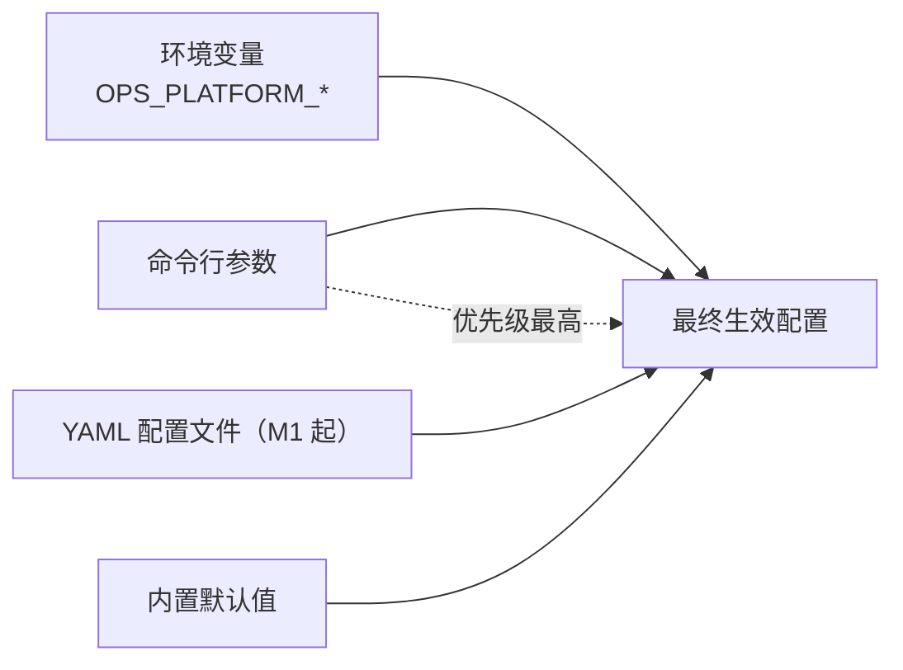
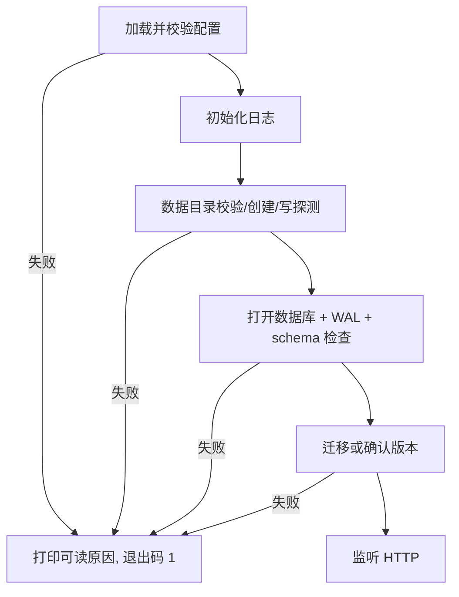

# DOC-11 M0 实现基线（基础设施骨架）

> 状态：`draft`（其中配置键名、环境变量名、HTTP 路径、库文件名与默认值待用户确认，OQ-036）
> 读者：底座开发、部署运维 ｜ 上游：[DOC-06](06-non-functional-requirements.md)、[DOC-08](08-storage-and-data-directory.md)、[ADR-0001](adr/0001-single-binary-embedding.md)、[ADR-0007](adr/0007-persistence.md)、[ADR-0009](adr/0009-configuration-model.md)、[ADR-0012](adr/0012-module-boundaries-and-sdk.md)
> 下游：[DOC-07](07-open-questions.md)、`README.md`、`AGENTS.md`

本文记录 **M0 基础设施骨架**的实际落地基线。它**不是**新的架构决策来源：
凡与 `docs/**` 冲突之处，以用户确认的规格为准；本文只把「规格未定、但 M0 必须选一个可运行值」的项集中登记，
并全部指向 [OQ-036](07-open-questions.md)。

M0 不实现插件运行时、鉴权、主机下发与定时任务；这些能力的对外契约已随 ADR-0003/0004/0005/0006 定稿（OQ-001～OQ-006 已 decided），实现仍受 OQ-017、OQ-037 等未定项约束（跨主机运行与调用已由 OQ-010、OQ-027 的 `decided` 结论解除阻塞）。

## 1. 已实现范围

| 项 | M0 实现 |
| --- | --- |
| 单二进制与模块骨架 | `cmd/` + `internal/` + `web/`，按 ADR-0012 的边界裁剪 |
| 配置加载 | 命令行 > 环境变量 > 配置文件 > 内置默认值；非法配置启动失败。**M1 起配置文件格式由 JSON 改为 YAML**，见 [DOC-12](12-m1-plugin-runtime.md) §2 |
| 数据目录 | 绝对路径校验、规范子目录创建、权限收紧、写探测 |
| 存储 | 纯 Go SQLite、WAL、schema 版本表、迁移框架、迁移前备份、拒绝降级 |
| 内嵌 UI | `prototype/index.html` 同步后经 Go `embed` 打包，服务端静态托管 |
| HTTP | 健康检查、版本信息、请求日志中间件、优雅关闭 |
| 日志与信号 | slog JSON 输出到 stdout；SIGINT/SIGTERM 触发优雅关闭 |
| 构建 | `scripts/build.ps1`、`scripts/build.sh`，强制 `CGO_ENABLED=0` |
| 启动自检 | 配置合法 → 数据目录可写 → schema 可迁移；失败非零退出并给出原因 |

## 2. 未实现范围（明确不在 M0）

- 插件发现、注册、生命周期与执行器（CAP-01、CAP-04）。
- 调用网关与身份授权（CAP-02、CAP-07）。
- 主机清单与 SSH 下发（CAP-13）。
- 定时任务（CAP-14）。
- 批量写队列的真实实现：只有 [internal/store/queue.go](../internal/store/queue.go) 的接口；
  `Enqueue` 返回 `ErrQueueNotImplemented`，禁止静默丢弃（DOC-08 ST-W-02）。
- 单实例 `.lock`：DOC-08 §4 规定的 `.lock` 尚未实现，启动时不做互斥检测。
- 网络文件系统检测：只有 `FilesystemChecker` 接口，默认实现 `NoopFilesystemChecker` 不做检测。
- Windows ACL 细化：仅通过 `os.Chmod` 设置权限，ACL 约束未实现。
- 插件凭据加密、备份保留策略、指标端点、插件 SDK。

## 3. 模块布局

```text
Operations-Platform/
├── cmd/ops-platform/          # 单二进制入口：装配、信号处理、优雅关闭
├── internal/
│   ├── api/                   # HTTP 路由、健康/版本接口、访问日志中间件
│   ├── config/                # 配置加载、优先级合并、校验
│   ├── observability/         # 结构化日志
│   └── store/                 # 数据目录、SQLite、schema 迁移、批写队列接口
├── web/                       # 内嵌资源包（embed）与同步后的 dist/
├── scripts/                   # 构建脚本
├── prototype/                 # 页面事实来源（不在 M0 重写）
├── go.mod
└── docs/ .ai/ plugin-spec/    # 规格与代理上下文
```

与 ADR-0012 的差异：`internal/plugin`、`internal/gateway`、`internal/authz`、`sdk/` 在 M0 中**不创建空目录**，
等对应能力进入实现时再按 ADR-0012 建立，避免留下无实现的占位结构。

## 4. 配置基线

### 4.1 来源与优先级



- 优先级：命令行 > 环境变量 > 配置文件 > 默认值。
- 配置文件位置**没有默认值**，只能由 `-config <path>` 指定；配置文件目录约定仍待 ADR-0009 定稿。
- 配置文件格式：M0 曾采用 **JSON**；**M1 起改为 YAML**（[ADR-0016](adr/0016-yaml-and-json-schema-dependencies.md)、[DOC-12](12-m1-plugin-runtime.md)），不再提供 JSON 兼容模式。
- 未知配置字段直接报错，避免键名拼写错误被静默忽略。
- 环境变量为空字符串时视为未设置，不覆盖文件值。

### 4.2 配置项（待 OQ-036 确认）

| 键名 | 环境变量 | 命令行 | 必填 | 默认值 | 说明 |
| --- | --- | --- | --- | --- | --- |
| `data_dir` | `OPS_PLATFORM_DATA_DIR` | `-data-dir` | 是 | 无 | 数据根目录；必须为绝对路径。未配置时启动失败，不猜默认路径（OQ-022） |
| `listen_addr` | `OPS_PLATFORM_LISTEN_ADDR` | `-listen` | 是 | 无 | HTTP 监听地址，格式 `host:port`；默认监听地址未定（OQ-036） |
| `log_level` | `OPS_PLATFORM_LOG_LEVEL` | `-log-level` | 否 | `info` | `debug` / `info` / `warn` / `error` |
| `shutdown_timeout` | `OPS_PLATFORM_SHUTDOWN_TIMEOUT` | `-shutdown-timeout` | 否 | `10s` | 优雅关闭等待时长；取值待 OQ-036 确认（NFR-RUN-03 只要求可配置） |

配置示例：

```json
{
  "data_dir": "/var/lib/operations-platform",
  "listen_addr": "127.0.0.1:8080",
  "log_level": "info",
  "shutdown_timeout": "10s"
}
```

启动时会以结构化日志打印**最终生效配置**，当前不含密钥类字段，已预留脱敏入口（ADR-0009）。

## 5. 数据目录与权限

启动时按 DOC-08 §4 创建以下目录（已存在则复用）：

```text
<data-dir>/
├── db/
├── backups/
├── plugins/
├── plugin-data/
└── tmp/
```

| 规则 | M0 实现 |
| --- | --- |
| 绝对路径 | 配置层与存储层双重校验，相对路径拒绝启动（ST-D-01） |
| 创建策略 | 目录不存在时创建；M0 选择「自动创建」，该策略待 OQ-022 一并确认（ST-D-04） |
| 目录权限 | 创建与启动时收紧到 `0700`；失败仅告警（ST-P-04 对「是否拒绝启动」未定） |
| 文件权限 | 库文件与备份文件收紧到 `0600`（ST-P-02） |
| WAL/SHM 权限 | Unix 上把进程 umask 收紧到 `0077`，使 SQLite 附属文件继承 0600 |
| 可写性 | 启动时在数据目录做一次临时文件写入探测，失败即中止 |
| 网络文件系统 | 只留 `FilesystemChecker` 接口；M0 默认不检测（DOC-08 §5、§11） |
| Windows ACL | 未实现，属于已知限制 |

## 6. 存储基线

| 项 | 结论 | 依据 |
| --- | --- | --- |
| 驱动 | `modernc.org/sqlite v1.62.0`（纯 Go、免 cgo） | ADR-0007、DOC-08 §11「实现阶段选型」 |
| 库文件 | `<data-dir>/db/platform.db` | DOC-08 §4 文件名待实现确认 |
| 日志模式 | 启动时切换 `journal_mode=WAL`，未成功则拒绝启动 | DOC-08 §5、§7 |
| 连接模型 | 单连接串行化（`MaxOpenConns(1)`） | DOC-08 §6 单写者 |
| 写入入口 | `Store.Write(ctx, fn)` 统一开写事务；禁止调用方自行写库 | DOC-08 §6 |
| schema 版本表 | `schema_version(id, version, updated_at)`，单行 | DOC-08 §8 |
| 当前版本 | `1`（baseline，只含版本表，不编造业务表） | DOC-08 §8 |
| 迁移 | 版本升序、事务内执行、成功后写入版本 | ST-M-03、ST-M-04 |
| 迁移前备份 | 已有库需要迁移时，先 `VACUUM INTO` 生成 `backups/pre-migration-v<from>-to-v<to>-<UTC时间>.db`；失败即中止 | ST-M-02、§7.1 |
| 降级 | 库版本高于二进制支持版本时拒绝启动 | ST-M-01 |
| 版本表缺失 | 非空库没有 `schema_version` 表时拒绝启动，提示恢复备份 | DOC-08 §8 |
| 批写队列 | M0 只有接口；**M1 已实现**（`store.BatchQueue`），见 [DOC-12](12-m1-plugin-runtime.md) §4 | ST-W-01、ST-W-02 |

## 7. HTTP 与内嵌 UI

| 路径 | 方法 | 返回 |
| --- | --- | --- |
| `/healthz` | GET | `{"status":"ok"}`；数据库不可用时 503 `{"status":"unhealthy"}` |
| `/api/version` | GET | `version`、`commit`、`build_time`、`go_version`、`schema_version` |
| `/` 及其它未匹配路径 | GET | 内嵌的 `index.html` 静态资源；未知路径返回 404 |

- 路由路径属于 M0 实现基线，待 OQ-036 确认；v1 仍只服务内嵌 UI（OQ-019）。
- 静态资源由 `web.Dist()` 提供；`web/dist/index.html` 是 `prototype/index.html` 的同步副本，
  构建脚本每次先复制，页面本身不在 M0 重写。
- 请求日志记录方法、路径、状态码、字节数、耗时与来源地址；**不记录查询串**，避免敏感参数落日志。
- `ReadHeaderTimeout` 固定为 5 秒，属于 M0 安全基线（待 OQ-036 确认）。

## 8. 构建与运行

要求 Go **1.26+**（驱动 `modernc.org/sqlite v1.62.0` 的 `go.mod` 要求 `go 1.26.0`）。

```powershell
# Windows
.\scripts\build.ps1
.\bin\operations-platform.exe -data-dir C:\ops-platform-data -listen 127.0.0.1:8080
```

```sh
# Linux / macOS
./scripts/build.sh
./bin/operations-platform -data-dir /var/lib/operations-platform -listen 127.0.0.1:8080
```

跨平台构建（脚本内部强制 `CGO_ENABLED=0`）：

```powershell
.\scripts\build.ps1 -GOOS linux -GOARCH amd64 -Output bin/linux
.\scripts\build.ps1 -GOOS linux -GOARCH arm64 -Output bin/linux-arm64
.\scripts\build.ps1 -GOOS windows -GOARCH amd64 -Output bin/windows
```

```sh
GOOS=linux GOARCH=amd64 OUTPUT=bin/linux ./scripts/build.sh
```

目标平台清单仍待 OQ-014 确认；上表只是可用命令示例，不构成 v1 平台承诺。
直接执行 `go build ./...` 时使用的是已提交的 `web/dist/index.html` 副本；缺少该文件会因 `go:embed` 失败而终止构建（ADR-0001）。

## 9. 启动自检与失败行为



- 所有失败路径都返回非零退出码，错误信息包含具体路径/配置项与对应规格编号。
- 启动阶段只做校验与就绪探测，不执行业务调用（NFR-RUN-04）。
- 收到 SIGINT/SIGTERM 后停止接收新请求，在 `shutdown_timeout` 内等待在途请求；超时则强制关闭并记录错误。

## 10. 依赖清单

| 依赖 | 用途 | 说明 |
| --- | --- | --- |
| `modernc.org/sqlite` | 纯 Go SQLite 驱动 | ADR-0007 指定「纯 Go、免 cgo」；包名与版本属实现阶段选型 |
| 其余传递依赖 | 驱动运行时需要 | 均为纯 Go，不引入 cgo |

除上述依赖外只使用 Go 标准库；M1 另引入 `gopkg.in/yaml.v3` 与 `github.com/santhosh-tekuri/jsonschema/v5`
（[ADR-0016](adr/0016-yaml-and-json-schema-dependencies.md)），M2/M3 计划引入 `golang.org/x/crypto`（[ADR-0017](adr/0017-golang-x-crypto.md)）。
**未引入**前端框架、Node 构建链或 Web 框架。

## 11. 待确认清单（OQ-036）

以下项在 M0 中已选了一个可运行值，需要用户确认或调整：

1. 配置键名、环境变量前缀 `OPS_PLATFORM_`、命令行参数名。
2. 配置文件格式：M0 曾采用 JSON，**M1 已改为 YAML**（OQ-039），本项不再是待确认项。
3. `listen_addr` 是否保持必填、不提供默认值。
4. `shutdown_timeout` 默认 `10s`、HTTP `ReadHeaderTimeout` 默认 5 秒。
5. HTTP 路径 `/healthz`、`/api/version`。
6. 库文件名 `platform.db`、schema 版本表名 `schema_version`。
7. 数据目录不存在时自动创建（与 OQ-022 一并确认）。
8. Go module 路径 `operations-platform`（未来发布 SDK 时需改为可引用路径）。

## 12. 与规格的映射

| 本文内容 | 规格来源 |
| --- | --- |
| 单二进制、embed 内嵌 | [ADR-0001](adr/0001-single-binary-embedding.md)、NFR-PKG-01/02 |
| 配置来源与优先级 | [ADR-0009](adr/0009-configuration-model.md)、NFR-CFG-01～06 |
| 数据目录与权限 | [DOC-08](08-storage-and-data-directory.md) §4、§4.1、§5 |
| SQLite、WAL、单写者 | [ADR-0007](adr/0007-persistence.md)、DOC-08 §6 |
| schema 迁移与备份 | DOC-08 §7、§8 |
| 健康检查与版本 | CAP-11、DOC-02 |
| 日志与信号 | NFR-LOG-01～05、NFR-RUN-01～04 |
| 模块边界 | [ADR-0012](adr/0012-module-boundaries-and-sdk.md) |
