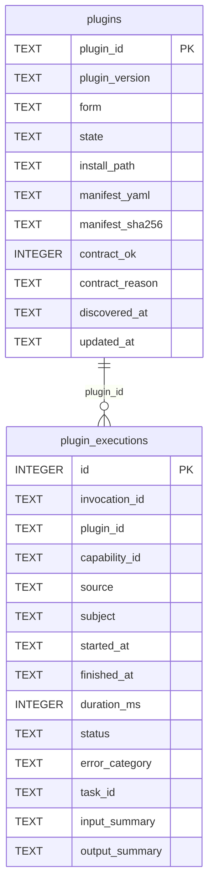
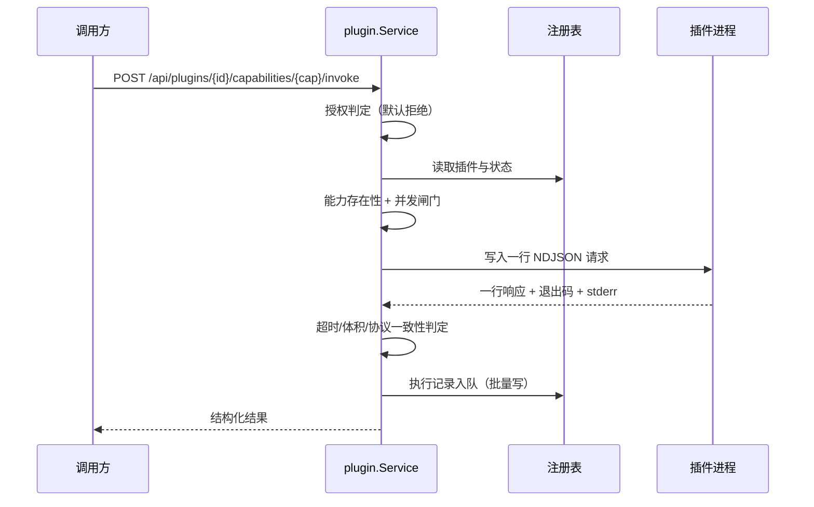

# DOC-12 M1 实现基线（插件运行时最小闭环）

> 状态：`draft`（配置键、默认值、HTTP 路径属于**实现基线，可回改**，登记为 [OQ-039](07-open-questions.md)）
> 读者：底座开发、插件开发、评审 ｜ 上游：[DOC-03](03-plugin-model.md)、[DOC-04](04-plugin-lifecycle.md)、[DOC-05](05-extension-points-and-compatibility.md)、[DOC-08](08-storage-and-data-directory.md)、[ADR-0003](adr/0003-plugin-discovery-registration.md)、[ADR-0004](adr/0004-stdio-wire-protocol.md)、[ADR-0006](adr/0006-plugin-authz.md)、[ADR-0016](adr/0016-yaml-and-json-schema-dependencies.md)
> 下游：[DOC-07](07-open-questions.md)、[DOC-14](14-host-management-m3.md)、[DOC-15](15-m4-scheduled-tasks.md)

本文记录 **M1（可发现、可注册、可调用）** 的实际落地。凡与契约冲突之处以 `plugin-spec/**` 与 `docs/03~05` 为准；
本文只登记「规格未定、但 M1 必须选一个可运行值」的项，全部指向 OQ-039。

## 1. 已实现范围

| 项 | M1 实现 |
| --- | --- |
| 配置格式 | YAML（含插件清单同一依赖），见 [ADR-0016](adr/0016-yaml-and-json-schema-dependencies.md) |
| 清单解析 | 固定 `plugin.yaml`；结构体解析 + Draft-07 JSON Schema + 语义校验 |
| 校验可诊断性 | 每个错误给出字段路径（如 `capabilities[0].id`）与原因；一次返回全部错误 |
| 禁止项 | `dependencies` 与凭据类键（`password`/`secret`/`token`/`credential`/`private_key` 等）递归拒绝 |
| 契约版本 | M1 落地时公布支持的契约集合为 `1.0` 与 `1.1`，安装/启用按插件声明范围与交集判定；M1 代码按 `1.0` 语义实现，`1.1` 增量（新错误类别、`context.credential`、`risk_level`）尚未落地。**现行契约已到 `1.2`**（远端 TCP+mTLS、`runtime.listen.port`、`config[]`），见 [DOC-05](05-extension-points-and-compatibility.md) §3.2.2；M1 实现未覆盖 1.1/1.2 增量，属 R0 偏差 |
| 发现与注册 | 扫描 `<plugin_dir>` 一级子目录；幂等 upsert；清单摘要变化识别为 updated |
| 默认状态 | 安装/发现后 `disabled`，必须显式启用；清单变更不自动启用 |
| 热加载 | `plugin_hot_reload` 默认关闭；开启后按 `plugin_scan_interval` 周期扫描 |
| stdio 调用 | NDJSON 单行请求/响应；stderr 只作日志；进程组终止 |
| 资源上限 | 超时 30s、结果 8 MiB、全局并发 20（均可配置） |
| 错误映射 | 响应 `status`/`error.code` 与退出码 0~8 双向校验，矛盾按 `protocol_invalid` 处理 |
| 执行记录 | 每次调用（含拒绝、失败、超时）写一条；经批量写队列落盘 |
| 授权 | 能力级判定，默认拒绝；M1 使用内置管理员主体，接口为 M2 预留 |
| 对外接口 | 列插件、详情、扫描、启用、停用、调用、执行记录（JSON） |
| 示例插件 | `examples/plugins/demo-echo`（可运行）、`examples/plugins/broken-demo`（反例） |

不在 M1：登录与会话、主机与下发、定时任务、前端页面改造（原型保持原样）。

**M6（常驻插件运行时）尚未实现**：常驻插件的进程托管与监管、`--ops-*` 启动注入、一次性凭据文件、UDS `Invoke` 网关、就绪/健康探测、串行调度与高危确认校验均无代码。契约已定稿，见 [ADR-0018](adr/0018-daemon-process-custody-and-injection.md)~[ADR-0021](adr/0021-capability-execution-and-destructive-confirmation.md)；运行时数值默认值登记 [OQ-044](07-open-questions.md)，工具链版本登记 [OQ-045](07-open-questions.md)。在此之前，常驻插件不得宣告「可调用」。

## 2. 配置键（实现基线，OQ-039）

配置文件为 YAML，未知键启动失败；优先级 命令行 > 环境变量 > 配置文件 > 默认值。

| 键名 | 环境变量 | 默认值 | 说明 |
| --- | --- | --- | --- |
| `data_dir` | `OPS_PLATFORM_DATA_DIR` | 无（必填） | 绝对路径 |
| `listen_addr` | `OPS_PLATFORM_LISTEN_ADDR` | 无（必填） | `host:port` |
| `log_level` | `OPS_PLATFORM_LOG_LEVEL` | `info` | debug/info/warn/error |
| `shutdown_timeout` | `OPS_PLATFORM_SHUTDOWN_TIMEOUT` | `10s` | 优雅关闭 |
| `plugin_dir` | `OPS_PLATFORM_PLUGIN_DIR` | `<data_dir>/plugins` | 必须是 `data_dir` 内路径 |
| `plugin_hot_reload` | `OPS_PLATFORM_PLUGIN_HOT_RELOAD` | `false` | 热加载开关 |
| `plugin_scan_interval` | `OPS_PLATFORM_PLUGIN_SCAN_INTERVAL` | `30s` | 仅热加载开启时生效 |
| `plugin_invoke_timeout` | `OPS_PLATFORM_PLUGIN_INVOKE_TIMEOUT` | `30s` | 单次调用上限 |
| `plugin_max_result_bytes` | `OPS_PLATFORM_PLUGIN_MAX_RESULT_BYTES` | `8388608` | 响应行体积上限 |
| `plugin_max_concurrency` | `OPS_PLATFORM_PLUGIN_MAX_CONCURRENCY` | `20` | 底座侧全局并发上限 |
| `execution_queue_batch` | `OPS_PLATFORM_EXECUTION_QUEUE_BATCH` | `50` | 批量写队列每批条数 |
| `execution_queue_interval` | `OPS_PLATFORM_EXECUTION_QUEUE_INTERVAL` | `200ms` | 批量写队列刷新间隔 |

配置文件示例：

```yaml
data_dir: /var/lib/operations-platform
listen_addr: 127.0.0.1:8080
log_level: info
plugin_hot_reload: false
plugin_invoke_timeout: 30s
plugin_max_result_bytes: 8388608
plugin_max_concurrency: 20
```

## 3. 清单校验

文件固定为插件包根目录 `plugin.yaml`，大小上限 1 MiB。校验顺序（与 [DOC-04](04-plugin-lifecycle.md) §4 一致）：


语义校验项：

| 规则 | 说明 |
| --- | --- |
| 插件标识 | `^[a-z][a-z0-9-]*$` |
| 版本号 | `^[0-9]+\.[0-9]+\.[0-9]+` |
| 契约范围 | 支持 `>=`、`<`、`<=`、`=` 组合，必须包含底座 `1.0` |
| 能力标识 | 必须以 `<插件标识>.` 开头，且同一清单内唯一 |
| schema 引用 | `input_schema_ref` / `output_schema_ref` 必须指向包内存在的文件，拒绝绝对路径与 `..` |
| 入口 | 必须存在于包内；Unix 要求可执行位，Windows 允许 `.exe` 回退 |
| 禁止字段 | `dependencies` 与任何凭据类键（递归扫描，含嵌套 `metadata.*`） |

失败时以 `{"warnings":[...]}` 返回，一条目录一条告警，形如：

```text
插件目录 "broken-demo" 校验失败：identity.id: 必须匹配 ^[a-z][a-z0-9-]*$; version.contract: 声明范围 ">=2.0" 不包含底座支持的契约版本 1.0
```

## 4. 注册表与执行记录（schema v2）



- M5（schema v6）为执行记录补充 `input_summary` / `output_summary`，各截断至 2048 字节，供控制台展开查看；完整输入输出不落库（[DOC-16](16-web-ui-m5.md)、OQ-046）。

- 幂等：同一 `plugin_id` 重复发现时按 `manifest_sha256` 判断，摘要相同不写库；变化时更新版本、清单并保留 `state`。
- 冲突：同一 `plugin_id` 出现在多个目录时保留先发现者，其余计入 `conflicts`。
- 执行记录经 `store.BatchQueue` 批量写入，单批默认 50 条 / 200ms；关闭时排空，落盘失败重试一次。
- `task_id` 在 M1 恒为空，M4 复用该字段记录定时任务来源。

## 5. 调用链路



判定优先级：超时 → 结果超限 → 空输出/多行 → JSON 解析 → `status` → 退出码一致性。
stderr 只写底座日志（截断到 64 KiB 尾部），绝不进入 `output`。

| 情况 | 结果状态 | `error.code` |
| --- | --- | --- |
| 正常 | `ok` | 无 |
| 子进程超时 | `timeout` | `timeout` |
| 响应超限 | `error` | `result_too_large` |
| 响应非 JSON / 多行 / 缺字段 | `error` | `protocol_invalid` |
| `status=error` 且与退出码一致 | `error` | 插件声明类别 |
| `status` 与退出码矛盾 | `error` | `protocol_invalid` |
| 插件未启用 | `error` | `not_ready` |
| 能力未声明 | `error` | `capability_unknown` |
| 授权拒绝 | `error` | `permission_denied` |

## 6. 对外接口（实现基线，OQ-039）

| 路径 | 方法 | 说明 |
| --- | --- | --- |
| `/api/plugins` | GET | 插件列表 + 最近扫描的 `warnings`/`conflicts` |
| `/api/plugins/{id}` | GET | 详情：状态、能力、清单原文、重新校验结果 |
| `/api/plugins/scan` | POST | 触发扫描，返回 `inserted/updated/unchanged/rejected` |
| `/api/plugins/{id}/enable` | POST | 启用（复核清单与契约） |
| `/api/plugins/{id}/disable` | POST | 停用 |
| `/api/plugins/{id}/capabilities/{capability}/invoke` | POST | 调用，body `{"input":{...}}` |
| `/api/executions` | GET | 执行记录，支持 `plugin_id`、`capability_id`、`status`、`source`、`from`、`to`、`limit` |

错误响应统一为 `{"error":{"code","message","details"}}`；`code` 到 HTTP 状态的映射见 §5。
插件业务失败也返回结构化 body（含 `invocation_id`），HTTP 状态按错误类别映射，便于界面直接展示原因。

## 7. 示例插件与验证

```powershell
.\scripts\build.ps1
$data = "$env:TEMP\ops-m1-demo"
New-Item -ItemType Directory -Path "$data\plugins" -Force | Out-Null
Copy-Item -Recurse examples\plugins\demo-echo "$data\plugins"
.\bin\operations-platform.exe -data-dir $data -listen 127.0.0.1:8080
```

```powershell
Invoke-RestMethod http://127.0.0.1:8080/api/plugins
Invoke-RestMethod -Method Post http://127.0.0.1:8080/api/plugins/demo-echo/enable
Invoke-RestMethod -Method Post http://127.0.0.1:8080/api/plugins/demo-echo/capabilities/demo-echo.echo/invoke `
  -ContentType 'application/json' -Body '{"input":{"text":"hello"}}'
Invoke-RestMethod http://127.0.0.1:8080/api/executions?plugin_id=demo-echo
```

预期：列表 `state=disabled`；启用后为 `enabled`；调用返回 `{"echo":"hello"}`；
执行记录包含 `source=api`、`subject=user:admin`、耗时与状态。

`examples/plugins/broken-demo` 只用于验证拒绝路径，预期计入 `rejected` 并在 `warnings` 中列出字段路径。

## 8. 测试覆盖

| 测试 | 文件 |
| --- | --- |
| 清单正反例（标识、能力前缀、禁止字段、schema 引用、路径穿越、入口） | `internal/plugin/manifest/validate_test.go` |
| 契约区间与版本比较 | `internal/plugin/manifest/validate_test.go` |
| NDJSON 解析、超时、体积上限、退出码映射、stderr 隔离 | `internal/plugin/runtime/stdio_test.go` |
| 注册幂等、清单变更识别、契约拒绝 | `internal/plugin/discovery/discovery_test.go` |
| 批量写队列排空与关闭行为 | `internal/store/queue_test.go` |
| YAML 配置优先级与校验 | `internal/config/config_test.go` |

## 9. 与规格的偏差（需确认）

| 偏差 | 原因 | 处理 |
| --- | --- | --- |
| 配置文件由 JSON 改为 YAML | 与插件清单统一依赖，减少一套解析器（[ADR-0016](adr/0016-yaml-and-json-schema-dependencies.md)） | 已登记 OQ-039 |
| `/api/executions` 未分页，默认 100、上限 500 | OQ-038 仍未定，先给安全上限 | 待 OQ-038 |
| HTTP 层固定使用内置管理员主体 | M1 无登录；M2 由会话中间件替换 | 见 DOC-13 |
| 启动扫描失败只告警不阻断 | 规格未定义插件目录不可读时的启动行为 | 待 OQ-039 确认 |
