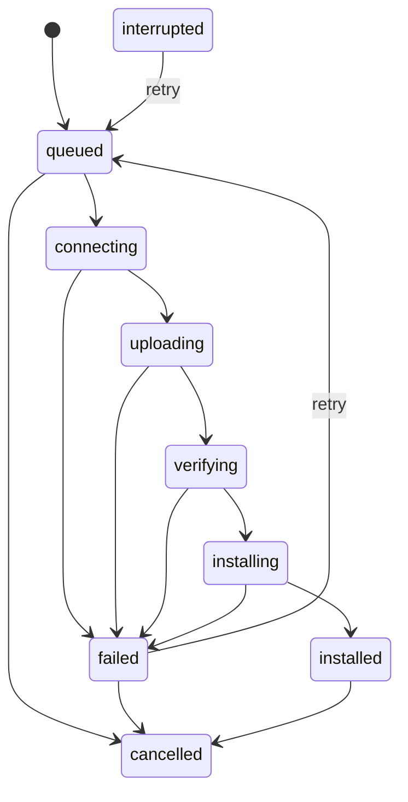

# DOC-14 M3 实现基线（主机与插件下发）

> 状态：`draft`（SSH 库选型、表结构、默认值、HTTP 路径属于**实现基线，可回改**，登记为 [OQ-041](07-open-questions.md)）
> 读者：底座开发、评审 ｜ 上游：[DOC-06](06-non-functional-requirements.md)、[DOC-08](08-storage-and-data-directory.md)、[DOC-09](09-host-management-and-plugin-distribution.md)、[ADR-0013](adr/0013-plugin-credential-encryption.md)、[ADR-0014](adr/0014-ssh-transport-and-host-credentials.md)、[ADR-0017](adr/0017-golang-x-crypto.md)
> 下游：[DOC-07](07-open-questions.md)、[DOC-15](15-m4-scheduled-tasks.md)

本文记录 **M3（主机与下发）** 的实际落地。契约以 DOC-09 与 ADR-0013/0014 为准；
本文只登记「规格未定、但 M3 必须选一个可运行值」的项，全部指向 OQ-041。

## 1. 已实现范围与边界

| 项 | M3 实现 |
| --- | --- |
| 主机记录 | 新增 / 编辑 / 删除 / 列表 / 详情；端口必填无默认值 |
| 连接方式 | SSH 密钥（含口令短语）与账号密码两种 |
| 凭据加密 | AES-256-GCM；密文只存 `host_credentials.ciphertext`，主密钥来自 `credential_key` |
| 主密钥缺失 | 底座仍可启动，但任何凭据读写显式失败（`credential_key_missing`），**不降级为明文** |
| 凭据回显 | 所有读接口只返回 `credential_configured` 布尔值；无导出接口 |
| 指纹策略 | TOFU：首次连接成功后锁存 `SHA256:...`；指纹变更一律阻断，无忽略开关 |
| 连通性测试 | 建立 SSH 后只执行 `uname -s`；非 Linux 报 `unsupported_os`（OQ-024） |
| 下发 | 本地打包 tar.gz → 上传 → 远端 sha256 校验 → 暂存目录解包并复核 `plugin.yaml` 摘要 → 原子替换目标目录 |
| 并发 | 同一主机串行、跨主机并发上限 4（`distribution_max_concurrency`） |
| 幂等 | `(host_id, plugin_id, plugin_version, idempotency_key)` 唯一；重复提交返回既有任务 |
| 状态机 | `queued → connecting → uploading → verifying → installing → installed / failed`；重启把中间态标记为 `interrupted` |
| 撤销 | `queued/failed/interrupted` 直接置 `cancelled`；`installed` 尝试删除目标目录，失败则保留原状态并报错 |
| 边界 | **M3 实际实现**：只在目标机落地安装，不在目标机启动或调用插件；所有下发响应 `callable=false`。**现行规格已扩展**（见 §1.1） |
| 审计 | 创建/编辑/删除主机、测试连接、创建/重试/撤销下发、各阶段状态变更均留痕 |
| 明确不做（M3） | 手工 shell、批量执行、回滚到旧版本、远端启停与调用 |

### 1.1 与现行规格的偏差（R0，待后续里程碑补齐）

用户已定「远端常驻插件由目标机 systemd 托管、调用走 TCP + mTLS」（[ADR-0018](adr/0018-daemon-process-custody-and-injection.md)、[ADR-0022](adr/0022-remote-plugin-pki-and-mtls-certificates.md)），
因此 [DOC-09](09-host-management-and-plugin-distribution.md) §6 的要求已高于 M3 实现。M3 未实现、需在后续里程碑补齐：

| 缺口 | 现行要求 | 归属 |
| --- | --- | --- |
| 证书签发与下发 | 下发产物必须含服务端证书/私钥、CA 证书 | ADR-0022 / OQ-047 |
| 按主机配置文件 | 生成 `listen`/`tls`/`data_dir`/实例标识 | plugin-spec/03 §3.2 |
| systemd unit | 下发 unit 并 `enable --now` | OQ-048 |
| 启动与三态 | 已安装 / 已启动 / 可调用分别记录 | DOC-09 §6.3 |
| 撤销清理 | 停服务、删 unit、删证书、吊销序列号 | DOC-09 §6.5 |
| 端口覆盖 | 按主机覆盖 `runtime.listen.port` 并做冲突校验 | plugin-spec/01 §3.6 |

**在补齐前，M3 的「已安装」不得展示为「可调用」，也不得据此认为远端实例可用。**

## 2. 配置键（实现基线，OQ-041）

| 键 | 默认值 | 说明 |
| --- | --- | --- |
| `credential_key` | 无（必填才能使用凭据功能） | base64 编码的 32 字节；不落库、不写日志 |
| `ssh_connect_timeout` | `10s` | TCP + 握手超时 |
| `ssh_upload_timeout` | `5m` | 单次下发（连接 → 安装）总超时 |
| `distribution_max_concurrency` | `4` | 跨主机并发下发上限 |
| `distribution_remote_root` | `/opt/ops-platform/plugins` | 目标机安装根目录，可配置 |

环境变量前缀仍为 `OPS_PLATFORM_`（如 `OPS_PLATFORM_CREDENTIAL_KEY`）。

## 3. 数据表（v4 迁移，实现基线）

已存在的表结构（M0/M1 迁移文件，M3 直接使用）：

- `hosts(host_id, name, address, port, username, auth_method, host_key_fp, host_key_trusted, status, last_test_at, last_test_error, created_by, created_at, updated_at)`
- `host_credentials(host_id PK, ciphertext BLOB, updated_at)`，外键级联删除
- `distributions(distribution_id, host_id, plugin_id, plugin_version, state, stage, error_category, error_message, remote_path, idempotency_key, created_by, created_at, started_at, finished_at)`，`UNIQUE(host_id, plugin_id, plugin_version, idempotency_key)`

`hosts.status` 取值：`unknown` / `reachable` / `unreachable` / `fingerprint_mismatch`。
下发错误类别：`unreachable`、`auth_failed`、`fingerprint_mismatch`、`unsupported_os`、`timeout`、
`archive_failed`、`upload_failed`、`verify_failed`、`install_failed`、`cancelled`、`interrupted`。

## 4. 下发状态机

- 每个阶段先写库再执行下一步，失败立即落 `failed` 并记录错误类别与原因；**失败绝不会写成 installed**。
- 安装阶段先解包到 `<root>/<plugin>/<version>.tmp-<distID>`，复核 `plugin.yaml` 摘要后再原子替换；
  失败则尽力删除暂存目录。
- 上传阶段写入 `<root>/<plugin>-<version>.tar.gz.tmp`，校验成功后由安装阶段删除。

## 5. 对外接口（实现基线，OQ-041）

| 方法 | 路径 | 说明 |
| --- | --- | --- |
| GET | `/api/hosts` | 主机列表（无凭据） |
| POST | `/api/hosts` | 新增主机，必须携带 `credential` |
| GET | `/api/hosts/{id}` | 主机详情 |
| PUT | `/api/hosts/{id}` | 编辑主机；`credential` 缺省表示保留原凭据 |
| DELETE | `/api/hosts/{id}` | 删除主机；存在下发记录时需 `?force=true` |
| POST | `/api/hosts/{id}/test` | 连通性测试 |
| POST | `/api/hosts/{id}/distributions` | 创建下发，body `{plugin_id, plugin_version?}` |
| GET | `/api/hosts/{id}/distributions` | 该主机的下发记录 |
| GET | `/api/distributions/{id}` | 下发详情 |
| POST | `/api/distributions/{id}/retry` | 重试失败/中断任务 |
| DELETE | `/api/distributions/{id}` | 撤销下发 |

错误响应沿用统一 `{"error":{"code","message","details"}}`；
`credential_key_missing` 返回 500 并给出明确原因，其余错误码映射见 `internal/api/errors.go`。

## 6. 角色权限（沿用 M2 矩阵，OQ-040）

| 动作 | admin | operator | viewer |
| --- | --- | --- | --- |
| `host.read` | ✓ | ✓ | ✓ |
| `host.write` | ✓ | ✓ | ✗ |
| `host.test` | ✓ | ✓ | ✗ |
| `host.distribute` | ✓ | ✓ | ✗ |

## 7. 偏差与说明

| 项 | 处理 | 状态 |
| --- | --- | --- |
| 校验对象 | DOC-09 §7.4 要求解包后校验 `plugin.yaml`；实现改为「先校验归档摘要，再在安装阶段复核 `plugin.yaml`」 | 更严格，登记 OQ-041 |
| 下载式安装 | 未实现目标机主动拉取（架构固定为底座推送） | 保持现状 |
| 指纹手动重置 | 未提供接口；指纹变更只能人工核验后重建主机记录 | 待 OQ-028 决策 |
| 主机授权粒度 | v1 仍为角色级，未做「按主机」授权 | OQ-028 |
| 主机删除 | 下发记录保留，不级联删除 | 便于追溯 |
| 非 Linux | 只报 `unsupported_os`，不做适配 | OQ-024 |

## 8. 单元测试

| 文件 | 覆盖 |
| --- | --- |
| `internal/secret/box_test.go` | 加解密往返、随机 nonce、篡改检测、错误密钥、密钥缺失 |
| `internal/host/store_test.go` | 主机 CRUD、凭据保留/替换、指纹锁存、下发幂等、中断标记、级联删除 |
| `internal/host/distributor_test.go` | 成功状态流转、摘要不一致、上传失败、连接失败、缺少清单 |
