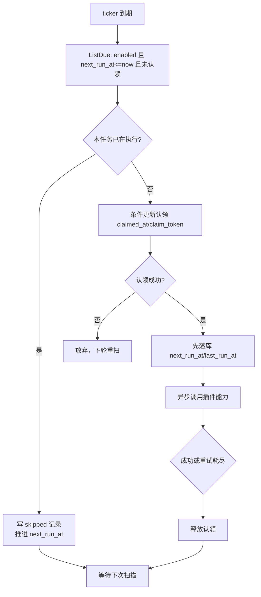

# DOC-15 M4 实现基线（定时任务）

> 状态：`draft`（cron 语义、默认值与 HTTP 路径属于**实现基线，可回改**，登记为 [OQ-042](07-open-questions.md)）
> 读者：底座开发、评审 ｜ 上游：[DOC-10](10-scheduled-tasks.md)、[ADR-0015](adr/0015-scheduler-implementation.md)、[DOC-12](12-m1-plugin-runtime.md)
> 下游：[DOC-07](07-open-questions.md)、[DOC-16](16-web-ui-m5.md)

本文记录 **M4（定时任务）** 的实际落地。语义以 DOC-10 为准；本文只登记
「规格未定、但 M4 必须选一个可运行值」的项，全部指向 OQ-042。

## 1. 已实现范围与边界

| 项 | M4 实现 |
| --- | --- |
| 任务定义 | 名称、说明、插件 + 能力、参数、触发规则（cron / 固定间隔）、时区、超时、重试、重叠策略、状态 |
| 调度 | 进程内 ticker 扫描（`task_scan_interval`）+ 任务持久化 + 条件更新认领 + 启动补写错过记录 |
| 单写者 | `tasks.claimed_at/claim_token` 条件更新（`claimed_at='' AND next_run_at=?`）保证同一计划时点只触发一次 |
| 同一任务并发 | 默认 `overlap_policy=skip`：本次触发跳过并写 `skipped` 执行记录 |
| 错过执行 | 启动时对已过期任务写 `missed` 记录并推进 `next_run_at`，**不补跑** |
| 崩溃恢复 | 启动时把遗留认领写 `interrupted`、清空认领并重算下次触发；无法重算则转 `paused` |
| 插件不可用 | 每次扫描检查插件状态，插件停用/卸载后任务转 `unavailable` 并停止触发；恢复需人工启用 |
| 手动执行 | 与定时执行同一调用路径（`InvokeWithTask`），`source=manual`，同样受「不并发」约束，不改变排期 |
| 执行记录 | 复用 `plugin_executions`（`task_id` 列），区分 `manual` / `scheduled` |
| 边界 | 只调度**本机**插件能力；不做 shell、DAG、分布式调度、跨主机下发（OQ-030） |

## 2. 配置键（实现基线，OQ-042）

| 键 | 默认值 | 说明 |
| --- | --- | --- |
| `task_scan_interval` | `30s` | 到期扫描周期；同时是「错过」判定的实际精度 |
| `task_min_interval` | `1m` | 固定间隔任务的下限，低于此值拒绝保存 |
| `task_default_timeout` | `5m` | 单次执行默认超时（任务可覆盖） |
| `task_default_retries` | `1` | 失败重试次数默认值（任务可覆盖，范围 0~10） |

环境变量前缀为 `OPS_PLATFORM_`（如 `OPS_PLATFORM_TASK_MIN_INTERVAL`）。

## 3. 数据表（v5 迁移，实现基线）

- `tasks(task_id, name UNIQUE, description, plugin_id, capability_id, input_json,
  trigger_type, cron_expr, interval_seconds, timezone, timeout_seconds, retries,
  overlap_policy, state, next_run_at, last_run_at, claimed_at, claim_token,
  created_by, created_at, updated_at)`
- `plugin_executions` 增加 `task_id TEXT NOT NULL DEFAULT ''` 与索引
  `idx_plugin_executions_task(task_id, started_at DESC)`；定时任务的执行记录据此可查。

`tasks.state` 取值：`enabled` / `paused` / `unavailable`。新建任务默认 `paused`（与插件安装后默认禁用一致）。

## 4. 触发语义

| 项 | M4 取值 |
| --- | --- |
| cron 字段 | 5 段（分 时 日 月 周），**最小粒度到分钟**，不支持秒 |
| cron 语法 | `*`、`n`、`a-b`、`*/n`、列表 `a,b,c`；周字段 `7` 归一为 `0`；日与周同时受限时取 OR |
| 固定间隔 | `interval_seconds >= task_min_interval` |
| 时区 | 必须显式给出 IANA 时区（如 `Asia/Shanghai`）；下次触发按任务时区计算 |
| 永不触发 | 解析或下次触发计算失败时拒绝保存 / 转 `unavailable`，不静默不执行 |
| 修改触发规则 | 立即重算 `next_run_at`；已认领未完成的执行不回滚 |

## 5. 调度流程



- **先认领后执行**：认领是单条 SQL 条件更新，避免同一时点重复触发。
- 执行异步化：单个任务阻塞不影响其他任务；关闭时 `Stop` 有界等待在途执行。
- 重试：`retries + 1` 次，当前实现为立即重试，未做退避（OQ-042）。

## 6. 对外接口（实现基线，OQ-042）

| 方法 | 路径 | 说明 |
| --- | --- | --- |
| GET | `/api/tasks` | 任务列表，附 `missed_count`（近 7 天） |
| POST | `/api/tasks` | 新建任务；默认 `paused` |
| GET | `/api/tasks/{id}` | 任务详情 |
| PUT | `/api/tasks/{id}` | 编辑任务定义 |
| DELETE | `/api/tasks/{id}` | 删除任务；执行记录保留 |
| POST | `/api/tasks/{id}/enable` | 启用并计算下次触发时间 |
| POST | `/api/tasks/{id}/pause` | 暂停并清空排期 |
| POST | `/api/tasks/{id}/run` | 手动立即执行（不改变排期） |
| GET | `/api/tasks/{id}/executions` | 该任务执行历史（最近 100 条） |

错误响应沿用统一 `{"error":{"code","message","details"}}`；调度错误码为
`input_invalid` / `permission_denied` / `not_found` / `conflict` / `dependency_unavailable`。

## 7. 角色权限（沿用 M2 矩阵，OQ-040）

| 动作 | admin | operator | viewer |
| --- | --- | --- | --- |
| `task.read` | ✓ | ✓ | ✓ |
| `task.write` | ✓ | ✓ | ✗ |
| `task.run` | ✓ | ✓ | ✗ |

定时触发使用内置系统主体 `system:scheduler`（内部具备调用权限），任务本身仍由具备
`task.write` 的人创建；插件调用仍走能力级授权，不因来源为调度器而放宽。

## 8. 偏差与说明

| 项 | 处理 | 状态 |
| --- | --- | --- |
| 连续失败自动暂停 | 未实现（TASK-F-02 未定） | 保持现状 |
| 失败告警通道 | 未实现（OQ-033） | 界面以 `missed_count` 与执行记录提示 |
| 重试退避 | 立即重试，无退避 | 待 OQ-042 确认 |
| 全局并发上限 | 未单独限制，受插件调用并发上限（`plugin_max_concurrency`）约束 | OQ-035 |
| 参数凭据检测 | 递归拒绝 `password` / `token` / `private_key` 等键名 | 比 TASK-P-03「规则待定」更严格，登记 OQ-042 |
| 补跑 | 不补跑，只写 `missed` | 按 DOC-10 候选 A |

## 9. 验证

单元测试（`go test ./internal/scheduler/...`）覆盖：

- cron 正反例（越界、`*/0`、空项）、时区无关的 `Next` 计算；
- 任务参数递归拒绝凭据键、必填项与非法触发规则；
- 默认值（超时 300s、重试 1）与最小间隔；
- 条件更新认领唯一、错过执行只写记录不调用、到期触发与重叠 `skipped`、崩溃认领恢复 `interrupted`。

二进制冒烟（Windows，示例插件 `demo-echo`）：

```powershell
# 启动（配置见 docs/15 §2 的默认值）
.\bin\operations-platform.exe --config .\smoke.yaml
# 登录 → 扫描 → 启用插件 → 新建任务（interval 60s）→ 启用 → 手动执行 → 查历史 → 暂停 → 重启校验任务仍在
```

实测输出摘要：

```text
scan: inserted=0 updated=0 rejected=1
enable: state=enabled
task: state=paused timeout=300 retries=1 overlap=skip
enabled: state=enabled next_run_at=2026-11-16T14:36:32Z
run: status=ok duration_ms=117
task_history: count=1 source=manual status=ok
paused: state=paused next_run_at=
after restart: tasks: count=1 persisted_state=paused
```
