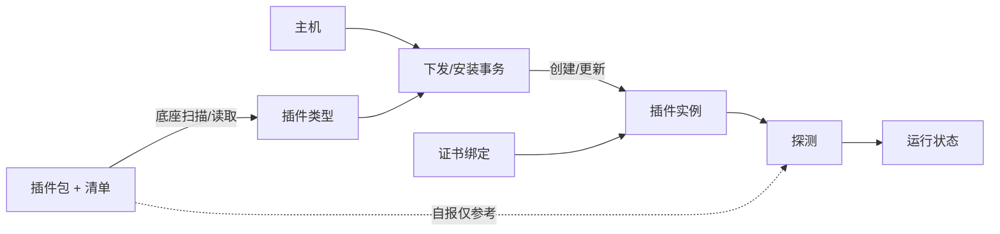
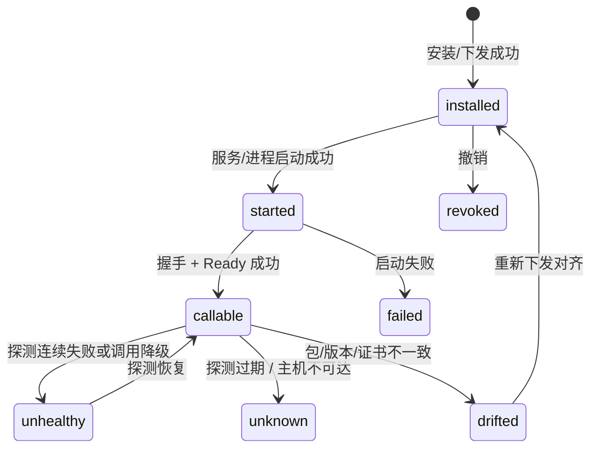

# DOC-17 插件注册、实例与配置模型

> 状态：`draft` ｜ 读者：底座开发、插件开发、评审 ｜ 上游：[DOC-03](03-plugin-model.md)、[DOC-04](04-plugin-lifecycle.md)、[DOC-09](09-host-management-and-plugin-distribution.md)、[DOC-08](08-storage-and-data-directory.md) ｜ 决策：[ADR-0023](adr/0023-plugin-registry-instances-and-configuration.md)、[ADR-0003](adr/0003-plugin-discovery-registration.md)、[ADR-0006](adr/0006-plugin-authz.md)

## 1. 范围与核心结论

本文件回答四个问题：插件如何登记到底座、登记什么、存在哪里、用户如何配置与使用。

核心结论：

1. **插件被底座注册**。事实来源是底座掌握的安装事实（下发/安装记录、包与清单、证书绑定）与可验证探测；插件自报只作参考。
2. **类型与实例分离**。类型描述「能做什么」，实例描述「装在哪台机器、现在能不能用」。
3. **状态分三层**：静态事实（可信、来自清单与安装）、运行状态（探测与调用结果）、自报信息（仅参考）。
4. **配置作用域是实例**。同一类型在不同主机可有不同配置；敏感值加密落库。
5. **调用、任务、批量操作与授权都以实例为目标**；能力按类型聚合展示。

不写具体字段名、SQL 与前端实现；这些属实现基线。

## 2. 术语

| 术语 | 含义 | 不使用的别名 |
| --- | --- | --- |
| 插件类型 / 类型 | 一个插件包代表的能力与清单事实，标识为插件标识 + 版本 | 「插件」（单独使用时歧义） |
| 插件实例 / 实例 | 某台主机上的一次具体安装，拥有独立运行状态与配置 | 「部署」「副本」 |
| 静态事实 | 安装后不随运行变化的事实：版本、能力、权限、配置声明、托管方式、证书绑定 | — |
| 运行状态 | 探测与调用得到的当前可用性：已安装 / 已启动 / 可调用 / 不健康等 | 「健康状态」（过窄） |
| 漂移 | 实机与注册事实不一致 | 「不一致」（太泛） |
| 自报 | 插件进程输出的版本、能力或健康描述 | 「上报」（易与注册混淆） |

## 3. 注册方向与事实来源

| 事实 | 唯一来源 | 说明 |
| --- | --- | --- |
| 主机上装了哪个类型、哪个版本 | 底座安装/下发记录 + 包摘要 | 目标机文件校验用于确认「仍在」 |
| 类型有哪些能力、输入输出结构、风险等级 | 包内清单（Schema 校验通过） | 自报不得增加或修改能力 |
| 实例与主机、证书的绑定 | 安装事务 + 证书序列号 | 证书只证明通道身份 |
| 是否已启动 | systemd 状态（远端）/ 进程与 socket（本机） | 不采信插件自报 |
| 是否可调用 | 探测：地址可达 + TLS 校验 + `Ready` | 自报健康不足以判定 |
| 是否不健康 | 探测连续失败 + 调用失败降级 | 两者都可触发 |

**禁止**：插件通过接口注册自己；插件心跳覆盖能力清单；插件自报健康直接置为可调用；以插件输出的版本号替换包记录。

**理由**：被入侵的主机可以伪造任何自报内容。只有底座持有的包摘要、清单、安装记录与证书绑定不可由被控主机单方面改写。

## 4. 类型与实例

| 维度 | 类型 | 实例 |
| --- | --- | --- |
| 数量 | 一个包一个类型（同标识多版本并存需显式处理） | 每台主机一个活动实例 |
| 能力 | 定义在此 | 仅引用类型 |
| 配置声明 | 定义在此 | 值存在此处 |
| 运行状态 | 无 | 有 |
| 证书 | 无 | 有（序列号/指纹） |
| 删除影响 | 需无实例引用 | 不影响类型本身 |

规则：

- 同一 `(主机, 类型)` 只允许一个活动实例；重复安装按升级或幂等重装处理。
- 调用必须给实例；只给类型时拒绝，批量操作按选中的实例集合展开并固化。
- 本地插件也必须有实例；不得存在「无实例但可调用」的插件。
- 目录扫描只产生类型候选；不自动创建实例、不自动启用。

### 4.1 与目录扫描的关系

[ADR-0003](adr/0003-plugin-discovery-registration.md) 的扫描机制保留，但职责收窄：

- 扫描 → 发现**类型**（清单校验、摘要、冲突检测）；
- 安装/启用 → 创建**实例**；
- 远端主机不扫描，实例只来自下发记录。

## 5. 状态分层

### 5.1 三层定义

| 层 | 内容 | 写入者 | 读取约束 |
| --- | --- | --- | --- |
| 静态事实 | 类型、版本、包摘要、能力、权限声明、配置声明、`risk_level`、托管方式、生效端口、证书绑定 | 安装/升级/撤销事务 | 可信；与实机不符时进入漂移，不得被自报覆盖 |
| 运行状态 | `installed` / `started` / `callable` / `unhealthy` / `disabled` / `revoked` / `unknown` | 底座探测、调用结果、下发事务 | 带时间戳；过期按 `unknown` |
| 自报信息 | 实际契约版本、插件版本、可选能力自述、健康自述 | 插件进程 | 仅作比对与漂移告警；不得自证健康或扩权 |

### 5.2 状态迁移

### 5.3 过期与漂移

| 情况 | 处理 |
| --- | --- |
| 探测结果超过 TTL | 状态降为 `unknown`，界面不得显示可调用；TTL 待 OQ-049 |
| 远端进程被杀 / systemd `failed` | `started=false`、`callable=false`；保留静态事实 |
| 包被删除或摘要不符 | `installed=false`、`drifted`；拒绝调用 |
| 实机版本与注册版本不符 | `drifted`；隔离，要求升级/重装 |
| 自报能力与清单不符 | 不采纳自报；写漂移审计 |
| 证书序列号/指纹不符 | 不可调用；标记证书异常 |
| 主机长期不可达 | `unknown` + `unreachable`；不删除实例 |

## 6. 逻辑存储

| 实体 | 说明 | 关系 |
| --- | --- | --- |
| 主机 | 已纳管主机 | 1:N 实例 |
| 插件类型 | 标识、版本、清单摘要、能力集合、配置声明、托管能力、默认端口 | 1:N 能力、1:N 实例 |
| 能力 | 类型维度：名称、输入/输出 schema、`risk_level`、取消支持 | N:1 类型 |
| 插件实例 | 主机 + 类型 + 版本 + 托管方式 + 生效端口 + 证书引用 + 启用状态 | N:1 主机、N:1 类型 |
| 实例配置 | 按实例的值；敏感项加密 | N:1 实例 |
| 探测记录 | 时间、结果、耗时、失败阶段 | N:1 实例 |
| 执行记录 | 调用/任务历史（增加实例引用） | N:1 实例 |
| 证书绑定 | 序列号、指纹、类型/主机/用途、状态 | N:1 实例 |
| 注册审计 | 安装、升级、撤销、漂移、配置与权限变更 | 关联实例 |

- 能力**独立一份**，以类型为键；「按能力查实例」走「能力 → 类型 → 活动实例」。
- 实例只引用类型版本，不复制能力定义。
- 保留期与上限待 OQ-049；字段与索引不在此固定。

## 7. 配置作用域

- 清单声明配置项：键、类型、必填、默认值、是否敏感、说明。
- 值按**实例**填写；底座校验后落库；同一类型不同主机可不同。
- 敏感值加密落库（[ADR-0013](adr/0013-plugin-credential-encryption.md)），接口只返回掩码。
- 注入：本机与远端都由底座生成配置文件（`0600`）并通过 `--ops-config` 传入；敏感值在文件内明文，但文件权限受限、不写日志。
- 证书与私钥是身份材料，不是配置项，不得被配置覆盖。
- 升级保留配置；新增必填项未补填则阻止升级；类型变更显式报错（策略待 OQ-051）。
- 撤销下发删除实例配置（保留期待 OQ-051）。

## 8. 使用路径

| 场景 | 目标 | 约束 |
| --- | --- | --- |
| 单次调用 | 实例 | 必须 `instance_id` |
| 定时任务 | 实例 | 实例撤销后任务失败并告警，不改投 |
| 批量操作 | 实例集合 | 执行前固化并审计 |
| 能力展示 | 类型 | 同时显示提供该能力的实例数 |
| 权限判定 | 实例 | 类型级授权仅作模板，展开后逐实例判定 |

接口族：

| 路径 | 方法 | 语义 |
| --- | --- | --- |
| `/api/plugin-types` | GET | 类型目录 |
| `/api/plugin-types/{typeId}` | GET | 类型详情 |
| `/api/plugin-instances` | GET | 实例列表（过滤：主机/类型/状态） |
| `/api/plugin-instances/{instanceId}` | GET | 实例详情 |
| `/api/plugin-instances/{instanceId}/probe` | POST | 手动探测 |
| `/api/plugin-instances/{instanceId}/probes` | GET | 探测历史 |
| `/api/plugin-instances/{instanceId}/config` | GET / PUT | 读取（掩码）/ 更新 |
| `/api/plugin-instances/{instanceId}/capabilities/{capability}/invoke` | POST | 实例调用 |
| `/api/capabilities` | GET | 能力目录 |
| `/api/capabilities/{capability}/instances` | GET | 按能力反查实例 |
| `/api/hosts/{hostId}/distributions` | POST / GET | 下发安装 |
| `/api/distributions/{id}` | GET / DELETE | 详情 / 撤销 |

`/api/plugins` 与 `/api/plugins/{id}/capabilities/{cap}/invoke` 保留为本机类型目录与本机实例的别名，不得引入第二套状态语义。

## 9. 界面要求

- 实例列表：主机、类型、版本、托管方式、三段状态、漂移标记、最后探测。
- 按能力反查：能力 → 实例列表与状态，不可调用需给原因。
- 漂移提示：区分未安装、未启动、不可调用、不健康、配置漂移、证书异常、主机不可达。
- 配置编辑：按实例，敏感项只显示「已设置」。
- 探测历史：时间、结果、耗时、失败阶段，可手动触发。
- 下发进度：已安装 / 已启动 / 可调用三段独立展示。

## 10. 待定

| 主题 | 编号 |
| --- | --- |
| 探测间隔、状态过期 TTL、降级阈值、记录保留 | OQ-049 |
| 类型级授权模板与实例例外的优先级、批量授权范围 | OQ-050 |
| 升级配置迁移、撤销后保留期、类型变更处理 | OQ-051 |
| 人类身份源与角色 | OQ-037 |
| 远端安装根目录 | OQ-041 |
