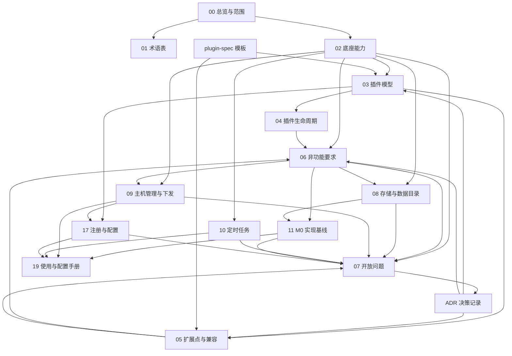

# 文档索引与阅读顺序

本目录是**人读规格**的唯一入口。所有文档遵循「规格即事实来源」：代码是文档的实现，文档之间不得互相矛盾。

## 1. 三种阅读路径

### 1.1 评审者 / 决策者（约 40 分钟）

1. [00-overview.md](00-overview.md) —— 这个项目做什么、不做什么
2. [02-foundation-capabilities.md](02-foundation-capabilities.md) —— 底座提供哪些能力
3. [03-plugin-model.md](03-plugin-model.md) —— 插件怎么接进来
4. [07-open-questions.md](07-open-questions.md) —— **需要你拍板的问题清单**
5. [adr/README.md](adr/README.md) —— 关键取舍的推荐与备选

### 1.2 底座开发者

按 00 → 01 → 02 → 03 → 04 → 05 → 06 → 08 → 09 → 17 → 10 → 11 → 07 顺序通读；ADR 作为实现约束逐条对照。

### 1.3 插件开发者

先读 [03-plugin-model.md](03-plugin-model.md) 建立整体认知，然后**直接进入** [plugin-spec/README.md](../plugin-spec/README.md)。
`plugin-spec/` 是自包含的：可以整目录复制到插件仓库，不依赖本目录即可独立使用。

## 2. 文档清单

| id | 文件 | 用途 | 主要读者 | 状态 |
| --- | --- | --- | --- | --- |
| DOC-00 | [00-overview.md](00-overview.md) | 定位、范围、非目标、成功标准、整体架构图 | 所有人 | draft |
| DOC-01 | [01-glossary.md](01-glossary.md) | 领域概念与术语唯一释义、禁用别名 | 所有人 | draft |
| DOC-02 | [02-foundation-capabilities.md](02-foundation-capabilities.md) | 底座能力清单（CAP-xx）与边界判定规则 | 评审、底座开发 | draft |
| DOC-03 | [03-plugin-model.md](03-plugin-model.md) | 插件模型、清单、能力声明、两种形态契约 | 底座/插件开发 | draft |
| DOC-04 | [04-plugin-lifecycle.md](04-plugin-lifecycle.md) | 发现→安装→启用→调用→健康→卸载 状态机 | 底座开发 | draft |
| DOC-05 | [05-extension-points-and-compatibility.md](05-extension-points-and-compatibility.md) | 扩展点（EP-xx）稳定性等级与版本兼容 | 底座/插件开发 | draft |
| DOC-06 | [06-non-functional-requirements.md](06-non-functional-requirements.md) | 单二进制、部署、日志、配置、安全、性能 | 评审、底座开发 | draft |
| DOC-07 | [07-open-questions.md](07-open-questions.md) | 开放问题与待决策清单（按优先级排序） | 评审、决策者 | draft |
| DOC-08 | [08-storage-and-data-directory.md](08-storage-and-data-directory.md) | 存储分区、数据目录布局、权限、写入策略、备份与迁移规则 | 底座开发、部署运维 | draft |
| DOC-09 | [09-host-management-and-plugin-distribution.md](09-host-management-and-plugin-distribution.md) | 主机清单、SSH 认证与凭据规则、连通性测试、插件下发安装与失败处置 | 底座开发、部署运维、评审 | draft |
| DOC-10 | [10-scheduled-tasks.md](10-scheduled-tasks.md) | 定时任务定义、触发语义、执行与记录、并发超时、错过执行、可靠性 | 底座开发、评审 | draft |
| DOC-11 | [11-implementation-baseline-m0.md](11-implementation-baseline-m0.md) | M0 基础设施骨架实现基线：配置键、数据目录、存储、HTTP、构建与待确认项 | 底座开发、部署运维 | draft |
| DOC-12 | [12-m1-plugin-runtime.md](12-m1-plugin-runtime.md) | M1 插件运行时实现基线：清单校验、发现注册、stdio 调用、执行记录、授权与接口 | 底座/插件开发 | draft |
| DOC-13 | [13-m2-identity-and-authz.md](13-m2-identity-and-authz.md) | M2 身份实现基线：口令派生、会话与 CSRF、角色矩阵、审计与接口 | 底座开发、安全评审 | draft |
| DOC-14 | [14-host-management-m3.md](14-host-management-m3.md) | M3 主机与下发实现基线：凭据加密、TOFU 指纹、下发状态机、接口与测试 | 底座开发、安全评审 | draft |
| DOC-15 | [15-m4-scheduled-tasks.md](15-m4-scheduled-tasks.md) | M4 定时任务实现基线：cron 语义、认领调度、错过执行、接口与测试 | 底座开发 | draft |
| DOC-16 | [16-web-ui-m5.md](16-web-ui-m5.md) | M5 Web 控制台实现基线：页面能力、总览口径、执行摘要、权限可见性 | 前端与底座开发 | draft |
| DOC-17 | [17-plugin-registry-and-configuration.md](17-plugin-registry-and-configuration.md) | 插件注册方向、类型/实例、三层状态、逻辑存储、实例配置、使用路径与界面 | 底座/插件开发、评审 | draft |
| DOC-18 | [18-m6-remote-plugins-and-instances.md](18-m6-remote-plugins-and-instances.md) | M6 远端插件与实例实现基线：内置 CA、mTLS、三态与漂移、下发扩展、实例授权 | 底座/插件开发、评审 | draft |
| DOC-19 | [19-usage-and-configuration.md](19-usage-and-configuration.md) | 部署与启动、配置项全集与默认值、首次使用、三态与下发、常见问题 | 部署运维、首次使用者 | draft |
| DOC-ADR | [adr/README.md](adr/README.md) | 架构决策记录索引与模板 | 所有人 | draft |

## 3. 文档依赖关系

阅读依赖规则：箭头指向「被依赖」的文档。**修改被依赖文档前，先检查所有下游文档是否仍成立**。

## 4. 事实来源优先级

1. 用户明确确认的决策（记录在 ADR 或文档正文，状态 `accepted`）
2. `docs/**` 规格正文
3. `.ai/**` 派生索引（冲突时以正文为准并立即修正）
4. `plugin-spec/**`（面向插件，是 `docs/03`、`docs/05` 的对外投影，必须与之一致）

## 5. 当前文档基线

- 全部人读规格状态为 `draft`；ADR 中 [ADR-0003](adr/0003-plugin-discovery-registration.md)（发现与清单）、[ADR-0004](adr/0004-stdio-wire-protocol.md)（stdio）、[ADR-0005](adr/0005-daemon-rpc-transport.md)（远程调用，本机 UDS + 远端 TCP/mTLS）、[ADR-0006](adr/0006-plugin-authz.md)（鉴权）、[ADR-0007](adr/0007-persistence.md)（存储）、[ADR-0013](adr/0013-plugin-credential-encryption.md)（凭据加密）、[ADR-0018](adr/0018-daemon-process-custody-and-injection.md)（常驻插件托管与注入）、[ADR-0019](adr/0019-error-categories-and-exit-code-scope.md)（错误类别与退出码）、[ADR-0020](adr/0020-contract-source-and-protoc-toolchain.md)（契约来源与工具链）、[ADR-0021](adr/0021-capability-execution-and-destructive-confirmation.md)（能力执行与高危确认）、[ADR-0022](adr/0022-remote-plugin-pki-and-mtls-certificates.md)（内置 CA 与 mTLS 证书体系）、[ADR-0023](adr/0023-plugin-registry-instances-and-configuration.md)（插件注册、类型/实例与配置）、[ADR-0024](adr/0024-proto-toolchain-baseline.md)（proto 工具链版本基线）已为 `accepted`，其余仍为 `proposed`。
- 未决事项统一登记在 [07-open-questions.md](07-open-questions.md)，**共 51 项**（其中 OQ-001~OQ-007、OQ-010、OQ-020、OQ-021、OQ-027 已 `decided`）。
- 已定：单节点部署、嵌入式 SQLite（纯 Go、免 cgo）、数据目录由配置文件指定、插件外部凭据 AES-256-GCM 加密。
- 已定契约（P0 六项）：清单 YAML + 内置 JSON Schema 校验（`plugin.yaml`）、NDJSON stdio、gRPC over 本机 UDS 的通用 `Invoke`、目录扫描 + 注册表持久化（安装后默认禁用）、短期凭据 + 能力级授权 + 默认拒绝、契约版本 `MAJOR.MINOR` 且插件声明支持范围。
- 已定契约（P0 后补齐，契约 **1.1**）：常驻插件由底座拉起托管 + 固定 `--ops-*` 注入 + 一次性凭据文件（读后即删）+ `run/plugins/<plugin-id>/` 下 `0600` socket；新增 `not_found` / `validation_failed` / `precondition_failed` 三个错误类别；退出码只适用于命令式插件；契约唯一来源 `sdk/` 且生成物入库；所有能力一律串行、禁止 `setup`/`version` 能力、`delete`/`restore`/`gc` 必须确认字段。
- 已定契约（契约 **1.2**，2026-11-16）：远端常驻插件由目标机 systemd 托管、直接监听 TCP + **双向 TLS**（内置 CA 在下发安装时签发并配置到目标机），SSH 凭据只用于下发安装；本机仍为底座 spawn + UDS；清单新增 `runtime.listen.port` 与 `config[]`。
- 已定模型（DOC-17 / ADR-0023）：插件「被注册」而非自报；类型与实例分离；静态事实 / 运行状态 / 自报三层；配置作用域落到实例；调用与授权判定落到实例，类型级仅作模板。
- 已纳入 v1：主机清单与插件 SSH 下发安装（CAP-13 / DOC-09 / ADR-0014）；远端 systemd 托管与 TCP+mTLS 调用（ADR-0018 / ADR-0022）；定时任务（CAP-14 / DOC-10 / ADR-0015，执行体为插件能力调用）。
- 仍未闭合的存储相关项：OQ-022（默认数据目录回退）、OQ-023（主密钥轮换与丢失处置）。
- 仍未闭合的主机下发项：OQ-024（远端仅 Linux + systemd 已收窄）、OQ-025、OQ-026、OQ-028、OQ-029。
- 仍未闭合的定时任务项：OQ-030~OQ-035（目标主机、秒级 cron、补跑、告警通道、权限体系、高频执行）。
- 由 P0 拆出的细节项：OQ-037（人类身份源、角色划分与 `scope` 强制校验）、OQ-038（字段命名风格、废弃支持周期、分页、错误堆栈）。
- 常驻插件运行时数值项：OQ-044（启动/就绪/关闭/退避/凭据有效期/Windows 支持）。OQ-045（protoc 版本锁定）已 `decided`（ADR-0024）。
- 远端证书与托管数值项：OQ-047（证书算法/有效期/轮换/CA 备份）、OQ-048（systemd unit/启停与探测超时/端口默认值与范围）。
- 注册与配置数值项：OQ-049（探测间隔/TTL/降级/保留）、OQ-050（授权粒度与批量范围）、OQ-051（配置迁移与撤销保留期）。
- **插件界面为 `proposed` 方向**（[ADR-0025](adr/0025-plugin-provided-ui.md)）：v1 只做**声明式界面**（清单声明入口、配置表单与结果展示，底座统一渲染，不加载插件代码）；二档「插件自带前端包」挂起为 idea，不进入 v1。一档的控件与展示边界待 OQ-011。
- **M0 基础设施骨架已落地**（Go 单二进制、配置、数据目录、SQLite、内嵌 UI、健康/版本、日志、构建脚本）；配置键名、HTTP 路径、库文件名等可运行基线待 OQ-036 确认，详见 [11-implementation-baseline-m0.md](11-implementation-baseline-m0.md)。**M1 插件运行时最小闭环已落地**（YAML 配置与清单、发现注册、stdio 调用、执行记录、能力级授权与接口），详见 [12-m1-plugin-runtime.md](12-m1-plugin-runtime.md)，取值登记为 OQ-039。**M2 本地身份与会话已落地**（PBKDF2 口令、Cookie 会话、CSRF、角色矩阵、审计），详见 [13-m2-identity-and-authz.md](13-m2-identity-and-authz.md)，取值登记为 OQ-040。M3 已落地主机下发安装（含 M6 扩展的证书/unit/启动/三态，见 [14-host-management-m3.md](14-host-management-m3.md)）；M4 定时任务见 [15-m4-scheduled-tasks.md](15-m4-scheduled-tasks.md)、M5 控制台见 [16-web-ui-m5.md](16-web-ui-m5.md)。**M6 远端证书签发、systemd unit、启动与 TCP+mTLS 调用已落地**（ADR-0018 / ADR-0022，实现基线见 [18-m6-remote-plugins-and-instances.md](18-m6-remote-plugins-and-instances.md)）；插件开发启动包见 `examples/starter/`（ADR-0024）。面向首次部署与日常使用的操作说明见 [19-usage-and-configuration.md](19-usage-and-configuration.md)（DOC-19）。

## 6. 完整文件清单

### 6.1 根目录与 agent 上下文

| 文件 | 用途 |
| --- | --- |
| [README.md](../README.md) | 项目门面：定位、当前阶段、入口导航、目录约定、硬性约束 |
| [AGENTS.md](../AGENTS.md) | AI 代理工作规则：铁律、文档地图、工作流、DoD |
| [.ai/index.md](../.ai/index.md) | 机器可读索引与编号体系 |
| [.ai/conventions.md](../.ai/conventions.md) | 文档命名、状态流转、待定写法、同步义务 |
| [.ai/glossary.yaml](../.ai/glossary.yaml) | 术语 → 定义/禁用别名（机器可读） |
| [.ai/open-questions.yaml](../.ai/open-questions.yaml) | 开放问题 → 优先级/阻塞对象/关联 ADR |

### 6.2 人读规格

| 文件 | 用途 |
| --- | --- |
| [README.md](README.md) | 本文件：阅读路径、清单、依赖图、事实来源优先级 |
| [00-overview.md](00-overview.md) | 定位、目标/非目标、架构图、范围判定规则、idea 清单 |
| [01-glossary.md](01-glossary.md) | 术语唯一释义、概念区分、命名约定 |
| [02-foundation-capabilities.md](02-foundation-capabilities.md) | CAP-01~14 能力、依赖关系、明确不做的能力 |
| [03-plugin-model.md](03-plugin-model.md) | 7 条不变量、插件包、清单（`plugin.yaml` + 内置 JSON Schema）、能力声明、两形态契约（NDJSON stdio / gRPC：本机 UDS 与远端 TCP+mTLS）、权限边界 |
| [04-plugin-lifecycle.md](04-plugin-lifecycle.md) | 生命周期状态（含远端三态）、各阶段要求、健康检查、重启恢复、审计 |
| [05-extension-points-and-compatibility.md](05-extension-points-and-compatibility.md) | EP-01~07、三版本模型、兼容判定、变更与废弃策略 |
| [06-non-functional-requirements.md](06-non-functional-requirements.md) | 单二进制、部署、启停、日志、配置、安全（含远端 mTLS 与证书权限）、可靠性、性能指标项 |
| [07-open-questions.md](07-open-questions.md) | 51 项待决策问题（P0/P1/P2，含 OQ-039~045 实现基线、OQ-047~051 远端与注册数值）与建议决策顺序 |
| [08-storage-and-data-directory.md](08-storage-and-data-directory.md) | 三类数据分区、数据目录布局与权限、文件系统硬约束、单写者批写、备份与恢复、schema 迁移 |
| [09-host-management-and-plugin-distribution.md](09-host-management-and-plugin-distribution.md) | 主机记录信息组、SSH 密钥/密码认证与凭据规则、连通性测试、下发状态机、并发幂等、回滚、审计、SSH 安全基线 |
| [10-scheduled-tasks.md](10-scheduled-tasks.md) | 任务定义信息组、cron/固定间隔语义、下次执行、并发与超时、错过执行、可靠性、变更联动、执行记录 |
| [11-implementation-baseline-m0.md](11-implementation-baseline-m0.md) | M0 已实现/未实现范围、模块布局、配置键、数据目录与权限、存储与迁移、HTTP 路径、构建运行、待确认项 |
| [12-m1-plugin-runtime.md](12-m1-plugin-runtime.md) | M1 配置键与默认值、清单校验规则、schema v2 表结构、调用判定顺序、插件接口与示例插件验证 |
| [13-m2-identity-and-authz.md](13-m2-identity-and-authz.md) | M2 口令派生参数、会话 Cookie 与 CSRF、角色矩阵、审计动作、身份接口与测试 |
| [14-host-management-m3.md](14-host-management-m3.md) | M3 主机下发实现基线与现行规格偏差（证书、systemd、启动、三态未实现） |
| [15-m4-scheduled-tasks.md](15-m4-scheduled-tasks.md) | M4 定时任务实现基线 |
| [16-web-ui-m5.md](16-web-ui-m5.md) | M5 Web 控制台实现基线 |
| [17-plugin-registry-and-configuration.md](17-plugin-registry-and-configuration.md) | 注册方向、类型/实例、三层状态、逻辑存储、实例配置、使用路径与界面（ADR-0023） |
| [18-m6-remote-plugins-and-instances.md](18-m6-remote-plugins-and-instances.md) | M6 配置基线、CA 与证书、远端 mTLS 与错误分类、schema v7、三态与漂移、下发扩展、实例授权（ADR-0018/0022/0023） |
| [19-usage-and-configuration.md](19-usage-and-configuration.md) | 使用与配置手册：最小配置、配置项全集与默认值、首次使用、主机与下发、三态与漂移、定时任务、常见问题 |

### 6.3 架构决策记录

| 文件 | 用途 |
| --- | --- |
| [adr/README.md](adr/README.md) | ADR 索引、模板、状态管理规则 |
| [adr/0001](adr/0001-single-binary-embedding.md) | 单二进制与前端资源内嵌方式 |
| [adr/0002](adr/0002-frontend-stack.md) | 前端技术栈与 UI 宿主形态 |
| [adr/0003](adr/0003-plugin-discovery-registration.md) | 插件发现、注册与清单校验 |
| [adr/0004](adr/0004-stdio-wire-protocol.md) | 命令式插件 stdio 线协议 |
| [adr/0005](adr/0005-daemon-rpc-transport.md) | 常驻插件远程调用协议与传输 |
| [adr/0006](adr/0006-plugin-authz.md) | 插件鉴权与授权模型 |
| [adr/0007](adr/0007-persistence.md) | 持久化存储与插件数据边界（accepted） |
| [adr/0008](adr/0008-distribution-signing.md) | 插件分发格式与完整性/签名 |
| [adr/0009](adr/0009-configuration-model.md) | 配置来源、格式与优先级 |
| [adr/0010](adr/0010-plugin-isolation-governance.md) | 进程隔离、资源限制与故障治理 |
| [adr/0011](adr/0011-observability-baseline.md) | 可观测性基线 |
| [adr/0012](adr/0012-module-boundaries-and-sdk.md) | 模块边界、契约版本与 SDK 形态 |
| [adr/0013](adr/0013-plugin-credential-encryption.md) | 插件外部凭据的静态加密（accepted） |
| [adr/0014](adr/0014-ssh-transport-and-host-credentials.md) | SSH 传输与主机凭据管理（proposed，含授权边界） |
| [adr/0015](adr/0015-scheduler-implementation.md) | 定时任务调度器实现方式（proposed） |
| [adr/0016](adr/0016-yaml-and-json-schema-dependencies.md) | 引入 YAML 与 JSON Schema 依赖（proposed） |
| [adr/0017](adr/0017-golang-x-crypto.md) | 引入 golang.org/x/crypto（proposed） |
| [adr/0018](adr/0018-daemon-process-custody-and-injection.md) | 常驻插件进程托管与启动注入契约（accepted） |
| [adr/0019](adr/0019-error-categories-and-exit-code-scope.md) | 错误类别扩展（契约 1.1）与退出码适用范围（accepted） |
| [adr/0020](adr/0020-contract-source-and-protoc-toolchain.md) | 契约文件唯一来源、SDK 边界与代码生成工具链（accepted） |
| [adr/0021](adr/0021-capability-execution-and-destructive-confirmation.md) | 能力执行模型与高危操作确认语义（accepted） |
| [adr/0022](adr/0022-remote-plugin-pki-and-mtls-certificates.md) | 内置 CA、证书内容与标识绑定、签发/轮换/吊销、私钥与 CA 保护（accepted） |
| [adr/0023](adr/0023-plugin-registry-instances-and-configuration.md) | 插件被注册、类型/实例、三层状态、逻辑存储与实例配置（accepted） |
| [adr/0024](adr/0024-proto-toolchain-baseline.md) | proto 工具链版本基线（protoc 36.2.0 / protoc-gen-go v1.36.6 / protoc-gen-go-grpc v1.5.1）与升级流程（accepted，关闭 OQ-045） |
| [adr/0025](adr/0025-plugin-provided-ui.md) | 插件界面承载模型：v1 仅声明式界面（proposed）；自带前端包挂起为 idea（OQ-011） |

### 6.4 插件开发规范模板（`plugin-spec/`，可整目录复制）

| 文件 | 用途 |
| --- | --- |
| [README.md](../plugin-spec/README.md) | 模板使用说明、阅读顺序、十三条硬性要求、与底座规格映射 |
| [AGENTS.md](../plugin-spec/AGENTS.md) | 插件仓库 AI 代理规则 |
| [00-contract-checklist.md](../plugin-spec/00-contract-checklist.md) | 契约自查清单（A~I 组，含 I 组「契约完备性」） |
| [01-manifest.md](../plugin-spec/01-manifest.md) | 元数据信息组、能力声明、权限声明、校验可诊断性 |
| [02-stdio-protocol.md](../plugin-spec/02-stdio-protocol.md) | 命令式插件通道契约、时序、超时、违规清单、自测 |
| [03-remote-protocol.md](../plugin-spec/03-remote-protocol.md) | 常驻插件状态机、必需接口、并发、就绪/健康/关闭 |
| [04-io-conventions.md](../plugin-spec/04-io-conventions.md) | 校验顺序、结构定义、命名格式、幂等、体积、敏感数据 |
| [05-errors-and-exit-codes.md](../plugin-spec/05-errors-and-exit-codes.md) | 结构化错误模型、错误类别、退出码建议表、消息质量 |
| [06-logging-observability.md](../plugin-spec/06-logging-observability.md) | 日志通道、级别、必带上下文、敏感信息、反例 |
| [07-versioning-compatibility.md](../plugin-spec/07-versioning-compatibility.md) | 双版本声明、兼容规则、插件自身演进、废弃流程 |
| [08-directory-layout.md](../plugin-spec/08-directory-layout.md) | 插件仓库/包/运行期目录、命名、禁止事项 |
| [09-example-plugin-spec.md](../plugin-spec/09-example-plugin-spec.md) | `demo-echo` 最小示例插件规格（仅规格，含 10 条验收用例） |
| [10-faq.md](../plugin-spec/10-faq.md) | 插件开发问答清单：已定结论，每条标注「契约强制 / 实现建议 / 待定」（含远端部署与证书） |
| [11-instance-and-config.md](../plugin-spec/11-instance-and-config.md) | 实例与配置：一个包多实例、能力只声明、`config[]`、配置来源与自报边界 |
| [12-plugin-ui.md](../plugin-spec/12-plugin-ui.md) | **草案，未生效**：一档声明式界面（v1 方向）与二档自带前端包（挂起）；字段与边界待 OQ-011 |
| [manifest.template.yaml](../plugin-spec/manifest.template.yaml) | 清单模板（字段集与校验规则与 01 对齐） |

### 6.5 SDK、示例与开发工具

| 文件 / 目录 | 用途 |
| --- | --- |
| [sdk/plugin/v1/plugin.proto](../sdk/plugin/v1/plugin.proto) | 契约唯一来源（ADR-0020） |
| [sdk/plugin/v1/contract.go](../sdk/plugin/v1/contract.go) | SDK 契约常量：契约版本、错误类别、命令式退出码（ADR-0024） |
| [sdk/plugin/v1/plugin.pb.go](../sdk/plugin/v1/plugin.pb.go) / [plugin_grpc.pb.go](../sdk/plugin/v1/plugin_grpc.pb.go) | 入库生成物（protoc 36.2.0 / protoc-gen-go v1.36.6 / protoc-gen-go-grpc v1.5.1） |
| [scripts/gen-proto.ps1](../scripts/gen-proto.ps1) / [gen-proto.sh](../scripts/gen-proto.sh) | 锁定工具链重生成；版本不符即失败（ADR-0024） |
| [examples/plugins/demo-echo](../examples/plugins/demo-echo) | 完整示例插件（stdio 双能力） |
| [examples/plugins/broken-demo](../examples/plugins/broken-demo) | 反例（验证拒绝路径） |
| [examples/starter](../examples/starter) | 插件开发启动包：命令式与远端 daemon 可复制骨架 + 本地自测（ADR-0024） |

### 6.6 M0 实现代码

| 文件 / 目录 | 用途 |
| --- | --- |
| [cmd/ops-platform/main.go](../cmd/ops-platform/main.go) | 单二进制入口：配置、日志、启动自检、信号处理、优雅关闭 |
| [internal/config/config.go](../internal/config/config.go) | 配置加载、优先级合并与校验 |
| [internal/store/datadir.go](../internal/store/datadir.go) | 数据目录创建、权限收紧、写探测、文件系统检测接口 |
| [internal/store/store.go](../internal/store/store.go) | SQLite 接入、WAL、单写事务入口、schema 版本表、迁移与迁移前备份 |
| [internal/store/queue.go](../internal/store/queue.go) | 批量写队列接口与未实现占位（显式报错） |
| [internal/api/server.go](../internal/api/server.go) | 路由、健康/版本接口、访问日志中间件、内嵌 UI 托管 |
| [internal/observability/log.go](../internal/observability/log.go) | slog JSON 日志与级别解析 |
| [web/embed.go](../web/embed.go) | 前端资源 `go:embed` 入口 |
| [web/dist/index.html](../web/dist/index.html) | 由 `prototype/index.html` 同步的构建产物副本 |
| [scripts/build.ps1](../scripts/build.ps1) / [build.sh](../scripts/build.sh) | 单二进制构建脚本（强制 `CGO_ENABLED=0`） |
| [go.mod](../go.mod) | Go 模块与依赖（`modernc.org/sqlite`） |

## 7. 引用关系（谁约束谁）

| 被引用文档 | 引用它的文档 | 含义 |
| --- | --- | --- |
| 00-overview | 01、02、07 | 范围与目标是所有判断的起点 |
| 02-foundation-capabilities | 03、06 | 插件契约必须建立在能力边界内 |
| 03-plugin-model | 04、05、07、`plugin-spec/01~05` | 插件契约是生命周期与插件规范的上游 |
| 05-extension-points-and-compatibility | 06、`plugin-spec/07` | 兼容规则决定版本声明与升级行为 |
| 06-non-functional-requirements | 07、08、`plugin-spec/06、08` | 打包/日志/配置/安全约束向下传导 |
| 08-storage-and-data-directory | 06（NFR-DEP/SEC/REL 引用）、04（卸载保留）、07 | 存储与数据目录的具体规则 |
| 09-host-management-and-plugin-distribution | 02（CAP-13）、03（安装位置）、04（安装阶段）、06（下发 NFR）、17（实例与三态）、07 | 主机与下发（含证书、unit、启动）的具体规则 |
| 10-scheduled-tasks | 02（CAP-14）、03（调用入口）、05（能力调用语义）、06（调度 NFR）、07 | 定时任务的具体规则 |
| 17-plugin-registry-and-configuration | 03（类型/实例）、04（生命周期）、09（下发）、06（探测 NFR）、07 | 注册、存储、配置与使用路径的具体规则 |
| 11-implementation-baseline-m0 | 06（配置/启停/日志）、08（存储/数据目录）、ADR-0001/0007/0009/0012、07（OQ-036） | M0 已落地基线；与正文冲突时以正文为准 |
| adr/0003、adr/0004、adr/0005、adr/0006 | 03、04、05、06、`plugin-spec/01~05、07` | 清单、stdio、远程调用与鉴权的最终裁决（均 accepted） |
| adr/0007、adr/0013 | 02、06、08、`plugin-spec/08` | 存储选型与凭据加密的最终裁决 |
| adr/0014 | 02、03、04、06、09、`plugin-spec/03` | SSH 下发与主机凭据的授权边界 |
| adr/0015 | 02、06、10 | 调度器实现方式与可靠性边界 |
| adr/0018 | 03、04、06、08、09、`plugin-spec/02、03、08、10` | 两套托管模型（本机 spawn / 远端 systemd）、`--ops-*` 注入、socket 与端口、三态时序 |
| adr/0019 | 03、05、06、`plugin-spec/05、07、10` | 错误类别扩展（契约 1.1）与退出码适用范围 |
| adr/0020 | 03、05、`plugin-spec/03、07、10` | 契约唯一来源 `sdk/`、生成物入库与工具链 |
| adr/0021 | 03、04、05、`plugin-spec/01、04、10` | 能力串行、命名禁令与高危确认 |
| adr/0022 | 03、06、09、`plugin-spec/03、08、10` | 内置 CA、证书签发/轮换/吊销、私钥与 CA 保护；证书不绑定端口、不代表授权 |
| adr/0023 | 03、04、06、09、17、`plugin-spec/01、11` | 注册方向、类型/实例、三层状态、能力独立存储、实例配置与授权粒度 |
| adr/0025 | 02（CAP-08）、05（EP-05）、`plugin-spec/12`、07（OQ-011） | 插件界面承载：v1 仅声明式、二档挂起；不注入第三方前端代码 |
| `plugin-spec/10-faq` | 全部 plugin-spec 章节、`docs/03`、`docs/05` | 规范问答的对外投影；结论必须先在正文定稿 |
| adr/* | 03、05、06、`plugin-spec/02、03` | ADR 是「待定」的最终裁决地 |

**不一致时的裁判顺序**：用户确认的 `accepted` 决策 → `docs/` 正文 → `plugin-spec/` → `.ai/` 派生索引。
