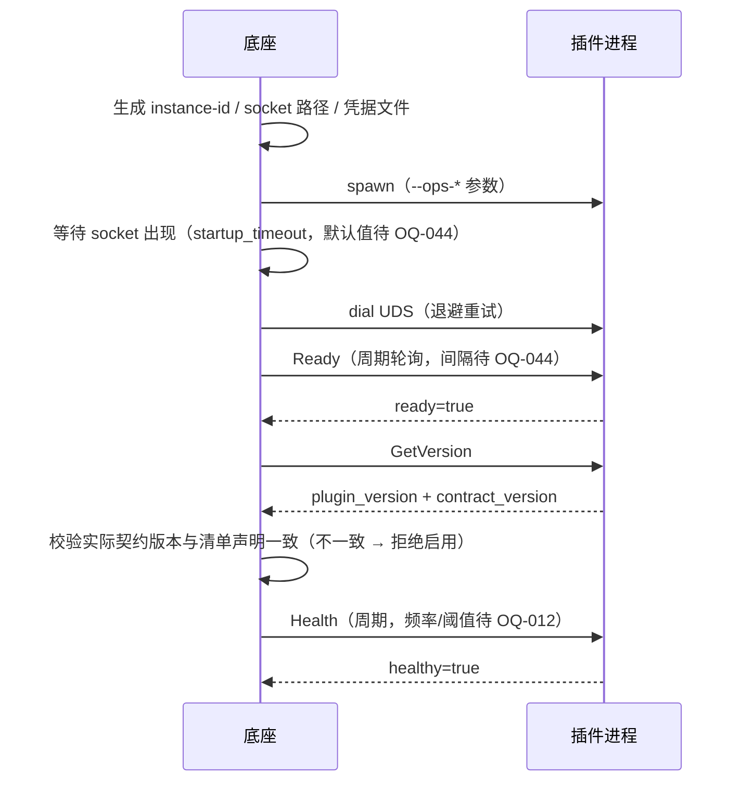
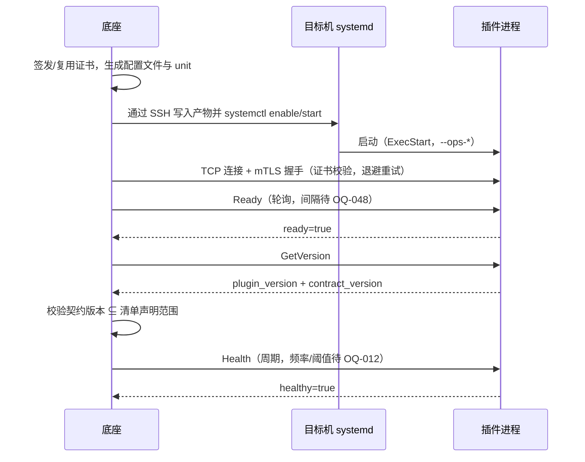

# ADR-0018 常驻插件进程托管与启动注入契约

- 状态：`accepted`（2026-11-16 修订：新增远端 systemd 托管形态）
- 日期：2026-11-16
- 决策者：用户（本地 spawn 托管；远端 TCP + mTLS，由目标机 systemd 托管，底座下发 unit 并负责启动与状态探测）
- 实现：M6 已落地（本地 spawn 与远端 systemd 两套托管、unit 下发与启停、三态回报、撤销与回滚），基线见 [DOC-18](../18-m6-remote-plugins-and-instances.md)；unit 细节待 OQ-048
- 关联：OQ-001（decided）、OQ-010/OQ-027（decided）、OQ-044、OQ-047、OQ-048、[ADR-0005](0005-daemon-rpc-transport.md)、[ADR-0006](0006-plugin-authz.md)、[ADR-0010](0010-plugin-isolation-governance.md)、[ADR-0022](0022-remote-plugin-pki-and-mtls-certificates.md)、[DOC-03](../03-plugin-model.md) §5.2、[DOC-04](../04-plugin-lifecycle.md) §3、[DOC-08](../08-storage-and-data-directory.md) §4、[DOC-09](../09-host-management-and-plugin-distribution.md)、[plugin-spec/03](../../plugin-spec/03-remote-protocol.md)

## 背景

常驻插件有两种部署位置：

- **本机**：底座与插件同机，底座是唯一可用的事实来源，负责拉起与监管。
- **远端**：底座与插件不同机，目标机上**没有底座进程**；SSH 只用于下发安装，调用走 TCP + mTLS（用户已选定）。

初版本 ADR 只定义了本机托管，并把「远端 daemon」整体排除。用户否决 SSH 隧道与节点代理后，远端必须有一个
**本机可用的进程管理者**，否则「已安装」永远无法变成「可调用」。因此本 ADR 扩展为两套托管模型，并写死两者的边界。

凡本文未定的数值，一律登记 OQ，不在正文臆造。

## 决策

**本机：底座 spawn 并托管；远端：目标机 systemd 托管，底座下发 unit、启动服务并探测状态；同一插件在同一主机上只能被一种方式托管。**

### 1. 两套托管模型

#### 1.1 本机形态（local）

| 项 | 结论 |
| --- | --- |
| 启动者 | **底座**（插件进程是底座的子进程） |
| 监管 | 就绪探测、健康检查、崩溃重启、优雅关闭全部由底座执行（[DOC-04](../04-plugin-lifecycle.md) §4） |
| 进程组 | 底座按**进程组**创建与终止，确保子进程树一起回收（NFR-RUN-05） |
| 网络面 | 只监听底座注入的 UDS；**不得**监听 TCP |
| 凭据 | 启动期一次性凭据文件 + `context.credential` 续期（§3） |

#### 1.2 远端形态（remote）

| 项 | 结论 |
| --- | --- |
| 启动者 | 目标机 **systemd**；底座通过 SSH 下发 unit、执行 `systemctl enable/start` |
| 监管 | 进程存活与自动重启由 systemd 负责；底座只负责**探测**（TCP + mTLS 握手、`Ready`、`Heartbeat/Health`）与状态记录 |
| 进程组 | 由 systemd cgroup 负责；底座不对远端进程发送信号（除撤销下发时通过 SSH 执行 `systemctl stop`） |
| 网络面 | 监听 TCP + 双向 TLS；监听地址与端口来自按主机生成的配置文件（§4.2） |
| 凭据 | 不使用启动期一次性凭据文件；对端身份由 mTLS 证书承担（[ADR-0022](0022-remote-plugin-pki-and-mtls-certificates.md)） |

#### 1.3 共同禁令（两套模型都适用）

- 插件**不得**自行 daemonize / fork 脱离父进程。
- 插件**不得**写 pid 文件、不得自带自启动脚本、不得自行注册 systemd unit。
- 插件**不得**在配置指定之外的地址或路径监听。
- 插件**不得**在未完成 `Ready` 前接受业务调用。

#### 1.4 为什么此处放开「双托管」禁令，以及如何避免互相干扰

初版禁令针对的是「同一实例同时被底座与 systemd 管理」，会产生两套状态事实来源、重复重启与信号竞争。
本轮放开的只是**远端位置**：远端没有底座进程，systemd 是唯一管理者，仍然只有**一个**监管者。

避免干扰的硬规则：

1. **托管方式由安装位置决定**，写入底座注册表（`custody=local|remote`），不得运行时切换。
2. **同一主机 + 同一插件**只允许一种托管方式；底座拒绝为已存在远程实例的插件再 spawn 本地实例，反之亦然。
3. 本地实例的 UDS 与远端实例的 TCP 端点使用不同的实例标识，注册表中分别记录，互不复用连接。
4. 远端 unit 名包含插件标识与主机标识，禁止与本地实例共用名称。
5. 底座不得通过 SSH 对远端进程发送 `SIGKILL`；停止一律走 `systemctl stop`，由 systemd 负责升级到 `SIGKILL`。
6. 远端插件不得反向注册到本地底座或复用本机 socket 路径。

#### 1.5 对 SSH 下发场景的影响

- 远端 daemon **允许**下发，但下发产物必须包含证书、私钥、CA 证书、按主机配置与 systemd unit（[DOC-09](../09-host-management-and-plugin-distribution.md) §6.1）。
- 下发成功后按「已安装 → 已启动 → 可调用」三段记录；**已安装不等于可调用**。
- 目标机不可达、systemd 不可用、端口不可达或证书校验失败时，必须如实记录失败阶段，不得写成「可调用」。

### 2. 非敏感启动参数（固定参数名，属契约）

#### 2.1 本机形态参数（全部必需，另有注明者除外）

| 参数 | 必需 | 含义 |
| --- | --- | --- |
| `--ops-plugin-id` | 是 | 插件标识（与清单 `identity.id` 一致） |
| `--ops-instance-id` | 是 | 本次运行实例标识，每次启动都不同 |
| `--ops-socket` | 是 | 底座分配给该实例的 UDS **绝对路径**，插件只能监听它 |
| `--ops-config` | 是 | 插件配置文件的**绝对路径**（只读） |
| `--ops-data-dir` | 是 | 插件私有数据目录的**绝对路径**（对应 `plugin-data/<plugin-id>/`） |
| `--ops-contract-version` | 是 | 底座本次使用的契约版本 `MAJOR.MINOR` |
| `--ops-credential-file` | 是 | 一次性凭据文件的**绝对路径**（§3） |
| `--ops-log-level` | 否 | 日志级别建议值（`debug`/`info`/`warn`/`error`） |

#### 2.2 远端形态参数（写入 systemd unit 的 `ExecStart`）

| 参数 | 必需 | 含义 |
| --- | --- | --- |
| `--ops-plugin-id` | 是 | 插件标识 |
| `--ops-instance-id` | 是 | 稳定的远端实例标识（由底座生成并写入配置/注册表） |
| `--ops-config` | 是 | 按主机生成的配置文件**绝对路径**（含监听地址、端口、证书路径） |
| `--ops-data-dir` | 是 | 目标机上的插件私有数据目录**绝对路径** |
| `--ops-contract-version` | 是 | 下发时锁定的契约版本 `MAJOR.MINOR` |
| `--ops-log-level` | 否 | 日志级别建议值 |

规则：

- `--ops-socket` 与 `--ops-credential-file` 是**本机专用**，远端 unit 中不得出现；反之 UDS 字段在远端不得被读取。
- 参数名与语义属契约：新增参数 = MINOR，改名/删除/改变语义 = MAJOR。
- 插件**不得**依赖任何环境变量获取上述信息；也不得假设当前工作目录。
- 参数值中出现凭据、令牌、口令、私钥内容 → 视为契约违规，底座拒绝安装/启动并记审计。
- 插件必须容忍出现未识别的 `--ops-*` 参数（向前兼容），不得因此启动失败。

### 3. 凭据载体（仅本机形态）

既有禁令是「凭据不得经环境变量与命令行传递」（ADR-0006、NFR-SEC-16）。本机形态采用两级载体：

**（1）启动期：一次性凭据文件**

- 底座在启动插件**之前**写入 `<data-dir>/run/plugins/<plugin-id>/<instance-id>.cred`，权限 `0600`（Windows 用 ACL 限定服务账号）。
- 命令行只传**文件路径**，不传凭据值。
- 文件内容为 JSON：

  ```json
  {"token":"<opaque>","plugin_id":"demo-agent","issued_at":"2026-11-16T10:00:00Z","expires_at":"2026-11-16T11:00:00Z"}
  ```

- 插件必须在 `Ready` 返回 `ready=true` **之前**读取该文件、仅保存在内存，并**立即删除**该文件。
- 底座在就绪后检查文件是否已消失；仍存在则由底座删除，并记一条「插件未履行凭据交接」审计（不因此判定插件失败）。
- 文件缺失或过期 → 插件 `Ready` 必须返回 `ready=false` 且 `reason=credential_unavailable`。

**（2）运行期：调用上下文续期**

- 底座在每次 `Invoke` 的 `InvocationContext` 中携带新的短期凭据（字段 `credential`，契约 1.1 新增，见 [ADR-0019](0019-error-categories-and-exit-code-scope.md)）。
- 插件以最近一次收到的凭据为准；旧凭据到期后底座不再接受。
- 旧插件（声明 `<1.1`）不认识该字段，按「未知上下文字段忽略」规则继续工作，此时沿用启动期文件中的凭据直到过期。

**（3）远端形态的凭据边界**

- 远端**不注入**一次性凭据文件；调用方身份由 mTLS 客户端证书证明（ADR-0022）。
- `context.credential` 在远端可携带也可省略；插件**不得**依赖它做身份判定，授权判定仍在底座网关（ADR-0006）。
- 远端插件访问底座能力的通道 v1 不开放（EP-03/EP-04 仅本地注入配置与数据目录）；若将来开放，必须以证书 + 能力级授权实现并另立 ADR。

不违反禁令的理由：命令行上只有路径；凭据值位于权限受限、一次性、读取即删的文件中，且不进入插件磁盘、日志或环境变量；
续期凭据经已建立的连接传输，不经过任何进程启动面。远端不使用该机制，因而不存在「凭据进参数」的问题。

### 4. 监听位置、权限与网络面

#### 4.1 本机：UDS

| 项 | 结论 |
| --- | --- |
| 路径 | `<data-dir>/run/plugins/<plugin-id>/<instance-id>.sock`，由底座生成并通过 `--ops-socket` 传入 |
| 目录权限 | `run/` 与 `run/plugins/` 为 `0700`；socket 文件为 `0600`；属主为服务账号 |
| 插件义务 | 只能 `bind` 该路径；不得 `unlink` 其他路径；不得监听 TCP |
| 清理者 | 底座负责删除 socket 与凭据文件；插件可删除自己的 socket，但不得删除目录 |
| 长度约束 | UDS 路径总长必须 ≤ 100 字节（Linux `sun_path` 上限 108 含终止符，预留余量）；超限时启动失败并明确提示「数据目录过深」 |
| 兜底 | **不**自动回退到 `/tmp` 等全局可写目录（避免权限与命名冲突攻击面） |
| Windows | v1 仅在 Linux/macOS 验证 UDS；Windows 上本机 daemon 形态的可用性登记为待定（OQ-044），未确认前底座拒绝在 Windows 启用 |

#### 4.2 远端：TCP + mTLS

| 项 | 结论 |
| --- | --- |
| 监听地址 | 只来自 `--ops-config` 指向的配置文件（`listen.address`），不得从环境变量/命令行取值 |
| 监听端口 | 配置文件 `listen.port`；默认值来自清单 `runtime.listen.port`，下发时可按主机覆盖（§4.3） |
| TLS | 必须启用双向 TLS；证书、私钥、CA 证书路径来自配置文件 `tls.*`（ADR-0022 §6） |
| 明文 | **禁止**明文监听，禁止「内网所以不加密」的例外 |
| 回环 | 允许监听回环地址（本机调试或 SSH 端口转发场景），但认证要求不变 |
| 监听地址默认值 | 待定（OQ-048）；底座不得在未显式配置时假定 `0.0.0.0` |
| 端口可达与防火墙 | **由用户负责**（用户已明确）；底座只如实记录「不可达」，不修改防火墙、不做端口映射 |

#### 4.3 端口声明与按主机覆盖

- 清单 `runtime.listen.port` 声明插件的**默认端口**；缺省表示该插件不支持远端部署。
- 下发到具体主机时，底座可写入主机级覆盖值；覆盖值记录在主机-插件安装记录中并可审计。
- 同一主机上多个远端插件不得使用同一端口；冲突在下发校验阶段拒绝。
- 端口范围、默认端口取值与冲突检测规则的具体数值：待定（OQ-048）。
- **证书不绑定端口**，改端口不触发重签（ADR-0022 §2）。

### 5. 就绪、健康与版本校验时序

#### 5.1 本机



#### 5.2 远端



规则：

- 「服务已启动」**不等于**「可调用」；只有握手成功且 `Ready=true` 才把状态置为可调用。
- 本机：socket 出现不等于就绪。远端：端口可连不等于就绪。
- `Ready` 超时或返回 `ready=false` 且原因不可恢复 → 本机终止进程并按重启策略处理；远端记录 `start_failed`，不反复 `systemctl restart` 无上限。
- `GetVersion` 返回的 `contract_version` 必须落在清单 `version.contract` 声明的范围内，且 MAJOR 与注入值相同；否则拒绝启用（`version_incompatible`）。
- `Health` 必须无副作用、可高频调用；连续失败达到阈值转 `unhealthy`，调用短路，不重试到进程。

### 6. 关闭顺序（固定，不得调换）

#### 6.1 本机

1. 底座停止接受该插件的新调用（网关直接返回 `not_ready`）。
2. 等待在途调用结束，最长 `drain_timeout`（默认值待 OQ-044）；超时者在途调用按 `cancelled` 处理。
3. 调 `Shutdown(grace_ms)`，插件停止接收新调用。
4. 等待进程自行退出至 `grace_ms`。
5. 未退出 → 发送 `SIGTERM`（Windows：`TerminateProcess`）→ 再等 `grace_ms` 的一半 → 仍未退出 → `SIGKILL`。
6. 删除 socket 与凭据文件，清理实例运行目录。
7. 写审计：是否强杀、退出码/信号、在途调用数量。

#### 6.2 远端

1. 底座停止接受该插件的新调用（网关返回 `not_ready`）。
2. 等待在途调用结束（`drain_timeout`，值待 OQ-048）。
3. 调 `Shutdown(grace_ms)`（尽力而为；连接不可用则跳过）。
4. 通过 SSH 执行 `systemctl stop`；systemd 发送 `SIGTERM`，超时后升级 `SIGKILL`（unit 的 `TimeoutStopSec`，值待 OQ-048）。
5. 探测服务已停止；失败则记录 `stop_failed` 并告警，**不**把状态写成已停止。
6. 保留证书、配置与数据（正常停用不删除）；只有撤销下发才删除产物（DOC-09 §6.2）。
7. 写审计：触发动因、耗时、是否强杀、失败阶段。

### 7. 崩溃重启与残留清理

#### 7.1 本机

- 运行期崩溃：记录退出码/信号与 stderr 尾部 → 若插件仍为 `enabled`，按指数退避重启；退避基数、上限与最大尝试次数待 OQ-044。
- 达到上限仍失败 → 转 `unhealthy` 并告警，**不得**静默无限重启。
- 每次重启都使用**新的** `instance-id`、socket 与凭据文件，不复用旧路径。
- 重启前必须清理：遗留 socket（确认无进程在监听）、遗留凭据文件、实例临时文件。
- 底座启动时扫描 `run/plugins/**`，清理属主为服务账号且无对应运行实例的残留（崩溃或断电遗留）。

#### 7.2 远端

- 自动重启由 systemd `Restart=on-failure` 承担，重启次数与间隔受 unit 的 `StartLimitBurst` / `StartLimitIntervalSec` 约束（具体值待 OQ-048）。
- 底座**不**对远端进程执行 spawn；它记录探测结果：连续握手/`Ready` 失败达到阈值 → `unhealthy` 并告警。
- 达到重启上限后 systemd 会进入 `failed`；底座在状态探测中识别并要求人工介入，不无限重试。
- 残留清理：撤销下发时删除 unit 与证书；正常升级保留状态目录。目标机上的孤儿进程由 systemd 自身回收，底座不越权杀进程。
- 同一主机 + 同一插件不得同时存在旧实例与新实例的监听；端口冲突在启动阶段即失败，底座记录 `start_failed`。

### 8. stdout / stderr 去向

| 形态 | 结论 |
| --- | --- |
| 本机 stdout | 底座以管道捕获，逐行接入底座结构化日志（不作为协议通道）；**不得**承载业务结果 |
| 本机 stderr | 同上，作为日志通道；单行长度上限与截断策略待 OQ-017/OQ-044 |
| 远端 stdout/stderr | 由 systemd journal 承载；底座默认不采集，仅在诊断时按需读取（读取方式、行数与时间窗待 OQ-048） |
| 落盘 | 本机默认跟随底座日志出口；远端跟随 journald 配置；是否按插件分文件待 OQ-016 |

## 被否方案与原因

| 方案 | 说明 | 否决原因 |
| --- | --- | --- |
| 本机由插件自行常驻（systemd / 自建守护） | 运维习惯成熟 | 本机已有底座作为唯一管理者，双托管产生两套状态事实来源 |
| 远端继续由底座 spawn（SSH 远程执行拉起） | 统一托管 | SSH 会话结束即失控，进程脱离可用监管；底座需承担跨主机进程树管理，故障面过大 |
| 远端无托管者（仅落地文件） | 最省事 | 「已安装」永远无法变成「可调用」，制造不可用资产；用户已否决 |
| 插件 daemonize 脱离父进程 | 看似解耦 | 进程组失控，超时与强杀无法保证；残留无法清理（两套形态均禁止） |
| 经环境变量传 socket/配置/凭据 | 实现最简单 | 违反 ADR-0006 禁令；环境变量可被子进程继承、易泄漏 |
| 凭据值直接放命令行 | 无需文件 | 进程列表可被同机其他账号读取 |
| 启动时经 stdin 传参数 | 复用已有关闭语义 | stdin 属于协议/生命周期语义，混入控制面会让「输入结束」歧义 |
| 单一 descriptor 文件承载全部注入信息与凭据 | 参数最少 | 仍需一个路径参数；且把非敏感与敏感信息混在同一文件，扩大泄漏面 |
| 插件自选 socket 路径 / 自选监听端口 | 插件自治 | 路径与端口冲突、权限不可控、底座无法清理与审计 |
| 远端用 SSH 隧道或节点代理承载调用 | 复用 SSH | 用户已明确否决：调用传输不应与运维凭据耦合，且目标机需独立可服务 |
| 不清理崩溃残留 | 实现省事 | 下次启动会撞路径或误连旧 socket，故障不可诊断 |

## 影响与约束

**正面**：两种部署位置都有唯一托管者；本机启动、就绪、关闭、重启完全可诊断；远端有 systemd 兜底且身份由证书保证；
凭据不经过 argv/env；端口可运维调整而不触发重签。

**负面 / 代价**：底座需实现进程监督器（本机）与远端编排器（下发 unit、启停、探测）；插件需同时适配两套启动注入；
远端依赖 systemd 与可写状态目录；证书生命周期成为新的运维面。

**实现约束**：

- 底座不得把插件 stdout 当协议；不得依赖插件自报健康来完成就绪判定。
- 插件不得在 `Ready` 前接受业务调用；不得缓存凭据到磁盘。
- 底座不得对远端进程直接发信号，也不得在远端留下未登记的 unit。
- 所有新增默认值（超时、间隔、退避、尝试次数、端口）必须可配置，且默认值登记 OQ-044 / OQ-048，不得在代码里散落魔法数。

## 验证方式

1. 本机启动后 socket 未出现 → `startup_timeout` 到期，进程被终止，状态可诊断。
2. `Ready` 恒为 false → 不接收业务调用，调用方立即得到 `not_ready`。
3. `GetVersion` 报告契约版本与清单不符 → 拒绝启用，审计记录两个版本。
4. 插件读取凭据文件后未删除 → 底座删除并记录审计，插件仍可工作。
5. 插件无视 `--ops-socket` 自行监听其他路径 → 视为契约违规，拒绝启用。
6. 远端 unit 缺失或 `systemctl start` 失败 → 记录 `start_failed`，不把状态写成已启动或可调用。
7. 远端证书校验失败 → 不进入 `Ready`，状态为不可调用，不回退明文。
8. 远端端口按主机覆盖 → 使用新端口握手成功，证书无需重签。
9. 同一主机同一插件同时存在本地与远程托管 → 底座拒绝后一种，错误可诊断。
10. 撤销下发 → 服务停止、unit 与证书删除、状态不再显示可调用。
11. 底座异常退出后重启 → 清理本机 `run/plugins/**` 残留，不误连旧 socket；远端实例保持由 systemd 管理。

## 遗留待定

- 本机运行数值（启动/就绪/drain/grace/退避/凭据有效期/日志截断/Windows 支持）：OQ-044。
- 远端运行数值（systemd unit 细节、启动/停止超时、端口默认值与范围、journal 读取）：OQ-048；持续探测间隔、状态过期 TTL 与降级阈值：OQ-049。
- 证书算法、有效期、轮换周期、CA 备份：OQ-047。
- 健康检查阈值：OQ-012；量化目标：OQ-017。
- 主密钥与 CA 私钥的轮换联动：OQ-023。
