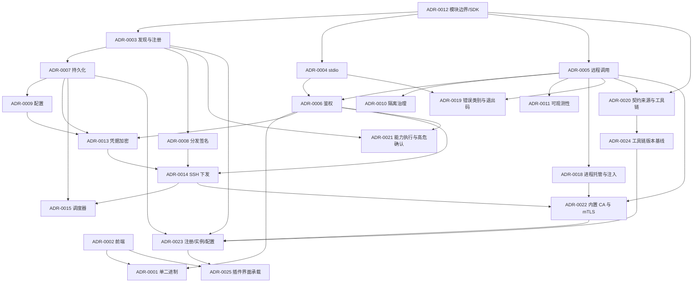

# 架构决策记录（ADR）

> 状态：`draft`（索引）｜ 已 `accepted`：ADR-0003、ADR-0004、ADR-0005、ADR-0006、ADR-0007、ADR-0013、ADR-0018、ADR-0019、ADR-0020、ADR-0021、ADR-0022、ADR-0023、ADR-0024；其余（含 ADR-0012 的 SDK 形态部分、ADR-0014、ADR-0015、ADR-0016、ADR-0017、ADR-0025）仍为 `proposed`

## 1. 什么是 ADR

ADR（Architecture Decision Record）记录**一个**架构层面的决策：为什么做这个决定、考虑过哪些替代方案、带来什么影响。
**未确认前状态为 `proposed`**；确认后改为 `accepted`；被取代时改为 `superseded` 并保留原文。

除已标注 `accepted` 的条目外，其余 ADR 都是**待确认草稿**，不代表已定稿的技术选型。规格正文中的「待定」都指向这里或 [DOC-07](../07-open-questions.md)。

## 2. ADR 清单

| 编号 | 标题 | 关联 OQ | 状态 |
| --- | --- | --- | --- |
| [ADR-0001](0001-single-binary-embedding.md) | 单二进制交付与前端资源内嵌方式 | OQ-014 | proposed |
| [ADR-0002](0002-frontend-stack.md) | 前端技术栈与 UI 宿主形态 | OQ-013、OQ-011 | proposed |
| [ADR-0003](0003-plugin-discovery-registration.md) | 插件发现、注册与清单校验 | OQ-002、OQ-005 | **accepted** |
| [ADR-0004](0004-stdio-wire-protocol.md) | 命令式插件 stdio 线协议 | OQ-004 | **accepted** |
| [ADR-0005](0005-daemon-rpc-transport.md) | 常驻插件远程调用协议与传输 | OQ-001、OQ-010 | **accepted** |
| [ADR-0006](0006-plugin-authz.md) | 插件鉴权与授权模型 | OQ-003、OQ-037 | **accepted** |
| [ADR-0007](0007-persistence.md) | 持久化存储方案与插件数据边界 | OQ-007、OQ-020、OQ-022 | **accepted** |
| [ADR-0008](0008-distribution-signing.md) | 插件分发格式与完整性/签名 | OQ-015 | proposed |
| [ADR-0009](0009-configuration-model.md) | 配置模型（来源、格式、优先级） | OQ-008 | proposed |
| [ADR-0010](0010-plugin-isolation-governance.md) | 插件进程隔离、资源限制与故障治理 | OQ-009、OQ-012 | proposed |
| [ADR-0011](0011-observability-baseline.md) | 可观测性基线 | OQ-016 | proposed |
| [ADR-0012](0012-module-boundaries-and-sdk.md) | 模块边界、契约版本与插件 SDK 形态 | OQ-006、OQ-018 | proposed（版本规则已定稿，SDK 形态待 OQ-018） |
| [ADR-0013](0013-plugin-credential-encryption.md) | 插件外部凭据的静态加密 | OQ-021、OQ-023 | **accepted** |
| [ADR-0014](0014-ssh-transport-and-host-credentials.md) | SSH 传输与主机凭据管理 | OQ-024~OQ-029 | proposed |
| [ADR-0015](0015-scheduler-implementation.md) | 定时任务调度器的实现方式 | OQ-030~OQ-035 | proposed |
| [ADR-0016](0016-yaml-and-json-schema-dependencies.md) | 引入 YAML 与 JSON Schema 依赖 | OQ-008、OQ-039 | proposed |
| [ADR-0017](0017-golang-x-crypto.md) | 引入 golang.org/x/crypto（口令派生与 SSH） | OQ-037、OQ-040、OQ-041 | proposed |
| [ADR-0018](0018-daemon-process-custody-and-injection.md) | 常驻插件进程托管与启动注入契约（本机 spawn / 远端 systemd） | OQ-001、OQ-010、OQ-027、OQ-044、OQ-048 | **accepted** |
| [ADR-0019](0019-error-categories-and-exit-code-scope.md) | 错误类别扩展（契约 1.1）与退出码适用范围 | OQ-006、OQ-038 | **accepted** |
| [ADR-0020](0020-contract-source-and-protoc-toolchain.md) | 契约文件唯一来源、SDK 边界与代码生成工具链 | OQ-006、OQ-018、OQ-045 | **accepted** |
| [ADR-0021](0021-capability-execution-and-destructive-confirmation.md) | 能力执行模型与高危操作确认语义 | OQ-005、OQ-006 | **accepted** |
| [ADR-0022](0022-remote-plugin-pki-and-mtls-certificates.md) | 内置 CA 与远端插件 mTLS 证书体系 | OQ-010、OQ-027、OQ-047、OQ-048 | **accepted** |
| [ADR-0023](0023-plugin-registry-instances-and-configuration.md) | 插件注册、类型/实例与实例配置模型 | OQ-010、OQ-049、OQ-050、OQ-051 | **accepted** |
| [ADR-0024](0024-proto-toolchain-baseline.md) | proto 工具链版本基线与升级流程（关闭 OQ-045） | OQ-045 | **accepted** |
| [ADR-0025](0025-plugin-provided-ui.md) | 插件界面承载模型（v1 仅声明式；自带前端包挂起） | OQ-011 | proposed |

## 3. 决策依赖



## 4. 模板

新 ADR 复制下面结构，编号递增：

```markdown
# ADR-NNNN 标题

- 状态：proposed
- 日期：YYYY-MM-DD
- 决策者：待定（用户）
- 关联：OQ-xxx、DOC-xx

## 背景
## 决策（待确认）
## 推荐方案与理由
## 备选方案
## 影响
### 正面
### 负面 / 代价
### 迁移成本
## 验证方式
## 待确认问题
```

## 5. 状态管理规则

- 代理**不得**自行将 ADR 标记为 `accepted`。
- 一条 ADR 只做一个决策；多个决策拆成多条。
- 修改已 `accepted` 的 ADR 不得直接改结论，应新增 ADR 并标记旧的为 `superseded`。
