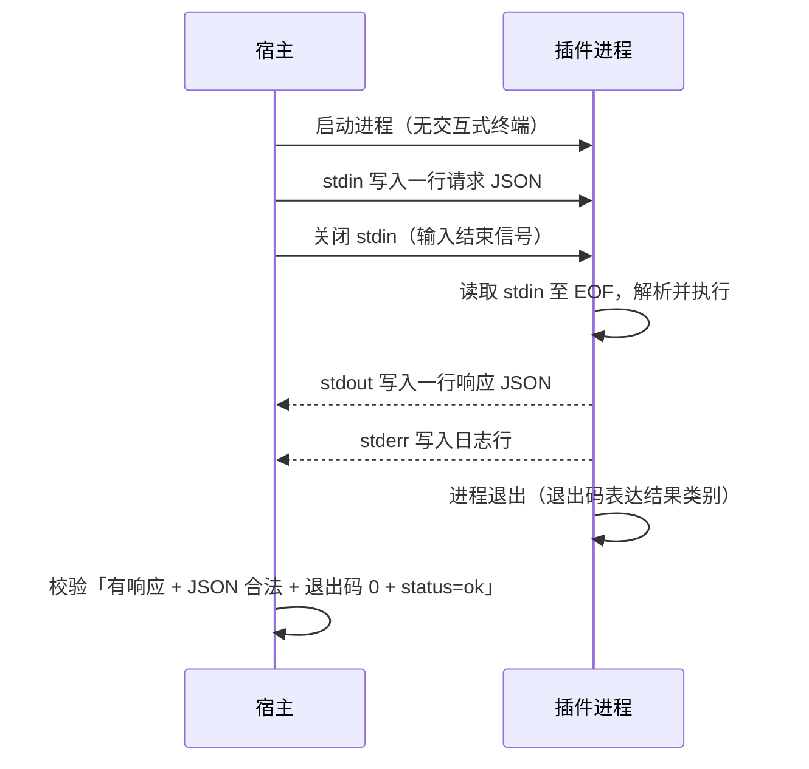

# PS-02 命令式插件通信协议（stdio）

> 对应底座规格：`docs/03-plugin-model.md` §5.1 ｜ 依据：底座 ADR-0004（accepted）、ADR-0023（`config` 声明）、OQ-004（decided）｜ 契约版本：`1.2`（本条协议条款自 1.0 起未变）

## 1. 基本模型

**一次调用 = 启动一个进程 = 处理一行请求 = 输出一行结果 = 退出。**



## 2. 通道契约（强制）

| 通道 | 允许内容 | 禁止内容 |
| --- | --- | --- |
| stdin | 恰好一行请求 JSON | 多条请求、交互式读取、等待更多输入 |
| stdout | 恰好一行响应 JSON | 日志、进度、警告、横幅、调试输出、多行 JSON |
| stderr | 日志与诊断（逐行） | 结构化结果的正式承载 |
| 退出码 | 结果类别（见 [05](05-errors-and-exit-codes.md) §3） | 用退出码代替错误详情 |

**为什么 stdout 必须纯净**：宿主按「stdout 的第一行 = 结果」解析。任何额外输出都会使结果不可解析，属于**协议违规**，
即使业务本身成功也判失败。

## 3. 编码与帧

| 项 | 结论 |
| --- | --- |
| 字符编码 | UTF-8，无 BOM |
| 帧格式 | NDJSON：一行一条完整 JSON，以 `\n` 结束 |
| 换行 | 行内不得出现裸换行；字符串内换行转义为 `\n` |
| 二进制数据 | base64 字符串内联（v1 无二进制帧） |
| 未知字段 | 忽略，不报错 |
| 结果体积 | 上限数值待定（OQ-017）；超限必须报错，禁止截断 |

## 4. 请求结构

```json
{"contract_version":"1.1","capability":"demo-echo.echo","input":{"text":"hello"},"context":{"invocation_id":"01J8Z0Q3K5V9M2X7","deadline_ms":5000,"subject":"user:alice","credential":"<opaque>"}}
```

| 字段 | 类型 | 必需 | 说明 |
| --- | --- | --- | --- |
| `contract_version` | string | 是 | 宿主使用的契约版本，`MAJOR.MINOR` |
| `capability` | string | 是 | 目标能力标识 `<插件标识>.<能力名>` |
| `input` | object | 是 | 能力输入；无输入时传 `{}`，不得省略为 `null` |
| `context` | object | 是 | 调用上下文 |
| `context.invocation_id` | string | 是 | 调用标识，宿主与插件共用于日志关联 |
| `context.deadline_ms` | integer | 是 | 剩余时间预算（毫秒），插件必须在此内结束 |
| `context.subject` | string | 否 | 调用主体；可能敏感，不得写入插件日志明文 |
| `context.credential` | string | 否 | 契约 1.1 新增：短期凭据；插件不得回显或落盘 |

未知的 `context` 字段必须忽略，不得因未知字段报错。

## 5. 响应结构

成功（示例）：

```json
{"status":"ok","output":{"echo":"hello"},"plugin_version":"0.1.0"}
```

失败（示例）：

```json
{"status":"error","error":{"code":"input_invalid","message":"字段 text 缺失（必填）","details":{"field":"text"},"retryable":false}}
```

| 字段 | 类型 | 必需 | 说明 |
| --- | --- | --- | --- |
| `status` | string | 是 | `ok` 或 `error` |
| `output` | object | `status=ok` 时是 | 能力输出，按输出 schema 校验 |
| `plugin_version` | string | 否 | 插件实际版本 |
| `error` | object | `status=error` 时是 | 结构化错误 |
| `error.code` | string | 是 | 错误类别，见 [05](05-errors-and-exit-codes.md) §2 |
| `error.message` | string | 是 | 面向人的说明，不得含敏感信息 |
| `error.details` | object | 否 | 定位信息（字段名、位置、上游错误摘要） |
| `error.retryable` | boolean | 否 | 是否建议重试；缺省视为 `false` |

要求：

- 成功与失败**互斥**：`ok` 不得带 `error`，`error` 不得带 `output`。
- 失败必须同时体现为「响应 `status=error`」与「非 0 退出码」，二者语义一致。

## 6. 超时、取消与终止

| 场景 | 宿主行为 | 插件义务 |
| --- | --- | --- |
| 超过 `deadline_ms` | 终止插件进程（先温和信号，宽限期内未退出则强制终止；具体宽限期待定，OQ-017） | 必须可被终止，不得忽略终止信号 |
| 主动取消 | 同上 | 不得阻塞在不可中断的等待上 |
| 进程异常崩溃 | 视为调用失败，记录退出码与 stderr 摘要 | — |

插件义务：

1. 自行清理自己创建的子进程（宿主负责终止插件主进程组）。
2. 调用结束（含失败）后不得留下临时文件。
3. 不得依赖「长驻」来完成工作。

## 7. 工作目录、环境与交互

- 不得假设特定的当前工作目录；资源路径应基于清单声明或显式参数解析。
- 是否向插件注入环境变量（如数据目录、配置）：**待定**（OQ-008 与 EP-03/EP-04 落地时确认）；但**凭据不得经环境变量注入**。
- **凭据不得经命令行参数传递**；需用凭据时使用 `credential.use` 权限引用凭据条目，或使用 `context.credential`。
- **禁止依赖 TTY、禁止等待交互输入**：stdin 只有一行请求，读不到额外输入；任何「请用户确认」的语义必须改成显式输入字段。
- 同一插件的调用由底座**串行**调度，不会同时启动多个进程；插件仍需自行保证同一数据目录上的写入安全（见 [04](04-io-conventions.md) §5）。

## 8. 协议违规清单（会被判失败）

- stdout 出现日志、多行内容、空输出或非 JSON。
- 未读取 stdin 即执行（忽略输入）。
- 失败时退出码为 0，或成功时退出码非 0。
- 响应 `status` 缺失或取值非 `ok`/`error`。
- 结果超出体积上限却返回成功。
- 要求交互式输入。
- 忽略终止信号、拒绝退出。

## 9. 合规自测（不需代码即可执行）

1. 只向 stdout 写一行合法 JSON 结果 → 宿主解析成功。
2. 故意在 stdout 混入一行日志 → 宿主判定协议违规。
3. 不写任何输出即退出 0 → 宿主判定「无结果」失败。
4. 死循环 → 超时后被终止，无残留进程。
5. 输入缺少必填字段 → 返回 `input_invalid` 且退出码非 0。
6. 输入带未知可选字段 → 正常执行。

## 10. 待定项

| 主题 | 编号 |
| --- | --- |
| 结果体积上限、超时默认值、终止宽限期 | OQ-017 |
| 是否注入环境变量 | OQ-008 |
| 字段命名风格（下划线/小驼峰） | OQ-038 |
