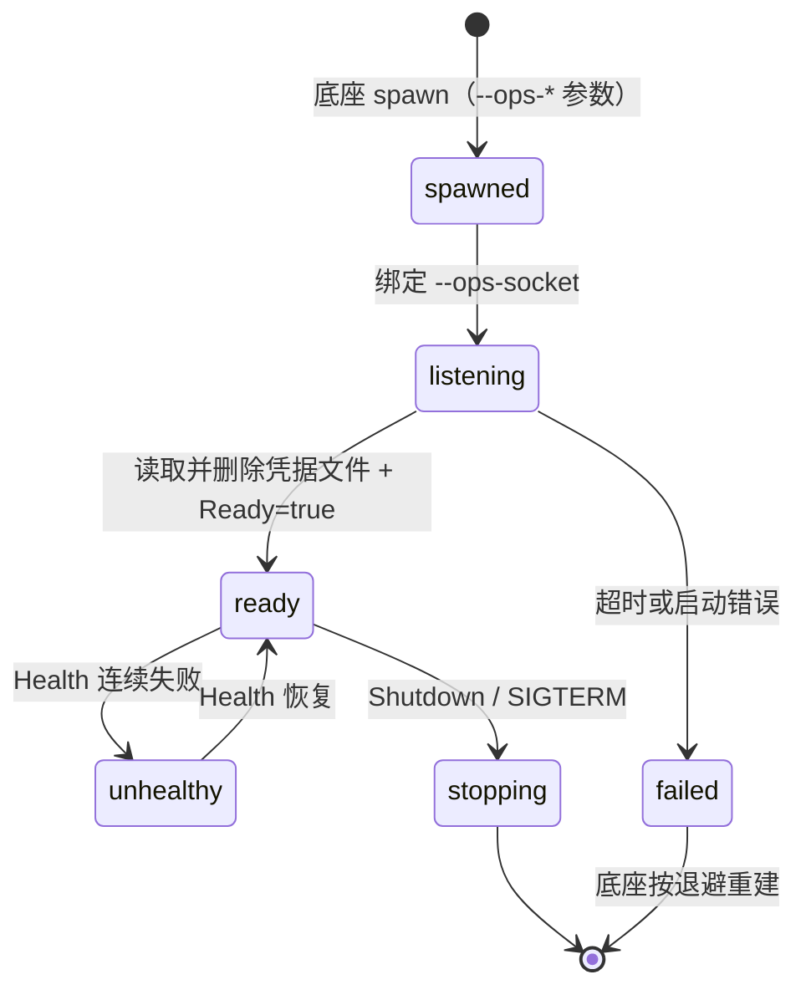
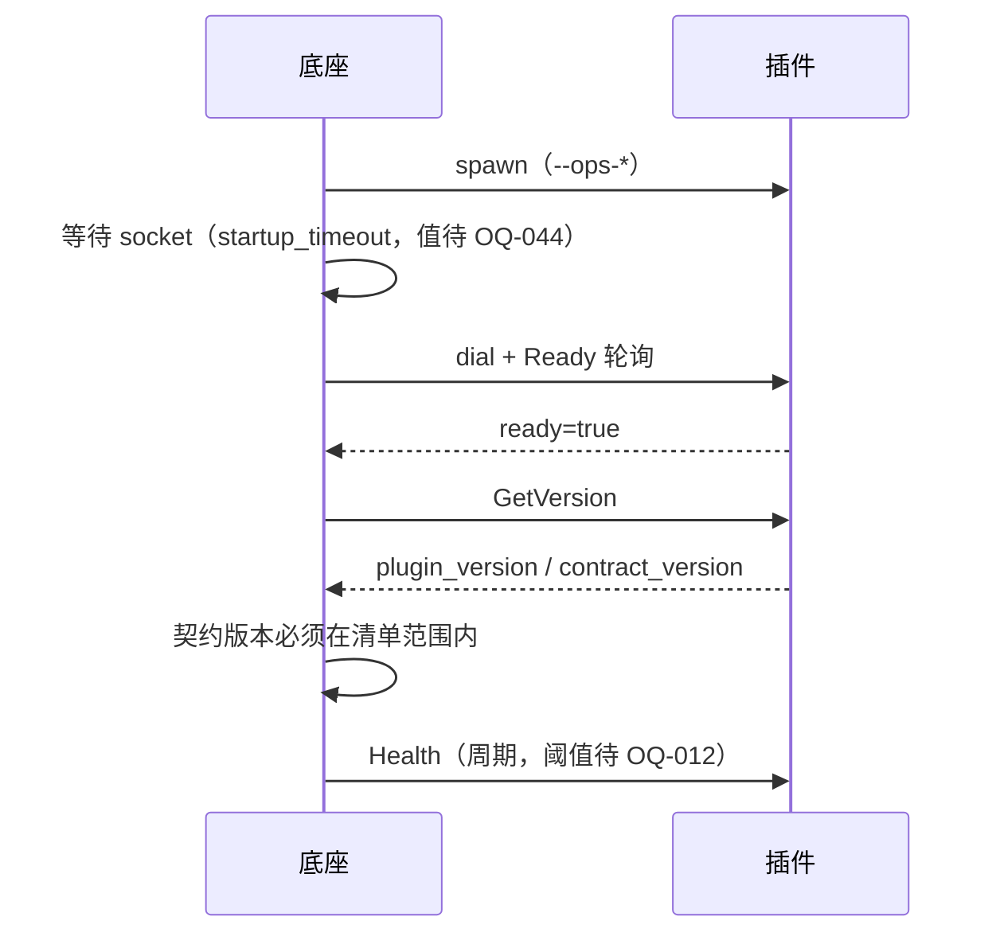
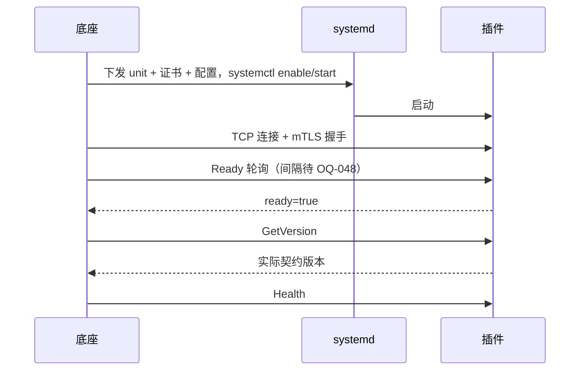

# 03 常驻插件契约（本机 UDS / 远端 TCP + mTLS）

> 契约版本：**1.2**（1.0 基线 + 1.1 增量 + 1.2 远端部署）
> 关联：ADR-0005、ADR-0018、ADR-0019、ADR-0021、ADR-0022、ADR-0024（纯文本引用，便于本目录独立复制）
> 本文件是常驻插件的唯一实现依据。未写明的行为**不得**自行约定，按 [AGENTS.md](AGENTS.md) §5 提问并回流。

## 0. 实现状态（契约 1.2，以此为准）

| 项 | 当前状态 |
| --- | --- |
| 契约版本 | `1.2`。唯一 proto 来源：`sdk/plugin/v1/plugin.proto`；契约常量：`sdk/plugin/v1/contract.go`；生成物：`sdk/plugin/v1/plugin.pb.go`、`sdk/plugin/v1/plugin_grpc.pb.go`（均已入库） |
| 生成脚本 | `scripts/gen-proto.ps1` / `scripts/gen-proto.sh`，锁定 protoc `36.2.0`（npm 包 `protoc@36.2.0`，经 npx 调用）、protoc-gen-go `v1.36.6`、protoc-gen-go-grpc `v1.5.1`；生成文件头记录 `v7.36.2` 属内部版本，是预期现象 |
| 本机 daemon 托管 | **尚未实现**（OQ-044）。§2 的本机 UDS 托管形状已定，但底座当前不会在本机拉起/托管 daemon；**本机实例请使用命令式形态** |
| 远端 daemon | **只能经底座下发运行**：底座通过 SSH 上传安装包、生成配置/证书/systemd unit 并 `systemctl daemon-reload + enable --now`；**不支持也不应指导用户手工部署二进制或注册 unit** |
| 命令式插件远端下发 | 不支持。远端实例要求 `form: daemon` 与 `runtime.listen.port`（`internal/host/service.go` 明确报错） |
| 两套骨架入口 | `examples/starter/command`：`form: command`，`entry.executable: bin/<id>`；`examples/starter/daemon`：`form: daemon`，`entry.launch: bin/<id>`，并声明 `runtime.listen.port` |

## 1. 两种部署形态

| 项 | 本机（local） | 远端（remote） |
| --- | --- | --- |
| 部署位置 | 与底座同机 | 目标主机 |
| 传输 | gRPC over Unix Domain Socket | gRPC over TCP + **双向 TLS** |
| 进程由谁拉起 | 底座 spawn | 目标机 systemd（底座下发 unit 并 `systemctl start`） |
| 谁负责重启 | 底座 | systemd（`Restart=on-failure`） |
| 地址来源 | `--ops-socket` 注入 | `--ops-config` 指向的配置文件 |
| 凭据 | 一次性凭据文件 + `context.credential` | mTLS 证书；不使用一次性文件 |
| 日志 | 底座捕获 stdout/stderr | journald |
| 清单要求 | `entry` | `entry` + `runtime.listen.port` |

**共同点**：同一套 proto、同一个 `Invoke`、同一套错误模型、同一套能力标识、一律串行调度。
**互斥点**：同一主机 + 同一插件只能被一种方式托管；不得同时存在本地实例与远端实例。

**实现状态**：上表「本机 → 底座 spawn」是契约形状，当前**尚未实现**（OQ-044），本机请用命令式；
「远端 → systemd」**只能由底座下发**（SSH 上传、生成配置/证书/unit 并 `systemctl enable --now`），
不接受也不应指导手工部署或注册 unit。

## 2. 本机形态（local）

### 2.1 进程模型



### 2.2 启动参数（固定参数名，属契约）

| 参数 | 必需 | 含义 |
| --- | --- | --- |
| `--ops-plugin-id` | 是 | 插件标识，与清单 `identity.id` 一致 |
| `--ops-instance-id` | 是 | 本次运行实例标识，每次启动不同 |
| `--ops-socket` | 是 | UDS 绝对路径，只能监听它 |
| `--ops-config` | 是 | 配置文件绝对路径（只读） |
| `--ops-data-dir` | 是 | 插件私有数据目录绝对路径 |
| `--ops-contract-version` | 是 | 契约版本 `MAJOR.MINOR` |
| `--ops-credential-file` | 是 | 一次性凭据文件绝对路径 |
| `--ops-log-level` | 否 | `debug` / `info` / `warn` / `error` |

规则：

- 不得从环境变量读取上述任何信息；不得假设工作目录；不得写 pid 文件、不得 daemonize。
- 只允许监听 `--ops-socket`；**不得**监听任何 TCP 地址（含回环）。
- 必须容忍未识别的 `--ops-*` 参数，不得因此启动失败。
- 参数中出现凭据值/令牌/口令 → 契约违规。

### 2.3 凭据文件

- 路径由 `--ops-credential-file` 给出，权限 `0600`；内容为：

  ```json
  {"token":"<opaque>","plugin_id":"demo-agent","issued_at":"2026-11-16T10:00:00Z","expires_at":"2026-11-16T11:00:00Z"}
  ```

- 必须在 `Ready` 返回 `ready=true` **之前**读取、仅存内存，并**立即删除**该文件。
- 文件缺失/过期 → `Ready` 返回 `ready=false` 且 `reason=credential_unavailable`。
- 运行期以 `InvocationContext.credential` 续期；不得写盘、不得写日志。
- 不得缓存到数据目录、不得随崩溃转储落盘。

### 2.4 socket

| 项 | 要求 |
| --- | --- |
| 路径 | `<data-dir>/run/plugins/<plugin-id>/<instance-id>.sock` |
| 权限 | socket `0600`；目录 `0700` |
| 长度 | ≤ 100 字节；超限由底座拒绝启动，插件不得自行改路径 |
| 清理 | 底座删除；插件可删自身 socket，不得删目录 |
| 回退 | 禁止回退 `/tmp` 或任何全局可写目录 |

### 2.5 就绪、健康与版本时序



- socket 出现 ≠ 就绪；未就绪时底座不转发，调用方得到 `not_ready`。
- `GetVersion.contract_version` 必须落在清单 `version.contract` 范围内且 MAJOR 与注入值一致。

### 2.6 关闭顺序

1. 停止接受新调用；
2. drain 在途调用（`drain_timeout`，值待 OQ-044）；
3. `Shutdown(grace_ms)`；
4. 等待退出；超时 `SIGTERM`；再超时 `SIGKILL`；
5. 删除 socket、凭据文件与实例临时目录；
6. 记录审计（强杀、信号、在途数量）。

### 2.7 崩溃与残留

- 底座记录退出码/信号与 stderr 尾部；仍 `enabled` 时按指数退避重启，使用新 `instance-id`（参数值待 OQ-044）。
- 达上限转 `unhealthy` 并告警，不静默无限重启。
- 重启前清理旧 socket / 旧凭据文件 / 实例临时文件；底座启动时清理 `run/plugins/**` 中无对应实例的残留。

### 2.8 输出通道

- stdout/stderr 均被底座捕获为日志；**不得**承载业务结果或协议帧。
- 单行长度上限与截断策略待 OQ-017 / OQ-044。

## 3. 远端形态（remote）

### 3.1 进程与 systemd

- 进程由目标机 **systemd** 托管；底座通过 SSH 下发 unit 并执行 `systemctl enable/start`。
- **远端 daemon 只能经底座下发运行**：安装包、配置、证书与 unit 全部由底座生成并写入，随后执行
  `systemctl daemon-reload + enable --now`。不支持、也不得指导用户手工在目标机部署二进制或注册 unit。
- unit 的 `ExecStart` 只包含可执行文件与 §3.2 的非敏感参数；**不得**在 unit 中写凭据、令牌或私钥内容。
- 插件进程必须**前台运行**（`Type=simple` 或等价），不得 fork 脱离、不得写 pid 文件；重启由 systemd 负责。
- 底座不对远端进程直接发送信号；停止/重启一律通过 `systemctl`。

### 3.2 监听配置来源

- 监听地址、端口、证书路径**只**来自 `--ops-config` 指向的配置文件；不得从环境变量或命令行值读取。
- 配置文件由底座按主机生成，示例：

  ```yaml
  deployment: remote
  plugin_id: demo-agent
  instance_id: host-01-demo-agent
  listen:
    address: 0.0.0.0        # 具体默认值待 OQ-048；必须显式配置
    port: 29443             # 示例值；生效值 = 主机覆盖值或清单默认端口
  tls:
    cert_file: /etc/ops-platform/plugins/demo-agent/tls/server.crt
    key_file:  /etc/ops-platform/plugins/demo-agent/tls/server.key
    ca_file:   /etc/ops-platform/plugins/demo-agent/tls/ca.crt
    expected_client: base:base-01   # 期望的底座客户端标识
  data_dir: /var/lib/ops-platform/plugins/demo-agent
  ```

- 配置中的 `listen.address` / `listen.port` 为**生效值**；清单只提供默认端口。
- 插件不得自行改写配置文件，也不得在配置缺失时使用内置默认地址或端口。

### 3.3 证书文件位置与权限

| 文件 | 相对位置 | 权限 | 说明 |
| --- | --- | --- | --- |
| 服务端私钥 | `tls/server.key` | `0600` | 属主为服务账号；不得在包内 |
| 服务端证书 | `tls/server.crt` | `0644` | 链到内置 CA |
| CA 证书 | `tls/ca.crt` | `0644` | 用于校验底座客户端证书 |
| 按主机配置 | `config.yaml` | `0600` | 只含路径与非敏感参数 |

- 状态目录 `0700`；父目录不得全局可写。
- 私钥不得写入日志、审计、崩溃转储或插件包。
- 证书缺失/不可读 → 启动失败，不得降级为明文监听。

### 3.4 端口声明与按主机覆盖

- 清单 `runtime.listen.port` 声明**默认端口**；缺省表示插件不支持远端部署。
- 下发到具体主机时允许覆盖；覆盖值由底座写入配置文件并记录在主机-插件安装记录中。
- 同一主机多个远端插件端口冲突 → 下发校验阶段拒绝。
- 端口范围与默认值：待定（OQ-048），规范不写死。
- **证书不绑定端口**：改端口不触发重签；证书绑定插件标识 + 主机标识 + 用途（ADR-0022 §2）。

### 3.5 就绪、健康与版本



- 端口可连 ≠ 就绪；握手失败 ≠ 未启动。三者必须分别记录。
- 状态语义：`installed`（产物已写入）、`started`（systemd 已启动）、`callable`（握手 + `Ready` 成功）。
- `Ready` 持续失败时底座记录 `start_failed`，不无限重启；systemd 的重启上限由 unit 约束。

### 3.6 关闭、重启与日志

- 正常停用：停止新调用 → drain → `Shutdown`（尽力）→ `systemctl stop`；保留证书与数据。
- 撤销下发：停止并禁用服务 → 删除 unit、证书、私钥、按主机配置 → 吊销证书序列号 → 审计。
- 崩溃：systemd 按 `Restart=on-failure` 重启；底座观测并记录，超过阈值转 `unhealthy`。
- 日志：stdout/stderr 进入 journald；底座默认不采集，诊断时按需读取（方式待 OQ-048）。

### 3.7 远端禁止事项

- 禁止明文 TCP、禁止关闭证书校验、禁止 `InsecureSkipVerify`。
- 禁止监听配置文件之外的地址与端口。
- 禁止自行注册/修改 systemd unit、禁止写 pid 文件、禁止 daemonize。
- 禁止把私钥或令牌写入包、日志、审计、环境变量或命令行。
- 禁止依赖目标机上的底座进程或本地 socket。

## 4. 两种形态的共同规则

1. 只暴露通用 `Invoke`（`capability` + `input_json` + 上下文），不为每个能力生成强类型方法。
2. **一律串行调度**：每插件单队列，跨能力亦串行；清单 `concurrency` 仅为承受能力声明。
3. `Ready` 决定能否接调用；`Health` 决定是否需要重启；二者不得合并。
4. 能力标识为 `<插件标识>.<能力名>`；禁止 `setup`、`version` 能力；禁止依赖 TTY。
5. 高危能力（`delete` / `restore` / `gc`）必须按 ADR-0021 声明 `risk_level: destructive` 并在产生副作用前校验确认字段。
6. 未知上下文/未知可选字段必须忽略；未知错误类别由底座归一为 `internal_error` 并保留原码。
7. 不得假设调用方与被调用方共享内存、文件句柄或工作目录。

## 5. 服务定义（唯一来源：`sdk/plugin/v1/plugin.proto`）

```proto
// 契约唯一来源（ADR-0020）。
// 本文件与 plugin-spec/03-remote-protocol.md §5 必须逐字一致。
// Invoke 相关消息的字段名与编号属契约；其余生命周期消息的非 Invoke 字段属实现基线（OQ-045）。
syntax = "proto3";

package opsplatform.plugin.v1;

option go_package = "operations-platform/sdk/plugin/v1;pluginv1";

service PluginService {
  rpc GetVersion(GetVersionRequest) returns (GetVersionResponse);
  rpc Ready(ReadyRequest) returns (ReadyResponse);
  rpc Health(HealthRequest) returns (HealthResponse);
  rpc Invoke(InvokeRequest) returns (InvokeResponse);
  rpc Shutdown(ShutdownRequest) returns (ShutdownResponse);
}

message GetVersionRequest {}

message GetVersionResponse {
  string plugin_version   = 1;
  string contract_version = 2;
}

message ReadyRequest {}

message ReadyResponse {
  bool   ready  = 1;
  string reason = 2;
}

message HealthRequest {}

message HealthResponse {
  bool   healthy = 1;
  string reason  = 2;
}

message InvokeRequest {
  string contract_version = 1;  // 底座使用的契约版本 MAJOR.MINOR
  string capability       = 2;  // <插件标识>.<能力名>
  bytes  input_json       = 3;  // UTF-8 JSON
  InvocationContext context = 4;
}

message InvocationContext {
  string invocation_id = 1;
  int64  deadline_ms   = 2;
  string subject       = 3;  // 可能敏感，不得写日志明文
  string credential    = 4;  // 契约 1.1 新增；远端可省略
}

message InvokeResponse {
  string status         = 1;  // "ok" | "error"
  bytes  output_json    = 2;
  PluginError error     = 3;
  string plugin_version = 4;
}

message PluginError {
  string code         = 1;
  string message      = 2;
  bytes  details_json = 3;
  bool   retryable    = 4;
}

message ShutdownRequest {
  int64 grace_ms = 1;
}

message ShutdownResponse {
  bool accepted = 1;
}
```

- 字段名与编号属契约；新增可选字段 = MINOR，改名/删除/改语义 = MAJOR。
- 本文件的 proto 副本必须与 `sdk/plugin/v1/plugin.proto` **逐字一致**（ADR-0020）。
- 传输（UDS / TCP+TLS）不改变 proto。

## 6. Invoke 示例

```json
{
  "contract_version": "1.2",
  "capability": "demo-agent.execute",
  "input_json": "{\"command\":\"uptime\"}",
  "context": {
    "invocation_id": "6f1c…",
    "deadline_ms": 2800,
    "subject": "user:admin",
    "credential": "<opaque>"
  }
}
```

失败示例：

```json
{
  "status": "error",
  "error": {
    "code": "not_found",
    "message": "partition \"log-2025\" does not exist",
    "details_json": "{\"partition\":\"log-2025\"}",
    "retryable": false
  },
  "plugin_version": "1.4.2"
}
```

## 7. 并发、超时与取消

| 项 | 要求 |
| --- | --- |
| 并发 | 底座一律串行；插件可声明 `concurrency` 表示承受能力，但不得据此自行并发处理同一插件的调用 |
| 超时 | 必须遵守 `deadline_ms`；超时中止并返回 `timeout` |
| 取消 | 尽力响应；不支持必须在能力声明中标明 |
| 结果体积 | 超限返回 `result_too_large`，禁止截断后返回成功；上限待 OQ-017 |

## 8. 失败模式与错误

| 场景 | 本机 | 远端 | 调用方看到 |
| --- | --- | --- | --- |
| 未启动 | socket 不存在 | systemd `failed` / 端口不可达 | `not_ready` |
| 启动超时 | `startup_timeout` 到期 | `start_failed` | `not_ready` |
| 证书/身份失败 | 不适用 | 握手失败 | 连接错误（可诊断，不进入授权） |
| 契约版本不符 | 拒绝启用 | 拒绝启用 | `version_incompatible` |
| 在途崩溃 | 底座位监督者 | systemd 监督 | `internal_error` |
| 未知错误类别 | — | — | 底座归一 `internal_error`，保留原码 |

退出码：仅命令式插件适用；常驻插件无退出码语义（ADR-0019 §3.1）。daemon 的进程退出码/信号只用于诊断与审计，
进程异常退出按「未就绪 / 在途调用失败」折算为错误类别（详见 [05](05-errors-and-exit-codes.md) §3.1）。

## 9. 代码生成与工具链

- 契约唯一来源：`sdk/plugin/v1/plugin.proto`；本文件副本必须一致。
- 生成物 `sdk/plugin/v1/plugin.pb.go` / `sdk/plugin/v1/plugin_grpc.pb.go` **入库**；插件直接引用，不要求本机安装 protoc。
- 生成脚本 `scripts/gen-proto.ps1` / `scripts/gen-proto.sh` 锁定工具链：protoc `36.2.0`（npm 包
  `protoc@36.2.0`，经 npx 调用）、protoc-gen-go `v1.36.6`、protoc-gen-go-grpc `v1.5.1`
  （基线与升级流程见 ADR-0024；已知现象：CLI 输出 `libprotoc 36.2` 而生成头记录内部版本 `v7.36.2`，
  对应同一发布版，属预期）。
- SDK 契约常量（契约版本、错误类别、退出码）在底座仓库 `sdk/plugin/v1/contract.go`；
  daemon 骨架 `examples/starter/daemon/gen/pluginv1/` 携带其副本（含 `plugin.proto`、`plugin.pb.go`、
  `plugin_grpc.pb.go`、`contract.go`）。
- 两套可运行骨架入口：`examples/starter/command`（`form: command`，`entry.executable: bin/<id>`）与
  `examples/starter/daemon`（`form: daemon`，`entry.launch: bin/<id>`，并声明 `runtime.listen.port`）。
- 无 protoc 时的路径：Go 直接 import 生成码 → 其他语言使用官方生成器 → 退化为命令式插件 → **禁止手写桩**。
- SDK 只含 proto、生成码与契约常量；不得 import 底座内部包。

## 10. 自测清单（交付前逐条勾选）

- [ ] 本机：只监听 `--ops-socket`，未监听任何 TCP。
- [ ] 本机：读取凭据文件后立即删除，`Ready` 前完成。
- [ ] 远端：只监听配置中的 `listen.address:port`，且启用 mTLS。
- [ ] 远端：私钥 `0600`、状态目录 `0700`，不在包内、不写日志。
- [ ] 远端：证书/配置缺失时启动失败，不回退明文。
- [ ] 远端：`expected_client` 与客户端证书不符时拒绝连接。
- [ ] 两种形态：`Ready` / `Health` 分离，未就绪返回 `not_ready`。
- [ ] 两种形态：同一插件串行处理调用，不并行。
- [ ] 两种形态：`GetVersion` 返回的实际契约版本落在声明范围内。
- [ ] 高危能力：`risk_level: destructive` 且确认字段为 `required`，副作用前校验。
- [ ] 未识别参数/字段被忽略，不导致启动失败。

## 11. 待定

| 主题 | 编号 |
| --- | --- |
| 本机启动/就绪/drain/grace/退避/凭据有效期/日志截断/Windows | OQ-044 |
| 证书算法、有效期、轮换周期、CA 备份 | OQ-047 |
| systemd unit 细节、远端启动/停止/探测超时、端口默认值与范围、journal 读取 | OQ-048 |
| 健康检查频率与阈值 | OQ-012 |
| 载荷体积上限 | OQ-017 |
| 远端安装根目录 | OQ-041 |
