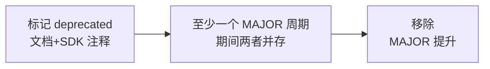

# PS-07 版本与兼容

> 对应底座规格：`docs/05-extension-points-and-compatibility.md` §3 ｜ 依据：底座 ADR-0012（版本规则已定稿）、ADR-0019（错误类别 1.1）、ADR-0005/0018/0022（远端形态 1.2）、ADR-0023（`config[]` 1.2）、OQ-006（decided）｜ 契约版本：`1.2`

## 0. 当前契约版本：1.2

底座同时支持 `1.0`、`1.1` 与 `1.2`。

### 0.1 1.1 相对 1.0 的差异（摘要）

| 变更 | 类型 | 对旧插件的影响 |
| --- | --- | --- |
| 新增错误类别 `not_found` / `validation_failed` / `precondition_failed` | MINOR | 无（旧插件不会返回） |
| `InvocationContext` 新增可选字段 `credential` | MINOR | 无（忽略未知字段即可） |
| 清单新增可选字段 `capabilities[].risk_level` | MINOR | 无（缺省 `normal`） |
| `concurrency` 语义明确为「插件承受能力」，调度一律串行 | 澄清 | 无（底座行为统一为串行） |

### 0.2 1.2 相对 1.1 的差异

| 变更 | 类型 | 对旧插件的影响 |
| --- | --- | --- |
| 新增部署形态：远端常驻插件监听 TCP + 双向 TLS | MINOR | 无（本机 UDS 条款完全不变） |
| 清单新增可选字段 `runtime.listen.port` | MINOR | 无（缺省即本机专用） |
| 清单新增可选字段 `config[]`（7 个子字段） | MINOR | 无（缺省即无用户可配置项） |
| 远端不注入 `--ops-socket` / `--ops-credential-file`；改由 `--ops-config` 提供监听与 `tls.*` | MINOR（新增形态约束） | 无（本机参数不变） |
| proto 无字段变更（`credential` 为 1.1 新增） | — | 无 |

**使用门槛**：
- 要用 1.1 的新错误类别，`contract` 下限必须 ≥ `1.1`。
- 要声明远端部署（`runtime.listen.port`）或使用 `config[]`，`contract` 下限建议 ≥ `1.2`；仅用 1.0/1.1 语义的插件可继续声明 `">=1.0 <2.0"`。

**实现状态**：1.2 的远端形态**只能经底座下发运行**，不支持手工部署或注册 systemd unit；
1.2 的本机 UDS daemon 托管**尚未实现**（OQ-044），本机实例请使用命令式形态。

## 1. 三个版本

| 版本 | 谁维护 | 表达什么 | 形式 |
| --- | --- | --- | --- |
| 契约版本 | 底座 | 宿主与插件之间的接口规范 | `MAJOR.MINOR` |
| 插件版本 | 插件作者 | 插件自身功能演进 | `MAJOR.MINOR.PATCH` |
| 清单 schema 版本 | 底座 | 清单字段集的形状 | 随契约 MAJOR 演进 |

## 2. 契约版本规则

- `MAJOR`：破坏性变更——删除能力/字段、改字段语义、改必填性、改通信语义、改错误码含义、改 proto 字段编号。
- `MINOR`：向后兼容增量——新增可选字段、新增能力、新增扩展点、新增错误类别、新增部署形态。
- 不使用 PATCH；编辑性修正（错别字、注释）不改版本。
- 底座**同时支持同一 MAJOR 下的多个 MINOR**，并公布支持的 MAJOR 集合。

## 3. 插件如何声明

```yaml
version:
  plugin: 0.1.0            # 插件自身版本
  contract: ">=1.0 <2.0"   # 支持的契约版本范围
```

规则：

1. 范围写法为空格分隔的约束集合，操作符支持 `>=`、`<`、`=`。
2. 范围必须与底座支持的 MAJOR 集合有交集，否则拒绝安装（`version_incompatible`）。
3. 禁止声明「任意版本兼容」；禁止省略 `contract`。
4. 升级底座 MINOR 不得要求插件改动；若需改动，说明底座发生了破坏性变更，属 MAJOR。

## 4. 兼容判定时机

| 时机 | 动作 | 失败后果 |
| --- | --- | --- |
| 安装 | 比对 `contract` 范围与底座支持集 | 拒绝登记 |
| 启用 | 再次确认当前底座版本仍在范围内 | 拒绝启用，保留已安装状态 |
| 调用 | 不重复判定，使用已记录结果 | — |

判定结果必须写入注册表并留审计，便于回答「为什么这个插件不可用」。

## 5. 已知不兼容的典型变更

| 变更 | 版本 | 原因 |
| --- | --- | --- |
| 请求/响应增加必填字段 | MAJOR | 旧插件无法提供 |
| 请求/响应增加可选字段 | MINOR | 忽略未知字段即可兼容 |
| 错误码语义变化 | MAJOR | 调用方分支判断会失效 |
| 新能力 | MINOR | 旧调用方不受影响 |
| 能力标识改名 | MAJOR | 寻址失效 |
| 改 proto 字段编号 | MAJOR | 线格式不兼容 |
| 新增错误类别 | MINOR | 旧插件不返回；调用方按未知类别兜底 |
| 新增上下文字段（可选） | MINOR | 忽略未知字段即可 |

## 6. 废弃流程



- 废弃必须在 SDK 与本文档中**显式标记**，并给出替代方案。
- 废弃期内旧路径必须继续可用。
- 支持周期的具体长度**待定**（OQ-038）。

## 7. 插件自身版本演进

- 遵循 `MAJOR.MINOR.PATCH`。
- 只要对底座暴露的输入/输出/错误语义不变，插件可自由升版本。
- 插件升级必须保持「已声明的契约范围」不缩窄到与底座无交集，否则该版本不可启用。
- 是否强制插件版本与能力语义绑定（同能力标识跨大版本语义漂移的检测方式）：**待定**（OQ-038）。

## 8. 自检

1. 声明 `">=1.0 <2.0"`，底座支持 1.x → 通过。
2. 声明 `">=2.0 <3.0"`，底座仅 1.x → 拒绝安装并说明无交集。
3. 声明 `">=1.1 <2.0"` 并使用 `not_found` → 通过；底座支持 1.1。
4. 声明 `">=1.0 <2.0"` 却返回 `not_found` → 底座归一为 `internal_error` 并告警（契约漂移）。
5. 删除一个已发布能力但不升 MAJOR → 属违规变更，评审应拦截。
6. 新增可选字段不升版本 → 属违规变更，应升 MINOR。
7. daemon 插件声明 `runtime.listen.port` 但 `contract` 下限 < `1.2` → 底座给出兼容性告警（不阻断），并要求补正。
8. 本机 UDS 插件升级到 1.2 底座 → 行为与参数完全不变，无需修改插件。
