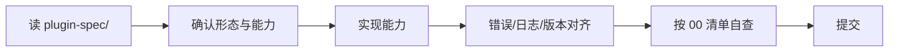

# AGENTS.md —— 插件仓库 AI 代理规则

本文件属于**插件开发规范模板**，随目录复制到插件仓库。它约束 AI 代理在该插件仓库中的行为。

## 1. 你在哪里

你位于一个**运维平台插件**仓库。插件通过底座契约接入平台：命令式插件通过 stdio 按次调用，常驻插件通过远程调用长期提供服务。
契约定义见本目录 `plugin-spec/`；**不要**假设底座内部实现细节。

## 2. 铁律

1. **只实现已声明能力**：清单里没有的能力不许偷偷实现，也不许在能力里塞未声明的副作用。
2. **不得编造契约**：字段名、错误码、协议细节若标注「待定（OQ-xxx）」，不要自造，先问用户。
3. **stdout 纯净**（命令式插件）：stdout 只输出结果；任何日志、进度、调试信息一律走 stderr。
4. **错误结构化**：使用统一错误类别，禁止只返回人类可读字符串。
5. **禁止跨插件依赖**：不得调用其他插件，不得读取其他插件数据目录。
6. **权限最小化**：不得请求清单未声明的资源；不得绕过底座直接访问平台内部组件。
7. **敏感信息零记录**：日志、错误详情、审计中不得出现凭据、令牌、私钥。
8. **超时与取消**：必须假设调用随时可能被终止；不得留下子进程与临时文件。
9. **版本诚实**：声明真实的插件版本与契约版本范围，不得虚报。
10. **构建/测试命令**：本模板未提供，读取仓库实际 `go.mod`/CI 后补写，**不得臆造**。

## 3. 工作流

- 改契约相关内容时，同步更新插件仓库内的 `plugin-spec/` 副本说明（若底座已发布新版本，先升级副本）。
- 提交信息使用 Conventional Commits。
- 不得引入未经用户批准的新依赖或框架。

## 4. 必须停下来问用户的情况

- 需要新增/删除能力，或改变已发布能力的语义。
- 需要申请新的权限类别。
- 契约文档中有「待定」且实现必须依赖它。
- 需要与底座团队确认兼容性范围。
- **规范未覆盖**：`plugin-spec/` 与 `10-faq.md` 都找不到答案。

## 5. 规范回流规则（强制）

这类「规范没写、只能来问」的问题会反复出现。处理方式固定为三条：

1. **停下提问**：问题不在 `plugin-spec/`（含 [10-faq.md](10-faq.md)）覆盖范围内时，**不得**继续实现、不得按惯例先做。
2. **答案写回规范正文**：结论必须落入 `plugin-spec/` 或底座 `docs/` 的正文（含 ADR，若涉及取舍），
   并同步 `.ai/` 索引与开放问题登记；**只存在于对话或 issue 里的答案视为无效**。
3. **禁止私定**：不得在单个插件仓库里自行决定字段、错误码、退出码、路径或生命周期语义；
   不得把「本插件特例」当成通用做法；确需例外时先写 ADR 并获得批准。

判定顺序：先查 [10-faq.md](10-faq.md) → 再查 `plugin-spec/` 各章 → 仍未覆盖 → 停下提问。

插件契约的完备性由底座规范承担：插件作者不应需要与底座额外口头约定任何行为。
如果你发现必须口头约定，说明规范有缺口，按上述第 1、2 条处理。
